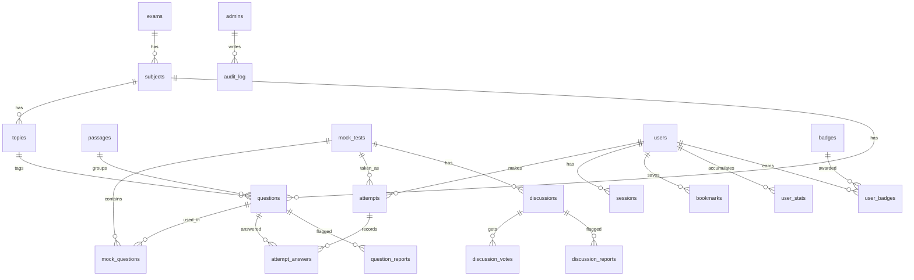

# CUETFreeMockTest.com — Master Blueprint (AI-Agent Edition)

Status: v2 FINAL. Merges the original chat notes with the "Corrected Edition" PDF (30 Oct 2026). Replaces all earlier versions.
Language: English (identifiers, SQL and routes are the source of truth).

---

## 0. How to use this file (instructions for the AI agent)

1. This file is the single source of truth. If anything elsewhere conflicts with it, this file wins.
2. Work phase by phase (see section 4). Do not start phase N until the Definition of Done (DoD) of phase N-1 passes.
3. Never invent exam facts (dates, marking scheme, syllabus, question counts, duration). Read them from the `exam_info` / `mock_tests.marking_scheme` data. Any seed value must carry `source_url` and `last_verified`. If unverified, mark it `TODO_VERIFY`.
4. Only ask the human about items listed in section 17 (Open decisions). For everything else, follow the defaults here.
5. Global conventions:
   - All DB access through prepared statements. No string-concatenated SQL.
   - Timestamps are UTC ISO-8601 text.
   - Soft delete (`deleted_at`) for admin-managed content. Never hard-delete questions, mocks or users without an explicit instruction.
   - The server is the authority for score, rank and time. Never trust the client.
   - Correct answers are never sent to the browser before submit.
   - Every admin write action creates an `audit_log` row.
   - Every migration is a numbered file in `/migrations`.
6. Free-tier limits and prices change often. Verify them on the provider's pricing page before relying on them.

---

## 1. Product summary

A free CUET UG mock test website modeled on the NTA exam interface.

- Audience: CUET UG aspirants, mostly on phones.
- Goals: (1) realistic NTA-style practice, (2) leaderboards and progress tracking, (3) strong organic SEO, (4) eligibility for Google AdSense.
- Reference project: prepwithpro.in (research notes are archived outside this repository).
- Not affiliated with NTA. A disclaimer page is mandatory.

---

## 2. Locked decisions

| Area | Decision |
|---|---|
| Framework | Astro (SSR) with `@astrojs/cloudflare` adapter |
| Hosting | New build: Astro on Cloudflare Workers (Cloudflare's current Astro guide recommends Workers for new projects). Existing stable Pages project: keep it, do not migrate without a concrete reason. Same D1/KV/R2 bindings either way. Test preview and production bindings separately |
| Database | Cloudflare D1 (SQLite). Questions live in D1, NOT in JSON files |
| Cache / rate limit | KV for rate-limit counters. Leaderboard/page caching only after measured need (start with indexed D1 queries) |
| Images | Cloudflare R2, only URL/path stored in D1, served from a custom domain (e.g. `img.cuetfreemocktest.com`) |
| Math formulas | KaTeX (text), never images |
| Admin auth | Cloudflare Access on `/admin/*` and `/api/admin/*`, verify the JWT server-side, map email to role via `admins` table |
| User auth | HttpOnly secure cookie sessions. Method: see open decision D1 |
| Guests | Can take tests. Leaderboard, history and dashboard need login |
| Scoring | Server-side only. Timer verified against server time |
| Leaderboard | Only the first attempt per user per mock counts |
| Offline | Ranked attempts are online and server-verified only. Offline = separate local-practice mode, score labeled local-only, never ranked |
| Languages | Question content supports English and Hindi (`*_hi` columns, nullable) |
| Cost target | Everything on free tiers at launch |

Explicitly NOT in v1: video classes, live chat rooms, payments, AI tutor.

---

## 3. Architecture

```
                         +---------------------------+
   Browser (mobile) ---> |  Cloudflare Worker (Astro)|
                         |  SSR pages + static assets|
                         +-------------+-------------+
                                       |
                              Worker API (/api/*)
                                       |
         +------------+----------------+----------------+-------------+
         |            |                |                |             |
     +---v---+   +----v----+     +-----v-----+    +-----v----+   +----v-----+
     |  D1   |   |   KV    |     |    R2     |    | CF Access|   | Analytics|
     |  SQL  |   | cache,  |     |  images   |    | admin JWT|   |  + GSC   |
     | (core)|   | ratelim.|     | (WebP)    |    +----------+   +----------+
     +-------+   +---------+     +-----------+

Request rules
  /admin/*, /api/admin/*  -> Cloudflare Access -> JWT verify -> role check
  /api/attempts/*         -> session or guest_token -> server-side scoring
  public pages            -> server-rendered HTML (SEO), minimal JS
  /attempt/*              -> NTA-style screen, noindex, JS-heavy, no header/footer
```

---

## 4. Roadmap

### 4.1 Dependency diagram

```
P0 Foundation
  |
P1 Database schema (full, section 5)
  |
P2 Admin core: Access + roles + Questions + Images + Mock builder + Audit log
  |
P3 Test engine (instructions -> attempt -> submit -> result)
  |
P4 User auth (signup/login/Google, sessions)
  |
  +--> P5 Leaderboards
  |
  +--> P6 User dashboard + public profile
  |
  +--> P7 Discussion + moderation
  |
P8 SEO pages + content + SEO editor + Exam-info editor
  |
P9 Homepage
  |
P10 QA + legal + launch
  |
P11 Post-launch (AdSense, extras)
```

### 4.2 Phase table

| Phase | Name | Rough time (solo dev) |
|---|---|---|
| P0 | Foundation | 1-2 days |
| P1 | Database schema | 2 days |
| P2 | Admin core | ~1 week |
| P3 | Test engine | 1-1.5 weeks |
| P4 | User auth | 2-3 days |
| P5 | Leaderboards | 2 days |
| P6 | Dashboard + public profile | ~4 days |
| P7 | Discussion + moderation | 3-4 days |
| P8 | SEO pages + content tools | ~1 week (content written separately) |
| P9 | Homepage | 2 days |
| P10 | QA, legal, launch | 3-4 days |
| P11 | Post-launch | ongoing |

### 4.3 Phase details and Definition of Done

**P0 Foundation**
- Repo, Astro SSR, Cloudflare adapter, D1/KV/R2 bindings in `wrangler.toml`, `/migrations` folder.
- Separate local (`wrangler dev`) and production D1 databases.
- Design tokens (light/dark CSS variables), base layout, header/footer, logo.
- DoD: `wrangler dev` serves a page that reads one row from local D1.

**P1 Database schema**
- Apply section 5 as `/migrations/0001_init.sql`, plus seed for `exams` (CUET UG), `subjects`.
- DoD: migration applies cleanly on empty local D1; foreign keys on; all indexes exist.

**P2 Admin core**
- Cloudflare Access + JWT verify + role middleware (section 10).
- Question CRUD, KaTeX preview, image upload (section 9), CSV/JSON bulk import with validation preview and duplicate check.
- Mock builder: select questions, sections, duration, marking scheme, draft -> in_review -> published.
- Audit log on every write. Soft delete.
- DoD: an Editor can create 10 questions with an image and one formula, build and publish a mock; a Contributor cannot publish; every action is in `audit_log`.

**P3 Test engine** (most important)
- Pages: instructions, attempt screen, result, solutions (section 6).
- DoD: start -> answer -> refresh (progress kept) -> submit -> correct score; no correct answers visible in any network response before submit; timer cannot be extended by editing client state.

**P4 User auth**
- See section 7.
- DoD: guest attempt can be claimed by a user after login; rate limits on login and submit.

**P5 Leaderboards**
- See section 8.

**P6 Dashboard and public profile**
- See section 12. Ship v1 subset: overview, history, weak subjects, bookmarks.

**P7 Discussion and moderation**
- See section 11. Includes the Moderator role UI.

**P8 SEO pages and content tools**
- Routes in section 13, SEO rules in section 14. Build the SEO editor and exam-info editor here.
- DoD: dynamic sitemap from D1, canonical URLs, valid, eligible JSON-LD on public pages, every public page has unique intro text.

**P9 Homepage**
- Hero + "Most Popular" card, then two IPO-style cards. Everything from D1, with empty states. Needs real data, hence after P3-P8.

**P10 QA and launch**
- Unit tests: scoring, rank logic, first-attempt rule, auto-approve logic.
- E2E (Playwright): start -> answer -> submit -> result.
- Security review (section 16), accessibility, mobile testing.
- Analytics, Google Search Console, sitemap submit, scheduled D1 export backups.
- Legal pages: privacy policy, terms, disclaimer ("not affiliated with NTA").

**P11 Post-launch**
- AdSense (section 14.3) and extra features (section 15).

---

## 5. Data model

### 5.1 ER overview



### 5.2 Full schema (`/migrations/0001_init.sql`, D1 / SQLite)

```sql
PRAGMA foreign_keys = ON;

-- ===== Core taxonomy =====
CREATE TABLE exams (
  id INTEGER PRIMARY KEY AUTOINCREMENT,
  name TEXT NOT NULL,
  slug TEXT NOT NULL UNIQUE,            -- 'cuet-ug'
  is_active INTEGER NOT NULL DEFAULT 1
);

CREATE TABLE subjects (
  id INTEGER PRIMARY KEY AUTOINCREMENT,
  exam_id INTEGER NOT NULL REFERENCES exams(id),
  name TEXT NOT NULL,
  slug TEXT NOT NULL UNIQUE,
  type TEXT NOT NULL CHECK (type IN ('language','domain','general')),
  is_active INTEGER NOT NULL DEFAULT 1
);

CREATE TABLE topics (
  id INTEGER PRIMARY KEY AUTOINCREMENT,
  subject_id INTEGER NOT NULL REFERENCES subjects(id),
  name TEXT NOT NULL,
  slug TEXT NOT NULL,
  UNIQUE (subject_id, slug)
);

-- ===== People =====
CREATE TABLE users (
  id INTEGER PRIMARY KEY AUTOINCREMENT,
  username TEXT NOT NULL UNIQUE,
  email TEXT NOT NULL UNIQUE,
  password_hash TEXT,                    -- null for Google-only users
  google_id TEXT UNIQUE,
  avatar_url TEXT,
  bio TEXT,
  target_exam_date TEXT,
  is_profile_public INTEGER NOT NULL DEFAULT 0,   -- private by default
  streak_count INTEGER NOT NULL DEFAULT 0,
  last_active_date TEXT,
  approved_comments INTEGER NOT NULL DEFAULT 0,
  muted_until TEXT,
  created_at TEXT NOT NULL DEFAULT (datetime('now')),
  deleted_at TEXT
);

CREATE TABLE sessions (
  id TEXT PRIMARY KEY,                   -- random token hash
  user_id INTEGER NOT NULL REFERENCES users(id),
  expires_at TEXT NOT NULL,
  created_at TEXT NOT NULL DEFAULT (datetime('now'))
);

CREATE TABLE admins (
  id INTEGER PRIMARY KEY AUTOINCREMENT,
  email TEXT NOT NULL UNIQUE,
  role TEXT NOT NULL CHECK (role IN ('super','editor','moderator','contributor')),
  is_active INTEGER NOT NULL DEFAULT 1,
  created_at TEXT NOT NULL DEFAULT (datetime('now'))
);

-- ===== Content =====
CREATE TABLE passages (
  id INTEGER PRIMARY KEY AUTOINCREMENT,
  subject_id INTEGER NOT NULL REFERENCES subjects(id),
  body TEXT NOT NULL,
  body_hi TEXT,
  image_url TEXT,
  image_alt TEXT,
  deleted_at TEXT
);

CREATE TABLE questions (
  id INTEGER PRIMARY KEY AUTOINCREMENT,
  subject_id INTEGER NOT NULL REFERENCES subjects(id),
  topic_id INTEGER REFERENCES topics(id),
  passage_id INTEGER REFERENCES passages(id),
  text TEXT NOT NULL,                    -- English; may contain KaTeX ($...$)
  text_hi TEXT,
  -- options: [{"text":"...","image_url":null,"alt":null}, ...] (same shape for options_hi)
  options TEXT NOT NULL,
  options_hi TEXT,
  correct_option INTEGER NOT NULL CHECK (correct_option >= 0),  -- 0-based index
  explanation TEXT,
  explanation_hi TEXT,
  difficulty TEXT CHECK (difficulty IN ('easy','medium','hard')),
  year INTEGER,                          -- PYQ year, null for original questions
  image_url TEXT,
  image_alt TEXT,                        -- mandatory when image_url is set (enforced in API)
  explanation_image_url TEXT,
  status TEXT NOT NULL DEFAULT 'draft' CHECK (status IN ('draft','in_review','published')),
  supersedes_id INTEGER REFERENCES questions(id),  -- edit of a published question creates a new row
  created_by INTEGER REFERENCES admins(id),
  created_at TEXT NOT NULL DEFAULT (datetime('now')),
  updated_at TEXT,
  deleted_at TEXT
);

CREATE TABLE mock_tests (                           -- stable public identity (slug lives here)
  id INTEGER PRIMARY KEY AUTOINCREMENT,
  exam_id INTEGER NOT NULL REFERENCES exams(id),
  subject_id INTEGER REFERENCES subjects(id),      -- null for full mocks spanning subjects
  title TEXT NOT NULL,
  slug TEXT NOT NULL UNIQUE,
  type TEXT NOT NULL CHECK (type IN ('full','subject','chapter','pyq')),
  intro_html TEXT,                       -- unique SEO intro text
  pyq_paper_id INTEGER REFERENCES pyq_papers(id),
  current_version_id INTEGER,            -- latest published version (set on publish)
  status TEXT NOT NULL DEFAULT 'draft' CHECK (status IN ('draft','published','archived')),
  created_by INTEGER REFERENCES admins(id),
  created_at TEXT NOT NULL DEFAULT (datetime('now')),
  updated_at TEXT,
  deleted_at TEXT
);

CREATE TABLE mock_test_versions (                   -- published versions are immutable
  id INTEGER PRIMARY KEY AUTOINCREMENT,
  mock_id INTEGER NOT NULL REFERENCES mock_tests(id),
  version_no INTEGER NOT NULL,
  duration_min INTEGER NOT NULL,
  total_marks REAL NOT NULL,
  -- example only, VERIFY from official NTA bulletin:
  -- {"correct":5,"wrong":-1,"skipped":0}
  marking_scheme TEXT NOT NULL,
  instructions TEXT,
  status TEXT NOT NULL DEFAULT 'draft'
    CHECK (status IN ('draft','in_review','published','superseded')),
  published_at TEXT,
  created_by INTEGER REFERENCES admins(id),
  created_at TEXT NOT NULL DEFAULT (datetime('now')),
  UNIQUE (mock_id, version_no)
);

CREATE TABLE mock_questions (
  version_id INTEGER NOT NULL REFERENCES mock_test_versions(id),
  question_id INTEGER NOT NULL REFERENCES questions(id),
  section TEXT NOT NULL,                 -- e.g. 'English', 'Physics', 'General Test'
  position INTEGER NOT NULL,
  PRIMARY KEY (version_id, question_id)
);

CREATE TABLE pyq_papers (                           -- provenance and rights for previous-year papers
  id INTEGER PRIMARY KEY AUTOINCREMENT,
  exam_id INTEGER NOT NULL REFERENCES exams(id),
  subject_id INTEGER REFERENCES subjects(id),
  year INTEGER NOT NULL,
  shift TEXT,
  title TEXT NOT NULL,
  source_url TEXT,
  rights_note TEXT,
  status TEXT NOT NULL DEFAULT 'draft' CHECK (status IN ('draft','published'))
);

-- ===== Attempts =====
CREATE TABLE attempts (
  id INTEGER PRIMARY KEY AUTOINCREMENT,
  user_id INTEGER REFERENCES users(id),            -- null for guests
  guest_token TEXT,                                -- set for guests, claimable after login
  mock_id INTEGER NOT NULL REFERENCES mock_tests(id),
  version_id INTEGER NOT NULL REFERENCES mock_test_versions(id),
  status TEXT NOT NULL DEFAULT 'in_progress'
    CHECK (status IN ('in_progress','submitted','expired')),
  score REAL,
  correct INTEGER,
  wrong INTEGER,
  skipped INTEGER,
  time_taken_sec INTEGER,
  started_at TEXT NOT NULL,                        -- server time
  deadline_at TEXT NOT NULL,                       -- started_at + duration
  submitted_at TEXT,
  is_first_attempt INTEGER NOT NULL DEFAULT 0,
  CHECK (user_id IS NOT NULL OR guest_token IS NOT NULL)
);

CREATE TABLE attempt_answers (
  attempt_id INTEGER NOT NULL REFERENCES attempts(id),
  question_id INTEGER NOT NULL REFERENCES questions(id),
  selected INTEGER,                                -- null = not answered
  time_spent_sec INTEGER NOT NULL DEFAULT 0,
  marked_for_review INTEGER NOT NULL DEFAULT 0,
  updated_at TEXT,
  is_correct INTEGER,                              -- filled at submit
  PRIMARY KEY (attempt_id, question_id)
);

-- ===== Reports, discussion =====
CREATE TABLE question_reports (
  id INTEGER PRIMARY KEY AUTOINCREMENT,
  question_id INTEGER NOT NULL REFERENCES questions(id),
  user_id INTEGER REFERENCES users(id),
  reason TEXT NOT NULL,
  status TEXT NOT NULL DEFAULT 'open' CHECK (status IN ('open','resolved','dismissed')),
  created_at TEXT NOT NULL DEFAULT (datetime('now'))
);

CREATE TABLE discussions (
  id INTEGER PRIMARY KEY AUTOINCREMENT,
  mock_id INTEGER NOT NULL REFERENCES mock_tests(id),
  question_id INTEGER REFERENCES questions(id),
  user_id INTEGER NOT NULL REFERENCES users(id),
  parent_id INTEGER REFERENCES discussions(id),    -- max 1 level of nesting
  body TEXT NOT NULL CHECK (length(body) BETWEEN 2 AND 2000),
  status TEXT NOT NULL DEFAULT 'pending' CHECK (status IN ('visible','pending','hidden')),
  is_pinned INTEGER NOT NULL DEFAULT 0,
  is_best_answer INTEGER NOT NULL DEFAULT 0,
  upvotes INTEGER NOT NULL DEFAULT 0,
  created_at TEXT NOT NULL DEFAULT (datetime('now'))
);

CREATE TABLE discussion_votes (
  discussion_id INTEGER NOT NULL REFERENCES discussions(id),
  user_id INTEGER NOT NULL REFERENCES users(id),
  PRIMARY KEY (discussion_id, user_id)
);

CREATE TABLE discussion_reports (
  id INTEGER PRIMARY KEY AUTOINCREMENT,
  discussion_id INTEGER NOT NULL REFERENCES discussions(id),
  user_id INTEGER NOT NULL REFERENCES users(id),
  reason TEXT NOT NULL,
  status TEXT NOT NULL DEFAULT 'open',
  created_at TEXT NOT NULL DEFAULT (datetime('now')),
  UNIQUE (discussion_id, user_id)
);

-- ===== User features =====
CREATE TABLE bookmarks (
  user_id INTEGER NOT NULL REFERENCES users(id),
  question_id INTEGER NOT NULL REFERENCES questions(id),
  note TEXT,
  created_at TEXT NOT NULL DEFAULT (datetime('now')),
  PRIMARY KEY (user_id, question_id)
);

CREATE TABLE user_stats (                           -- updated after every submit, keeps dashboard fast
  user_id INTEGER NOT NULL REFERENCES users(id),
  subject_id INTEGER NOT NULL REFERENCES subjects(id),
  topic_id INTEGER NOT NULL DEFAULT 0,              -- 0 = whole subject
  attempted INTEGER NOT NULL DEFAULT 0,
  correct INTEGER NOT NULL DEFAULT 0,
  avg_time_sec REAL NOT NULL DEFAULT 0,
  PRIMARY KEY (user_id, subject_id, topic_id)
);

CREATE TABLE badges (
  id INTEGER PRIMARY KEY AUTOINCREMENT,
  code TEXT NOT NULL UNIQUE,                        -- 'tests_10', 'top10_physics'
  name TEXT NOT NULL,
  description TEXT
);

CREATE TABLE user_badges (
  user_id INTEGER NOT NULL REFERENCES users(id),
  badge_id INTEGER NOT NULL REFERENCES badges(id),
  awarded_at TEXT NOT NULL DEFAULT (datetime('now')),
  PRIMARY KEY (user_id, badge_id)
);

-- ===== Site content and admin =====
CREATE TABLE page_seo (
  path TEXT PRIMARY KEY,
  title TEXT,
  description TEXT,
  intro_html TEXT,
  faq_json TEXT,
  noindex INTEGER NOT NULL DEFAULT 0,
  updated_at TEXT
);

CREATE TABLE exam_info (                            -- dates, pattern, syllabus, marking
  key TEXT PRIMARY KEY,
  value TEXT NOT NULL,
  source_url TEXT,
  last_verified TEXT
);

CREATE TABLE announcements (
  id INTEGER PRIMARY KEY AUTOINCREMENT,
  message TEXT NOT NULL,
  link TEXT,
  is_active INTEGER NOT NULL DEFAULT 1,
  starts_at TEXT,
  ends_at TEXT
);

CREATE TABLE site_settings (
  key TEXT PRIMARY KEY,                             -- 'discussion_enabled', 'maintenance_mode'
  value TEXT NOT NULL
);

CREATE TABLE audit_log (
  id INTEGER PRIMARY KEY AUTOINCREMENT,
  admin_id INTEGER NOT NULL REFERENCES admins(id),
  action TEXT NOT NULL,                             -- 'question.update', 'mock.publish'
  entity_type TEXT NOT NULL,
  entity_id INTEGER,
  diff_json TEXT,
  created_at TEXT NOT NULL DEFAULT (datetime('now'))
);

-- ===== Indexes =====
CREATE INDEX idx_attempts_leaderboard ON attempts(mock_id, score DESC, time_taken_sec ASC);
CREATE INDEX idx_attempts_user ON attempts(user_id);
CREATE INDEX idx_attempts_guest ON attempts(guest_token);
CREATE UNIQUE INDEX uq_first_attempt ON attempts(user_id, mock_id) WHERE is_first_attempt = 1;
CREATE INDEX idx_questions_subject ON questions(subject_id, status);
CREATE INDEX idx_questions_topic ON questions(topic_id);
CREATE INDEX idx_mocks_status ON mock_tests(status, type);
CREATE INDEX idx_versions_mock ON mock_test_versions(mock_id, status);
CREATE INDEX idx_mq_version ON mock_questions(version_id, section, position);
CREATE INDEX idx_disc_mock ON discussions(mock_id, status, parent_id, created_at DESC);
CREATE INDEX idx_disc_question ON discussions(question_id, status);
CREATE INDEX idx_disc_top ON discussions(mock_id, status, upvotes DESC);
CREATE INDEX idx_sessions_user ON sessions(user_id);
```

### 5.3 Data rules

- A `mock_tests` row is the stable public identity (slug, SEO intro). The test content lives in `mock_test_versions`. A published version is immutable. A correction creates a new version (`version_no + 1`), and on publish `current_version_id` moves to it and the old version becomes `superseded`. Attempts store `version_id`, so old scores never change.
- Editing a question that belongs to a published version creates a new `questions` row (`supersedes_id` set). The old row stays for historical attempts.
- `user_stats`, leaderboard caches and counters are rebuildable projections. `attempts` and `attempt_answers` are the source data.
- Use versioned SQL migrations only. Never edit the production schema by hand.
- Publishing a version requires: every question has an explanation, `image_alt` wherever there is an image, `correct_option` within range.
- Workflow: Contributor writes draft -> Editor reviews (`in_review`) -> Editor publishes.

### 5.4 KV keys

KV is used for rate-limit counters only at launch. Do not cache leaderboards until measured read volume justifies it, and never write one hot key on every score event.

| Key | Purpose | TTL |
|---|---|---|
| `rl:comment:{userId}` | 5 comments/min counter | 60 s |
| `rl:login:{ip}` | Login attempts | 15 min |
| `rl:submit:{userId or guest}` | Submit throttle | 60 s |

---

## 6. Test engine

### 6.1 Attempt state machine

```
              POST /attempts/start
   (none) -----------------------------> in_progress
                                           |   ^
                          autosave (PUT)   |   | (stays in_progress)
                                           v   |
                                        in_progress
                                           |
              +----------------------------+------------------------------+
              | submit before deadline     |   deadline + grace passed    |
              v                            v                              |
          submitted                     expired  (auto-scored from        |
          (scored by server)            saved answers, status=expired)    |
```

### 6.2 Sequence

```
Browser                         Server (Pages Function)                D1
  | GET /mock/{slug}/instructions    |                                  |
  |--------------------------------->| render instructions              |
  | POST /api/attempts/start         |                                  |
  |--------------------------------->| create attempt                   |
  |                                  |  started_at = now()              |
  |                                  |  deadline_at = now()+duration -->|
  |<---------------------------------| attemptId, deadlineAt,           |
  |   questions WITHOUT answers      |  questions (no correct_option)   |
  | PUT /api/attempts/{id}/answers   |                                  |
  |   every ~10-15s + on change ---->| upsert attempt_answers --------->|
  | POST /api/attempts/{id}/submit   |                                  |
  |--------------------------------->| check deadline (+grace)          |
  |                                  | load correct_option from D1      |
  |                                  | compute score, mark is_correct   |
  |                                  | set is_first_attempt             |
  |                                  | update user_stats                |
  |<---------------------------------| redirect /result/{id}            |
```

### 6.3 Rules

1. Instructions page (verified duration, question count, marking scheme, navigation rules) is shown before the test starts (marking scheme, duration, navigation rules).
2. Attempt screen (`/attempt/[id]`) is NTA-style: question palette (not visited / not answered / answered / marked for review), subject/section tabs, countdown timer, next / previous / clear response / mark for review. No site header or footer.
3. The countdown is displayed from `deadline_at`, not from a client counter alone.
4. Autosave sends answers, `marked_for_review` and per-question time. A refresh or network drop must resume at the same state (`GET /api/attempts/{id}`).
5. Submit: server computes score using `mock_tests.marking_scheme`. Accept submits until `deadline_at` plus a small grace (about 15 s). After that, mark `expired` and score the saved answers.
6. `is_first_attempt` is set to 1 at submit only when `user_id` is not null and the user has no earlier submitted attempt for this mock. The partial unique index `uq_first_attempt` prevents races.
7. Guests: attempt is tied to `guest_token` (cookie). After login, the user may claim guest attempts (set `user_id`). A claimed attempt can be a first attempt if the rule above holds.
8. Result page: score, accuracy, section-wise analysis, time per question, solutions, rank (after P5).
9. Result and attempt pages are `noindex`.
10. Autosave must be idempotent (upsert on `(attempt_id, question_id)`), so a retried request never duplicates data. Reject a second submit for the same attempt.
11. Tab-switch warnings and full-screen prompts are UX signals, not proctoring. Never claim exam-grade invigilation.
12. Offline: cache the app shell and public study material only. Ranked attempts stay online. An optional local-practice mode must label its score local-only.
13. UX options: full-screen request and tab-switch warning (warn only, do not auto-fail), language toggle EN/HI, font-size control, dark mode.

### 6.4 Image and passage handling in the test UI

- Preload the next question's image. Lazy-load the rest. Set `width` and `height`. Tap-to-zoom on mobile.
- Questions sharing a `passage_id` display the passage once.

### 6.5 Test and result API

| Method | Path | Notes |
|---|---|---|
| POST | `/api/attempts/start` | body `{mockId}`. Creates attempt, returns questions without answers |
| GET | `/api/attempts/:id` | Resume: saved answers + remaining time |
| PUT | `/api/attempts/:id/answers` | Batch autosave |
| POST | `/api/attempts/:id/submit` | Server-side scoring |
| GET | `/api/results/:attemptId` | Result + solutions (only after submit) |
| POST | `/api/questions/:id/report` | Wrong-question report |

---

## 7. Auth and sessions

- Admin: Cloudflare Access only (Google login or email OTP). Server verifies the Access JWT. Role comes from `admins.role`. No custom admin password system.
- Users: HttpOnly, Secure, SameSite cookie containing a random session token; store its hash in `sessions`.
- Passwords (if email/password is enabled): PBKDF2 via Web Crypto, per-user salt.
- Optional Google OAuth (default recommendation, see D1).
- Rate-limit login and submit (KV).
- Endpoints: `POST /api/auth/signup`, `POST /api/auth/login`, `POST /api/auth/logout`, `GET /api/auth/google` + callback, `POST /api/auth/forgot`, `POST /api/auth/reset`.
- Pages: `/login`, `/signup`, `/forgot-password`.
- Rotate the session ID after login and privilege changes. CSRF protection on cookie-authenticated mutations. Generic error messages on login/reset.
- Never use a fast general hash (plain SHA-256) for passwords.
- Account deletion and personal-data export workflow, with documented retention for legally required records.

---

## 8. Leaderboards

- Scopes: per mock, subject-wise, overall; periods: weekly and all-time.
- Eligible rows: `status = 'submitted' AND is_first_attempt = 1`.
- Ordering: `score DESC, time_taken_sec ASC, accuracy DESC`.
- Rank within one test version. Start with indexed D1 queries (paginated, top 100). Add KV caching only after measured load justifies it. A user's own rank is a live query.
- Show the first-attempt rule next to the leaderboard.
- Public display: username only, never real name or email.
- Admin can remove suspicious attempts and trigger rank recalculation.
- Rank/percentile shown to users must be labeled "among users of this site".
- Endpoint: `GET /api/leaderboard?scope=mock|subject|overall&period=weekly|alltime&id=`.
- Pages: `/leaderboard`, `/leaderboard/[mock-slug]`.

---

## 9. Images and math

### 9.1 Where images appear
Inside the question, inside options, inside the explanation, and on passages (one passage image shared by several questions).

### 9.2 Storage
- R2 stores files, D1 stores only the URL path. Path pattern: `q/{year}/{random}.webp`.
- Serve R2 through a custom domain (`img.cuetfreemocktest.com`) to prevent hotlinking.
- Option images live inside the options JSON: `{"text":"...","image_url":"...","alt":"..."}`.

### 9.3 Admin upload flow
1. Upload / drag-drop / paste in the question form.
2. Validate on the server: only JPG, PNG, WebP; max size (about 500 KB after processing); verify type from file bytes (magic bytes), not extension.
3. Convert to WebP and resize. Workers have no native image library, so do the compression in the browser (canvas) before upload or use Cloudflare Image Resizing, and still re-validate type and size on the server.
4. Random filename, save to R2, store URL in D1.
5. `image_alt` is mandatory (SEO + accessibility).
6. Bulk import: CSV plus a ZIP of images, or image URLs.

### 9.4 Rules
- No SVG uploads (XSS risk).
- Only admins can upload.
- Never copy images from books or coaching sites. Redraw originals.
- Images only for diagrams, graphs and figures. Formulas use KaTeX, e.g. `$x^2 + y^2 = r^2$`. KaTeX is sharp, small, indexable and dark-mode friendly.
- Dark theme: images with white backgrounds get a light border/padding.

---

## 10. Admin system

### 10.1 Roles

| Capability | Super | Editor | Moderator | Contributor |
|---|---|---|---|---|
| Manage admins, settings, danger zone | yes | no | no | no |
| Questions: create/edit | yes | yes | no | yes (draft only) |
| Questions/mocks: publish | yes | yes | no | no |
| Mock builder | yes | yes | no | no |
| SEO editor, exam info, announcements | yes | yes | no | no |
| Discussions, reports, mute users | yes | yes | yes | no |
| Leaderboard control | yes | yes | no | no |
| Audit log (view) | yes | no | no | no |

### 10.2 Modules (all under `/admin`, noindex)

1. Dashboard: today's attempts, new users, popular mocks, pending reports.
2. Questions: list/filter (subject, status, year), new/edit, image upload, KaTeX preview, bulk import with validation preview, duplicate check.
3. Mock builder: select questions, sections, duration, marking scheme, preview; draft -> in_review -> published.
4. PYQ manager: year/shift-wise papers.
5. Users: search, view attempts, mute/ban, account-deletion requests.
6. Moderation: pending comments, reported comments, wrong-question reports.
7. Leaderboard control.
8. SEO editor: title, description, intro, FAQ per page; sitemap regenerate.
9. Exam info: dates, pattern, syllabus with `source_url` and `last_verified`.
10. Announcements: homepage banner.
11. Settings: site name, feature toggles (discussion on/off), maintenance mode.
12. Audit log.

Build order: auth + roles first, then Questions, then Mocks (P2). Moderation arrives in P7, SEO and exam-info editors in P8, the rest as needed.

### 10.3 Security rules

- Server-side role check on every admin API. Hiding UI is not enough.
- Verify the Cloudflare Access JWT. Never trust a header alone.
- `noindex` on admin routes and disallow in `robots.txt`.
- CSRF protection and strict CORS.
- Confirmation on destructive actions. Soft delete only.
- Every write action goes to `audit_log`.
- Scheduled D1 export / backup.

---

## 11. Discussion (comments)

### 11.1 API

Public / user:
- `GET /api/mocks/:id/discussions?sort=top|new&cursor=` top-level visible comments with replies.
- `GET /api/questions/:id/discussions` question-wise thread.
- `POST /api/discussions` body `{mockId, questionId?, parentId?, body}` (login required).
- `POST /api/discussions/:id/vote` toggle upvote.
- `POST /api/discussions/:id/report` body `{reason}`.
- `DELETE /api/discussions/:id` user deletes own comment.

Admin / moderator:
- `GET /api/admin/discussions?status=pending|reported`
- `PATCH /api/admin/discussions/:id` body `{status, isPinned, isBestAnswer}`
- `POST /api/admin/users/:id/mute` body `{until}`

### 11.2 POST logic

1. Check session. Reject if `muted_until` is in the future.
2. Rate limit: 5 comments per minute per user (KV).
3. Trim, check length (2-2000), strip all HTML (plain text only).
4. If `parentId`: parent must belong to the same mock and must not itself be a reply (max 1 level).
5. Status: contains a link or blocked word -> `pending`; else `approved_comments >= 3` -> `visible`; else `pending`.
6. When a moderator approves a comment, increment the author's `approved_comments`.
7. Prepared statements only.

### 11.3 UI

- "Discussion" section below the mock detail page and below the result page.
- On the solutions screen: "Discuss this question (N)" under every question.
- Comments are server-rendered (SEO). A small JS handles vote, reply, report.

### 11.4 Tests required
Spam rate limit, XSS payload stripped, nesting rule, auto-approve threshold, muted user blocked.

---

## 12. User dashboard and public profile

### 12.1 Private dashboard (`/dashboard`, login required, noindex)

v1 (ship with P6): overview cards (attempts, average score, best score, accuracy, time practiced), continue unfinished test, attempt history, strong/weak subjects and topics, bookmarks, account settings.

Later: score trend line chart, subject-wise accuracy bar chart, time analysis, rank and percentile per mock, wrong-questions list with "Retry wrong questions", streak, my discussions, goal countdown (exam date must come from `exam_info`), badges.

Analytics integrity: score trend comes from submitted attempts only. Accuracy = correct / attempted (document the definition of attempted). Do not label a topic "weak" from a tiny sample (set a minimum question count). Rank and percentile are among this site's eligible users only: show participant count and date.

Data source: `user_stats` (updated after every submit). Do not scan `attempt_answers` on dashboard load.

### 12.2 Public profile (`/u/[username]`)

Show only if `is_profile_public = 1`: username, avatar, join date, tests taken, best rank, average accuracy, badges, recent public achievements.

Never show: email, phone, real name (unless user opts in), full attempt history, wrong answers, IP or device data.

Leaderboards show username only regardless of profile setting.

---

## 13. Routes (complete list)

### Public (indexable)
| Route | Purpose |
|---|---|
| `/` | Home |
| `/cuet-ug-mock-test` | All mocks |
| `/mock/[slug]` | Mock detail: intro, leaderboard, discussion, FAQ |
| `/cuet-mock-test/[subject]` | Subject page |
| `/cuet-mock-test/[subject]/[topic]` | Topic page (unique text) |
| `/cuet-ug-previous-year-papers`, `/pyq/[year]`, `/pyq/[year]/[subject]` | PYQs |
| `/cuet-ug-syllabus`, `/cuet-ug-syllabus/[subject]` | Syllabus |
| `/cuet-ug-exam-pattern`, `/cuet-ug-important-dates`, `/cuet-ug-marking-scheme` | Exam info |
| `/leaderboard`, `/leaderboard/[mock-slug]` | Leaderboards |
| `/blog`, `/blog/[slug]` | Guides |
| `/search` | Search (post-launch) |
| `/about`, `/contact`, `/privacy-policy`, `/terms`, `/disclaimer` | Trust and legal |
| `/u/[username]` | Public profile (only if profile is public) |

### Test flow (noindex)
`/mock/[slug]/instructions`, `/attempt/[id]` (no header/footer), `/result/[attemptId]`, `/result/[attemptId]/solutions`

### User (noindex)
`/login`, `/signup`, `/forgot-password`, `/dashboard`, `/dashboard/history`, `/dashboard/bookmarks`, `/dashboard/wrong-questions`, `/dashboard/discussions`, `/dashboard/settings`

### Admin (noindex, disallowed in robots.txt)
`/admin`, `/admin/questions` (list, new, edit, bulk import), `/admin/mocks` (list, builder), `/admin/pyq`, `/admin/users`, `/admin/moderation`, `/admin/seo`, `/admin/exam-info`, `/admin/announcements`, `/admin/settings`, `/admin/audit-log`

### System
`/sitemap.xml` (generated from D1), `/robots.txt`, `/rss.xml` (optional), `/404`, `/500`, maintenance page.

### Launch priority
- Must for launch: Home, mock list, mock details, instructions, test screen, result, subject pages, login, basic dashboard, legal pages, admin (questions + mocks).
- After launch: blog, public profiles, badges, search, PYQ year pages, RSS.
- SEO tip: write the syllabus and exam-pattern pages first. "CUET syllabus" style queries bring the most traffic.

---

## 14. SEO and AdSense

### 14.1 Technical SEO
- Server-rendered HTML on every public page.
- Dynamic `sitemap.xml` from D1, `robots.txt`, canonical URLs, Open Graph tags.
- JSON-LD only where eligible and matching visible content: `Organization`, `BreadcrumbList`, `Article` for editorial guides. `Quiz` only for flashcard-style education Q&A pages. `QAPage` only for a page about ONE user-submitted question with answers, never for a self-written FAQ or a normal mock page. Do not assume `FAQPage` gives a rich result. Valid markup never guarantees a rich result.
- Breadcrumbs and internal links: subject -> mocks -> PYQs -> guides.
- "Last updated" date on exam-info pages.
- Core Web Vitals: WebP images, lazy loading, minimal JS on non-test pages.
- Mobile-first design.
- `noindex`: attempt, result, dashboard, admin, login, and any empty or list-only page.
- Submit sitemap in Google Search Console and monitor indexing.
- Each page needs a unique title and meta description (stored in `page_seo`).

### 14.2 Content strategy (also needed for AdSense)
1. Syllabus and exam-pattern pages, subject-wise, verified against the official NTA information bulletin (nta.ac.in / cuet.nta.nic.in), with `last_verified`.
2. Long guides (1000+ words): normalization, preparation strategy, marking scheme explained.
3. Original step-by-step solution for every question (highest value, cannot be copied).
4. A unique intro on every mock page: what it covers, difficulty, who it is for, tips.
5. Topic pages with their own text.
6. FAQ sections with real questions.
7. Exam updates page (verified items only).
8. Rule: no thin pages. Every public page needs readable original text.
9. Do not copy coaching-site or NTA PDF text. Take facts only, write in your own words.
10. AI-assisted drafting is allowed, but a human must edit, verify facts and add an original angle.

### 14.3 AdSense plan
Approval needs original, useful content; required pages; a clean, policy-compliant site. Google publishes no fixed minimum traffic, post count or domain age. The most common rejection reason is "Low Value Content".

Checklist:
- Custom domain + HTTPS (free on Cloudflare).
- Pages: About, Contact, Privacy Policy (must disclose analytics, ads, comments and cookies actually used), Terms, Disclaimer.
- Google gives no fixed page-count threshold. Publish enough original, useful content that the site feels complete. No approval guarantee.
- No "under construction" pages. Empty or list-only pages stay `noindex`.
- Do not place ads before approval. Avoid popup or redirect ad networks.
- Keep the site stable during review.
- If rejected: read the email reason (Low Value / Navigation / Insufficient Content), fix, reapply (2-3 attempts is common).
- After approval: add ads gradually. Place them on result, blog and content pages. Never on the active test screen or on screens with little publisher content.
- Moderate comments (spam can hurt ad eligibility).
- Check the current official AdSense policies right before applying.

Order of work:
1. Build the site + legal pages + enough original, useful pages.
2. Get indexed in Search Console, observe 3-4 weeks of organic traffic.
3. Apply to AdSense.
4. Add ads slowly after approval.

---

## 15. Post-launch features

Priority for the first 3 months after launch:
1. Resume test (partly covered by autosave) and shareable result card (image for WhatsApp/Instagram).
2. CUET score calculator and percentile predictor (high search volume, backlinks).
3. Weekly live mock (fixed time, instant leaderboard).
4. Custom test builder (subject, topic, difficulty, count).
5. PWA (installable, offline after the test loads).

Backlog:
- Test experience: section-wise timer, offline mode.
- Analysis: "silly mistake vs concept gap", topic-wise weak areas and "practice these 20 questions", compare with top 10% average.
- Practice: daily 10 questions with streak, wrong-question retry and spaced revision, bookmark notes, 10-15 minute chapter tests.
- Engagement: streaks, badges, XP, study planner, email/WhatsApp reminders (with permission), referrals.
- SEO tools: college predictor (only with verified official cut-off data), important-dates tracker, syllabus checklist, downloadable PDFs (syllabus, formula sheets).
- Admin/growth: auto difficulty tag from attempt data, analytics dashboard (popular mocks, drop-off points).

---

## 16. Security and QA checklist

- [ ] No correct answer or explanation in any response before submit.
- [ ] Timer and score are server-verified; client edits cannot extend time or change score.
- [ ] All SQL uses prepared statements.
- [ ] Question HTML and comments are sanitized (allowlist for question HTML, plain text for comments).
- [ ] No SVG uploads; image type verified from bytes; R2 behind a custom domain.
- [ ] Admin APIs check role server-side; Access JWT verified.
- [ ] CSRF protection and strict CORS.
- [ ] Rate limits: login, submit, comments.
- [ ] Soft delete + audit log + scheduled D1 backups.
- [ ] Unit tests: scoring, rank ordering, first-attempt rule, auto-approve.
- [ ] E2E (Playwright): start -> answer -> submit -> result.
- [ ] Accessibility pass and real-phone testing.
- [ ] Legal pages live, "not affiliated with NTA" disclaimer visible.

---

### 16.1 Cloudflare free-tier snapshot (from the PDF, checked 30 Oct 2026; re-verify before launch)

| Service | Documented free allowance | Implication |
|---|---|---|
| Workers / Pages Functions | 100,000 requests/day; static asset requests that do not invoke code are free | Keep content static where possible, no per-second polling |
| D1 | 5M rows read/day, 100k rows written/day, 5 GB total, 500 MB per DB | Rows scanned matter: paginate, use indexes, no images in D1 |
| R2 | 10 GB-month storage, 1M Class A + 10M Class B ops/month, free egress | Monitor operation counts |
| KV | 100k reads/day, 1k writes/day, 1 GB, 1 write/sec per key | No hot-key writes |

A free tier is a launch allowance, not a capacity plan. Set usage alerts and define an upgrade trigger before users depend on the service. Track D1 rows read/written, API errors, slow queries, autosave failures and moderation queue size.

## 17. Open decisions (ask the human only for these)

| ID | Question | Default if no answer |
|---|---|---|
| D1 | User login: Google OAuth, email/password, or both? | Google OAuth first (less password-security burden), email/password optional |
| D2 | Question source: write original questions, or use PYQs? | Original questions and solutions (better for SEO and avoids copyright risk). If PYQs are used, check copyright first |
| D3 | Final domain and R2 image subdomain | `cuetfreemocktest.com` and `img.cuetfreemocktest.com` |

---

## 18. What was fixed (original chat notes + v2 merge)

1. Removed the early "JSON files in repo" plan. D1 is the decision.
2. Removed the duplicated phase plan (it appeared twice) and renumbered phases cleanly (old "Phase 5.5" became P7).
3. Reordered phases so Admin core (questions + mock builder) comes before the test engine, because the engine needs real content to test. Old Phase 5 admin modules are now attached to the phases that need them.
4. Merged four separate schema fragments (core, discussion, dashboard, images/admin) into ONE consistent migration. Added missing pieces: `sessions`, `topics`, `passages`, `bookmarks`, `user_stats`, `badges`, `announcements`, `site_settings`, bilingual columns, `deleted_at`, versioning (`supersedes_id`, `previous_version_id`), `guest_token` for guest attempts, `status` on attempts.
5. Unified the admin roles (the original had two different role lists: super/editor vs super/editor/moderator/contributor).
6. Fixed the admin login contradiction: Cloudflare Access is the decision.
7. Fixed the garbled KaTeX example (`x2+y2` -> `$x^2 + y^2 = r^2$`).
8. Made first-attempt logic race-safe with a partial unique index.
9. Added a note that image compression cannot rely on a server-side image library in Workers.
10. Marked exam facts (marking scheme etc.) as verify-from-official-source instead of hard-coding them.
11. v2: split `mock_tests` (stable slug) from `mock_test_versions` (immutable content). Fixes a real bug in v1 where a new version row would have violated the UNIQUE slug. Attempts and `mock_questions` now reference `version_id`.
12. v2: added `pyq_papers` (source + rights note), idempotent autosave rule, tab-switch-is-not-proctoring rule, offline policy (ranked = online only).
13. v2: removed KV leaderboard caching from launch scope (premature), corrected structured-data guidance (FAQPage/QAPage/Quiz eligibility), removed the "20-30 pages" claim as a Google rule, added free-tier snapshot, account deletion/export, analytics-integrity rules.
14. Removed conversational filler ("Chaho to main...") and all offers to the user; replaced with agent instructions and open decisions.
