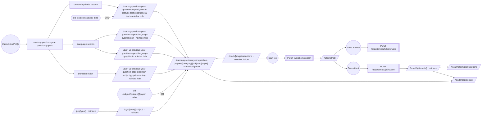
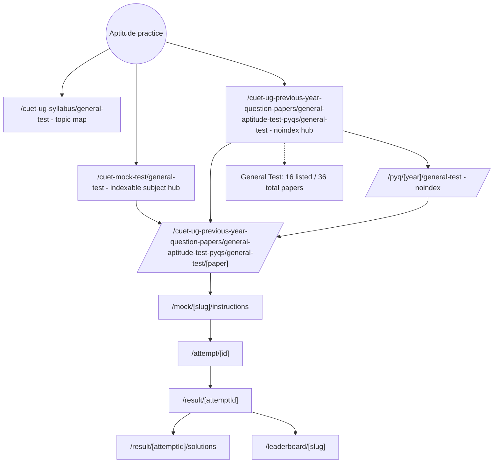
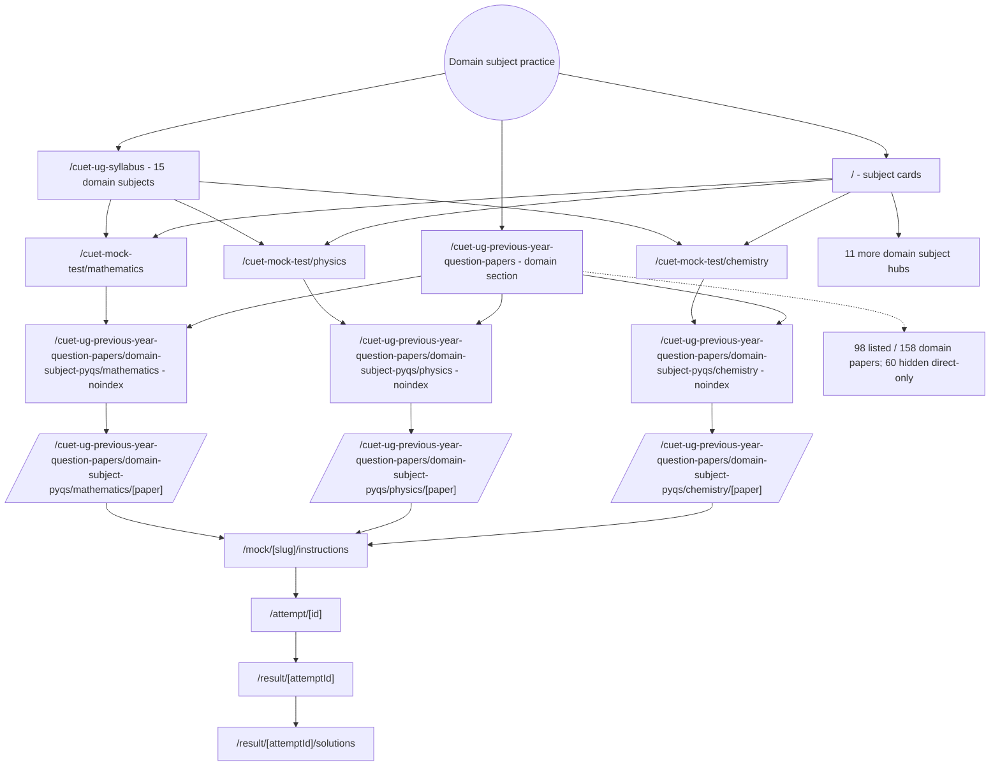
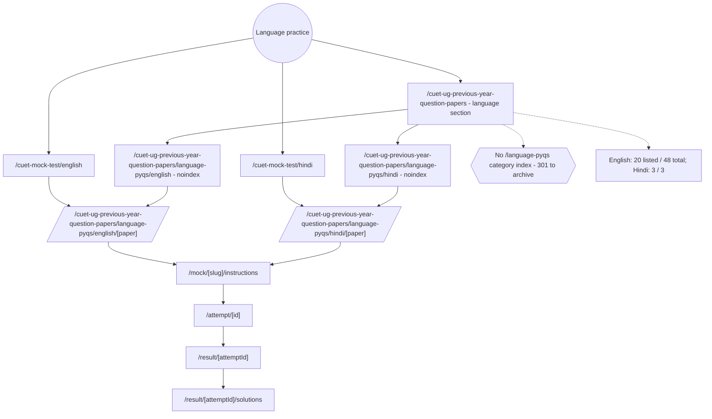
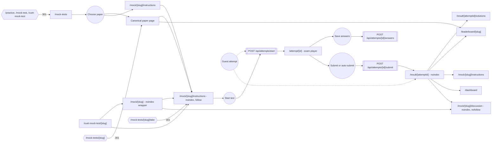
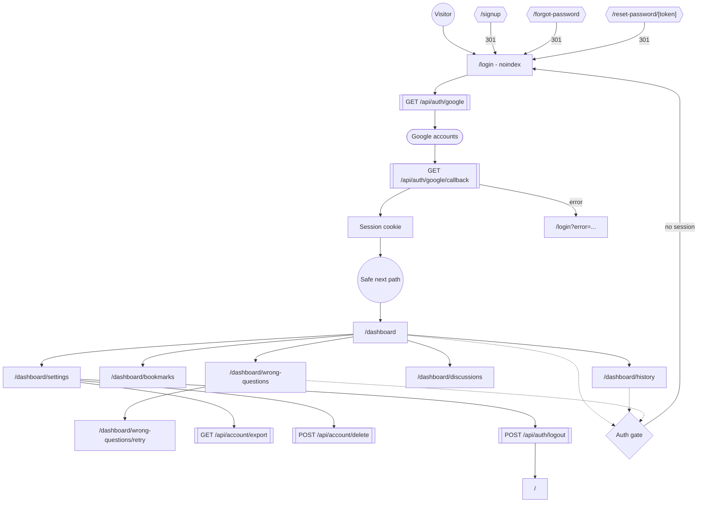
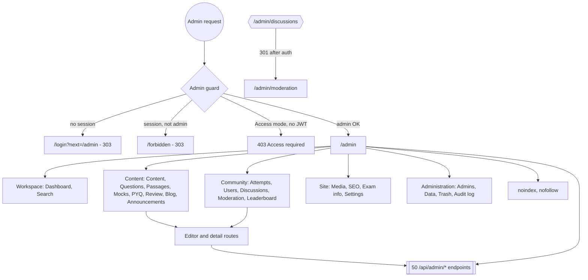
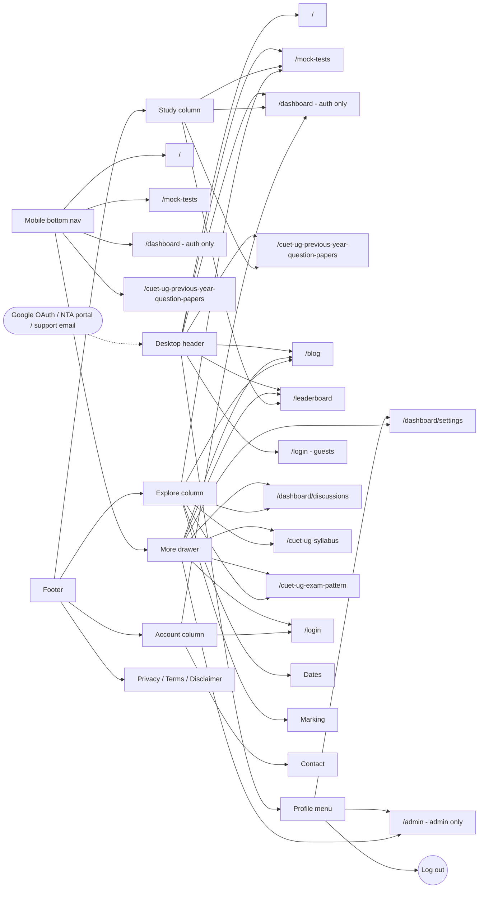
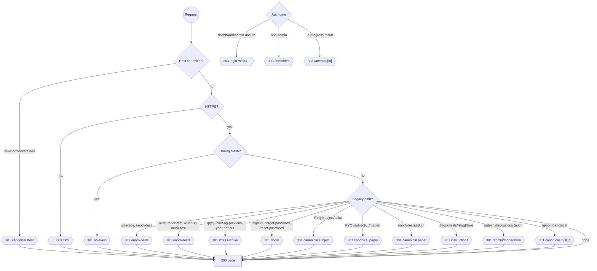

# CUET Free Mock Test - Website Sitemap aur Routing Map

> **Base URL:** `https://cuetfreemocktest.com`
> **Verification date:** 14-15 November 2026
> **Source commit:** `684c132` - "Update PYQ routes and metadata"
> **Scope:** documentation only. Is document ne website code, design ya behaviour change nahi kiya. Sirf `docs/WEBSITE_SITEMAP.md` add kiya gaya hai.

Yeh document site ke **actual route tree**, source code aur live production probes par based hai. Jahan sirf source code se behaviour confirm hua hai, wahan **Source-verified** likha hai. Jahan production request se status confirm hua hai, wahan **Live-verified** likha hai. Jo cheez verify nahi ho payi, use **Unverified** mark kiya gaya hai - kisi bhi missing page ya URL ko guess karke add nahi kiya gaya.

---

## Legend - Mermaid node shapes

| Shape | Meaning | Example |
| --- | --- | --- |
| Rectangle | Static page | `["/about"]` |
| Parallelogram | Dynamic route template | `[/"/blog/[slug]"/]` |
| Stadium | External destination | `(["Google accounts"])` |
| Hexagon | Redirect or alias | `{{"301 canonical paper"}}` |
| Circle | User action | `(("Start test"))` |
| Diamond | Decision or auth / permission gate | `{"Admin guard"}` |
| Subroutine | API endpoint | `[["POST /api/attempts/start"]]` |
| Cylinder | Data store | `[("D1 / Turso")]` |

**Indexability labels used in tables:**

- **Indexable** = live page returns 200 and no `noindex` directive.
- **noindex, follow** = page returns 200 but asks crawlers not to index it; links are still followed.
- **noindex, nofollow** = page returns 200 but crawlers should not index or follow it.
- **301** = permanent redirect.
- **303** = temporary redirect used after auth checks.
- **404** = live production returns not found.

---

## Quick facts

| Item | Value | Evidence |
| --- | --- | --- |
| Framework | Astro SSR, `output: "server"` | `astro.config.mjs` |
| Hosting | Cloudflare Workers, Worker `cuet-astro` | `wrangler.jsonc`, deployment config |
| Route modules | **179** (`91 .astro` + `88 .ts`) | `src/pages` scan |
| API endpoints | **82** | `src/pages/api` scan |
| Admin pages | **33** | `src/pages/admin` scan |
| Dynamic route modules | **73** (32 page templates + 40 API endpoints + 1 OG image route) | route scan |
| Local practice papers | **245** | `src/data/local-papers/index.json` |
| Listed papers | **137** (>= 30 recovered questions) | `MIN_LISTED_QUESTIONS = 30` |
| Hidden papers | **108** (< 30 recovered questions) | local paper data |
| Subjects | **18** (1 general, 2 language, 15 domain) | local paper data |
| Paper years | **2021-2026** | local paper data |
| Sitemap URLs (fresh local) | **234** (includes 2 E2E fixture URLs; production was 235 at last probe) | dev `/sitemap.xml` |
| Sitemap paper URLs | **137** | fresh sitemap |
| Blog posts in sitemap | **46** | fresh sitemap |
| Mock subject hubs in sitemap | **18** | fresh sitemap |
| Syllabus subject pages in sitemap | **18** | fresh sitemap |
| Core/static URLs in sitemap | **13** | live sitemap |
| Leaderboard paper URLs in sitemap | **1** | live sitemap |
| Mock overview URLs in sitemap | **1** | live sitemap |
| Shared question URLs in sitemap | **1** | live sitemap |
| Live topic pages | **0** (migration + CSV backfill pending) | `docs/TOPIC_BACKFILL.md` |

---

## 1. Project overview

CUET Free Mock Test ek independent CUET UG practice platform hai. Public site par mock tests, previous-year question papers (PYQs), syllabus topic maps, exam pattern, marking scheme, important dates, guides, leaderboard aur shared question pages hain. User account Google OAuth se banta hai; guest attempts bhi possible hain. Admin area content, questions, mocks, PYQ library, moderation, SEO aur site settings manage karta hai.

### 1.1 URL strategy

Current canonical strategy:

1. **Trailing slash nahi** - `/path/` ko `/path` par 301 kiya jata hai.
2. **PYQ canonical URL me `/subject/` segment nahi hai** - canonical shape:
   `/cuet-ug-previous-year-question-papers/<category>/<subject>/<paper>`
3. **Purane `/subject/` PYQ URLs 301 aliases hain**, canonical pages nahi.
4. **Category hamesha subject type se match karti hai**:
   - General Test -> `general-aptitude-test-pyqs`
   - English, Hindi, other languages -> `language-pyqs`
   - Baaki subjects -> `domain-subject-pyqs`
5. Agar URL me galat category ho, page 301 se correct canonical category par bhejta hai.
6. `/mock-tests/<slug>` canonical paper page par 301 karta hai; `/take` instructions par 301 karta hai.
7. `/pyq` aur `/cuet-ug-previous-year-papers` dono PYQ archive par 301 karte hain.

### 1.2 Indexability model

| Page family | Robots | Reason |
| --- | --- | --- |
| Canonical paper pages | Indexable only when listed (`recoveredQuestionCount >= 30`) and `rightsStatus != restricted`; otherwise `noindex, follow` | Main SEO landing pages, but partial/restricted papers stay crawlable only |
| PYQ archive | Indexable | Has substantive content |
| PYQ subject hubs | `noindex, follow` | Thin listing pages; canonical papers carry SEO |
| `/pyq/[year]`, `/pyq/[year]/[subject]` | `noindex, follow` | Duplicate year/subject listings |
| Category roots (`/<category>-pyqs`) | `301` to PYQ archive; invalid category `404` | Category UI lives on the archive, not on a standalone page |
| Topic pages (`/cuet-mock-test/[subject]/[topic]`) | Indexable when at least one live tagged question exists; otherwise `404` | Thin/empty topics are not published |
| `/mock-tests` base | Indexable | Main practice hub |
| `/mock-tests` filtered/paginated variants | `noindex, nofollow` | Filter duplicates |
| `/mock/[slug]` local paper wrapper | `noindex, follow`, canonical to paper | Wrapper only |
| `/mock/[slug]/instructions` | `noindex, follow`, canonical to paper | Step page |
| `/mock/[slug]/discussion` | `noindex, nofollow` | User-generated discussion |
| `/attempt/[id]` | `noindex, nofollow` | Private exam player |
| `/result/[attemptId]`, solutions | `noindex` | Private result |
| `/dashboard/*` | `noindex` | Private account area |
| `/login`, `/forbidden`, `/404`, `/500`, `/maintenance` | `noindex` | Non-content |
| `/search` | `noindex, nofollow` + `robots.txt` disallow | Internal search |
| `/cuet-ug-important-dates` | `noindex, follow` | Verification gate |
| `/u/[username]` | `noindex, follow` | Public profile is not a search landing page; username links appear only for `is_profile_public = 1` |
| `/q/[slug]` | `index, follow` when SEO-eligible, else `noindex, follow` | Shared question SEO page |
| `/leaderboard/[slug]` | Indexable when eligible entries exist, else `noindex, follow` | Conditional leaderboard |

### 1.3 Verification labels

- **Live-verified:** production request se status, canonical ya robots meta confirm hua.
- **Source-verified:** behaviour source file se confirm hua, production authenticated state se nahi.
- **Inferred:** sirf route pattern ya naming se guess; aise cases kam se kam rakhe gaye hain aur alag flag kiye gaye hain.
- **Unverified:** owner access, D1 quota ya auth session ke bina confirm nahi ho paya.

---

## 2. Hierarchical sitemap

### Diagram 1 - Full sitemap overview

```mermaid
flowchart TD
  Home["/ - Home"]

  subgraph Public["Public content"]
    MockHub["/mock-tests - Mock library"]
    PyqHub["/cuet-ug-previous-year-question-papers - PYQ archive"]
    SyllabusHub["/cuet-ug-syllabus"]
    SyllabusSubject[/"/cuet-ug-syllabus/[subject] - 18 pages"/]
    MockSubject[/"/cuet-mock-test/[slug] - 18 subject hubs"/]
    Topic[/"/cuet-mock-test/[subject]/[topic] - 0 live"/]
    ExamPattern["/cuet-ug-exam-pattern"]
    Marking["/cuet-ug-marking-scheme"]
    Dates["/cuet-ug-important-dates - noindex, follow"]
    BlogHub["/blog"]
    BlogPost[/"/blog/[slug] - 46 posts"/]
    Leaderboard["/leaderboard"]
    PaperBoard[/"/leaderboard/[slug]"/]
    About["/about"]
    Contact["/contact"]
    Legal["/privacy-policy /terms /disclaimer"]
  end

  subgraph Practice["PYQ and practice"]
    PyqSubject[/"/cuet-ug-previous-year-question-papers/[category]/[subject] - 18 hubs, noindex"/]
    PyqPaper[/"/cuet-ug-previous-year-question-papers/[category]/[subject]/[paper] - 245 pages"/]
    Year[/"/pyq/[year] - 6 years, noindex"/]
    YearSubject[/"/pyq/[year]/[subject] - noindex"/]
    Wrapper[/"/mock/[slug] - noindex wrapper"/]
    Instructions[/"/mock/[slug]/instructions - noindex"/]
    Attempt[/"/attempt/[id] - exam player"/]
    Result[/"/result/[attemptId] - noindex"/]
    Solutions[/"/result/[attemptId]/solutions"/]
    Discussion[/"/mock/[slug]/discussion - noindex, nofollow"/]
  end

  subgraph User["User and admin"]
    Login["/login - noindex"]
    Dashboard["/dashboard + 6 subpages - auth"]
    Admin["/admin + 32 subpages - admin only"]
    Forbidden["/forbidden - noindex"]
  end

  subgraph Utility["Utility and SEO"]
    Search["/search - noindex, nofollow"]
    SharedQ[/"/q/[slug] - shared question"/]
    Profile[/"/u/[username] - orphan"/]
    Sitemap["/sitemap.xml"]
    Robots["/robots.txt"]
    Ads["/ads.txt"]
    Og[/"/og/blog/[slug].svg"/]
    Offline["/offline.html"]
  end

  Home --> MockHub
  Home --> PyqHub
  Home --> SyllabusHub
  Home --> BlogHub
  Home --> Leaderboard
  Home --> About
  Home --> Contact
  Home --> Login
  Home --> Legal
  MockHub --> MockSubject
  MockSubject --> PyqPaper
  MockSubject --> Wrapper
  SyllabusHub --> SyllabusSubject
  SyllabusSubject --> MockSubject
  PyqHub --> PyqSubject
  PyqSubject --> PyqPaper
  PyqPaper --> Instructions
  Wrapper --> Instructions
  Wrapper --> Discussion
  Instructions --> Attempt
  Attempt --> Result
  Result --> Solutions
  Result --> PaperBoard
  Result --> Discussion
  PyqHub --> Year
  Year --> YearSubject
  YearSubject --> PyqPaper
  BlogHub --> BlogPost
  Leaderboard --> PaperBoard
  SharedQ --> Wrapper
  Login --> Dashboard
  Dashboard -.->|"admin only"| Admin
  Admin -.->|"non-admin"| Forbidden
  Search -.-> MockHub
  Profile -.-> Leaderboard
  Sitemap -.-> Home
  Robots -.-> Home
```



### 2.1 Text route tree

```text
/
├── about
├── contact
├── privacy-policy
├── terms
├── disclaimer
├── blog
│   └── [slug]                        46 published posts
├── cuet-ug-syllabus
│   └── [subject]                     18 subject topic maps
├── cuet-ug-exam-pattern
├── cuet-ug-marking-scheme
├── cuet-ug-important-dates           noindex, follow
├── cuet-mock-test                    -> 301 /mock-tests
├── cuet-mock-test/[slug]             18 subject hubs
├── cuet-mock-test/[subject]/[topic]  template; 0 live instances
├── cuet-ug-mock-test                 -> 301 /mock-tests
├── mock-tests
│   ├── [slug]                        -> 301 canonical paper
│   └── [slug]/take                   -> 301 /mock/[slug]/instructions
├── cuet-ug-previous-year-question-papers
│   ├── [category]                     -> 301 PYQ archive (invalid 404)
│   ├── [category]/[subject]           18 canonical subject hubs, noindex
│   ├── [category]/[subject]/[paper]   245 paper pages, 137 listed
│   ├── [category]/subject/[subject]   -> 301 canonical subject
│   ├── [category]/subject/[subject]/[paper] -> 301 canonical paper
│   └── subject/[subject]              -> 301 canonical subject
├── cuet-ug-previous-year-papers      -> 301 PYQ archive
├── pyq                                -> 301 PYQ archive
├── pyq/[year]                         noindex, follow
├── pyq/[year]/[subject]               noindex, follow
├── pyq/subject/[subject]              -> 301 canonical subject
├── mock/[slug]                       local wrapper noindex; DB mock indexable
├── mock/[slug]/instructions          noindex, follow
├── mock/[slug]/discussion            noindex, nofollow
├── attempt/[id]                      private exam player
├── result/[attemptId]                private result
├── result/[attemptId]/solutions      private solutions
├── leaderboard
│   └── [slug]                        indexable only when ranked entries exist
├── q/[slug]                          shared question page
├── u/[username]                      public profile, orphaned
├── search                            noindex, nofollow, robots-disallowed
├── login                             noindex
├── signup                            -> 301 /login
├── forgot-password                   -> 301 /login
├── reset-password/[token]            -> 301 /login
├── dashboard                         auth, noindex
│   ├── history
│   ├── bookmarks
│   ├── wrong-questions
│   │   └── retry
│   ├── discussions
│   └── settings
├── admin                             33 pages, auth, noindex nofollow
├── forbidden                         noindex
├── 404                               noindex
├── 500                               noindex
├── maintenance                       noindex, nofollow
├── dev/styleguide                    dev-only; 404 in production
├── dev/styleguide/frame              dev-only; 404 in production
├── sitemap.xml
├── robots.txt
├── ads.txt
├── og/blog/[slug].svg
└── api/*                             82 endpoints
```

---

## 3. Full route inventory

### 3.1 Route module reconciliation

| Category | Count | Notes |
| --- | ---: | --- |
| Total route modules | 179 | `src/pages` scan |
| `.astro` files | 91 | Pages and layouts-in-pages |
| `.ts` files | 88 | API, sitemap, robots, ads, redirects |
| API endpoints | 82 | `/api/*` |
| Admin pages | 33 | `/admin/*` |
| Public non-admin pages | 58 | 91 astro minus 33 admin |
| Dynamic route modules | 73 | 32 page templates + 40 API endpoints + 1 OG image route |
| Static utility/alias endpoints | 5 | `ads.txt`, `robots.txt`, `sitemap.xml`, `pyq/index.ts`, `og/blog/[slug].svg` |

### 3.2 Public static and core pages

| Page | Production URL | Type | Parent | Indexability | Linked from |
| --- | --- | --- | --- | --- | --- |
| Home | `/` | Static | Root | Indexable | Logo, header, mobile nav, footer |
| About | `/about` | Static | Root | Indexable | Footer brand link |
| Contact | `/contact` | Static | Root | Indexable | Footer account column |
| Blog index | `/blog` | Static | Root | Indexable | Header "Guides", footer |
| Syllabus hub | `/cuet-ug-syllabus` | Static | Root | Indexable | Header/Footer, mock-tests links |
| Exam pattern | `/cuet-ug-exam-pattern` | Static | Root | Indexable | Footer, archive, syllabus |
| Marking scheme | `/cuet-ug-marking-scheme` | Static | Root | Indexable | Footer, mock-tests links |
| Important dates | `/cuet-ug-important-dates` | Static | Root | `noindex, follow` | Footer |
| Mock tests hub | `/mock-tests` | Static | Root | Indexable | Header, mobile nav, footer |
| PYQ archive | `/cuet-ug-previous-year-question-papers` | Static | Root | Indexable | Header, mobile nav, footer |
| Leaderboard | `/leaderboard` | Static | Root | Indexable when ranked entries exist | Header, mobile drawer, footer |
| Privacy policy | `/privacy-policy` | Static | Root | Indexable | Footer legal |
| Terms | `/terms` | Static | Root | Indexable | Footer legal, login |
| Disclaimer | `/disclaimer` | Static | Root | Indexable | Footer legal, mock page |
| Login | `/login` | Static | Root | `noindex, nofollow` | Header guest CTA, footer, auth gates |
| Search | `/search` | Static | Root | `noindex, nofollow`; robots-disallowed | Homepage JSON-LD only |
| Forbidden | `/forbidden` | Static | Root | `noindex, nofollow` | Admin auth failure |
| 404 | `/404` | Static | Root | `noindex` | Any unknown URL |
| 500 | `/500` | Static | Root | `noindex` | Server error |
| Maintenance | `/maintenance` | Static | Root | `noindex, nofollow` | Manual/ops |
| Dev styleguide | `/dev/styleguide` | Static | Root | 404 in production | Dev only |
| Dev styleguide frame | `/dev/styleguide/frame` | Static | Root | 404 in production | Dev only |

### 3.3 Dynamic public routes

| Template | Live instances | Parent | Indexability | Primary links |
| --- | ---: | --- | --- | --- |
| `/blog/[slug]` | 46 | `/blog` | Indexable | Blog index, related guides, mock-tests |
| `/cuet-ug-syllabus/[subject]` | 18 | `/cuet-ug-syllabus` | Indexable | Syllabus hub, mock subject hub, PYQ archive |
| `/cuet-mock-test/[slug]` | 18 | Root | Indexable | Subject papers, topics, syllabus, PYQ year pages |
| `/cuet-mock-test/[subject]/[topic]` | 0 verified live | `/cuet-mock-test/[slug]` | Template indexable when questions exist | Subject page topic list |
| `/cuet-ug-previous-year-question-papers/[category]/[subject]` | 18 | PYQ archive | `noindex, follow` | Archive, canonical papers |
| `/cuet-ug-previous-year-question-papers/[category]` | 3 valid category roots | PYQ archive | Valid root 301 to archive; invalid 404 | Archive sections |
| `/cuet-ug-previous-year-question-papers/[category]/[subject]/[paper]` | 245 total; 137 listed | Subject hub | Indexable only when listed and not restricted; hidden/restricted `noindex, follow` | Subject hub, instructions, leaderboard |
| `/mock/[slug]` | 1 indexable DB mock + 245 noindex local wrappers | Root | Mixed | Subject hub, shared question, legacy URLs |
| `/mock/[slug]/instructions` | One per mock/paper | `/mock/[slug]` | `noindex, follow`, canonical paper | Mock overview, start action |
| `/mock/[slug]/discussion` | One per mock/paper | `/mock/[slug]` | `noindex, nofollow` | Mock overview, login/signup |
| `/attempt/[id]` | Per attempt | Instructions | `noindex, nofollow` | Instructions, result after submit |
| `/result/[attemptId]` | Per submitted attempt | Attempt | `noindex` | Solutions, leaderboard, retry, dashboard |
| `/result/[attemptId]/solutions` | Per submitted attempt | Result | `noindex` | Result, discussion, mock-tests |
| `/leaderboard/[slug]` | 1 indexable in sitemap | `/leaderboard` | Conditional | Leaderboard, mock instructions |
| `/q/[slug]` | 1 in sitemap | Root | `index, follow` if SEO-eligible | Instructions CTA, related mocks, mock library |
| `/u/[username]` | Public profiles | Root | `noindex, follow` | None (orphan) |
| `/pyq/[year]` | 2021-2026 | Root | `noindex, follow` | Paper cards, subject badges |
| `/pyq/[year]/[subject]` | DB-backed pairs | `/pyq/[year]` | `noindex, follow` | Paper cards |
| `/pyq/subject/[subject]` | Per valid subject | Root | 301 alias | Legacy links |
| `/cuet-ug-previous-year-question-papers/[category]/subject/[subject]` | Per valid subject | Archive | 301 alias | Legacy links |
| `/cuet-ug-previous-year-question-papers/[category]/subject/[subject]/[paper]` | Per valid paper | Archive | 301 alias | Legacy links |
| `/cuet-ug-previous-year-question-papers/subject/[subject]` | Per valid subject | Archive | 301 alias | Legacy links |
| `/mock-tests/[slug]` | Per local paper | `/mock-tests` | 301 to canonical paper | Old cards/bookmarks |
| `/mock-tests/[slug]/take` | Per local paper | `/mock-tests` | 301 to instructions | Old player links |
| `/reset-password/[token]` | Any token | Root | 301 to `/login` | Legacy auth links |

### 3.4 Auth and dashboard pages

| Page | URL | Guard | Indexability | Notes |
| --- | --- | --- | --- | --- |
| Login | `/login` | Public | `noindex, nofollow` | Google OAuth only; no password form |
| Dashboard overview | `/dashboard` | Session | `noindex` | Stats, recent attempts |
| Attempt history | `/dashboard/history` | Session | `noindex` | All attempts |
| Bookmarks | `/dashboard/bookmarks` | Session | `noindex` | Saved questions |
| Wrong questions | `/dashboard/wrong-questions` | Session | `noindex` | Mistake review |
| Wrong-question retry | `/dashboard/wrong-questions/retry` | Session | `noindex` | Private, unranked retry |
| My discussions | `/dashboard/discussions` | Session | `noindex` | Comments and moderation status |
| Account settings | `/dashboard/settings` | Session | `noindex` | Profile, export, delete, logout |
| Forbidden | `/forbidden` | Public | `noindex, nofollow` | Non-admin admin-area access |

### 3.5 Admin pages (33)

Admin layout `noindex, nofollow` hai. Sidebar groups permission-gated hain. Detail/editor routes parent section permission inherit karte hain.

| Group | Page | URL | Type | Access / note |
| --- | --- | --- | --- | --- |
| Workspace | Dashboard | `/admin` | Static | Admin session/Access |
| Workspace | Search | `/admin/search` | Static | Admin session/Access |
| Content | Content workspace | `/admin/content` | Static | `questions.write` |
| Content | Questions | `/admin/questions` | Static | `questions.write` |
| Content | Passages | `/admin/passages` | Static | `taxonomy.write` |
| Content | Mock tests | `/admin/mocks` | Static | `mocks.write` |
| Content | PYQ library | `/admin/pyq` | Static | `mocks.write` |
| Content | Review queue | `/admin/review` | Static | `questions.write` |
| Content | Guides and blog | `/admin/blog` | Static | `seo.write` |
| Content | Announcements | `/admin/announcements` | Static | `announcements.write` |
| Community | Attempts | `/admin/attempts` | Static | `attempts.view` |
| Community | Users | `/admin/users` | Static | `users.view` |
| Community | Discussions | `/admin/discussions` | Static | `moderation.write`; 301 to moderation after auth |
| Community | Moderation | `/admin/moderation` | Static | `moderation.write` |
| Community | Leaderboard | `/admin/leaderboard` | Static | `leaderboards.write` |
| Site | Media library | `/admin/media` | Static | `media.write` |
| Site | SEO and pages | `/admin/seo` | Static | `seo.write` |
| Site | Exam information | `/admin/exam-info` | Static | `exam_info.write` |
| Site | Site builder and settings | `/admin/settings` | Static | `settings.write` |
| Administration | Admin accounts | `/admin/admins` | Static | `admins.manage` |
| Administration | Data manager | `/admin/data` | Static | `data.manage` |
| Administration | Trash | `/admin/trash` | Static | `trash.manage` |
| Administration | Activity log | `/admin/audit-log` | Static | `audit.view` or `audit.own` |
| Content detail | New mock | `/admin/mocks/new` | Static | `mocks.write` |
| Content detail | Edit mock | `/admin/mocks/[id]` | Dynamic | `mocks.write` |
| Content detail | Preview mock | `/admin/mocks/[id]/preview` | Dynamic | `mocks.write` |
| Content detail | New question | `/admin/questions/new` | Static | `questions.write` |
| Content detail | Edit question | `/admin/questions/[id]` | Dynamic | `questions.write` |
| Content detail | Preview question | `/admin/questions/[id]/preview` | Dynamic | `questions.write` |
| Content detail | Import questions | `/admin/questions/import` | Static | `questions.write` |
| Community detail | Attempt detail | `/admin/attempts/[id]` | Dynamic | `attempts.view` |
| Data detail | Table browser | `/admin/data/[table]` | Dynamic | `data.manage` |
| Data detail | Table row editor | `/admin/data/[table]/row` | Dynamic | `data.manage`; 301 fallback to table |

### 3.6 API endpoints summary

| Family | Count | Examples | Guard |
| --- | ---: | --- | --- |
| Admin | 50 | `/api/admin/questions`, `/api/admin/mocks/[id]/publish` | Admin guard; 401/403 |
| Auth | 3 | `/api/auth/google`, `/api/auth/google/callback`, `/api/auth/logout` | OAuth |
| Account | 3 | `/api/account`, `/api/account/export`, `/api/account/delete` | Session |
| Me | 3 | `/api/me/history`, `/api/me/bookmarks`, `/api/me/wrong-questions/retry` | Session |
| Bookmarks | 2 | `/api/bookmarks`, `/api/bookmarks/[questionId]` | Session |
| Attempts | 4 | `/api/attempts/start`, `/api/attempts/[id]/answers` | Guest token or session |
| Results | 1 | `/api/results/[attemptId]` | Guest token or session |
| Discussions | 4 | `/api/discussions`, `/api/discussions/[id]/vote` | Mixed: read public, write session |
| Questions | 2 | `/api/questions/[id]/discussions`, `/api/questions/[id]/report` | Mixed |
| Public questions | 2 | `/api/public-questions/[publicId]`, `/check` | Public |
| Mocks | 3 | `/api/mocks`, `/api/mocks/[slug]`, `/api/mocks/[id]/discussions` | Public/mixed |
| Leaderboards | 1 | `/api/leaderboards/[mockSlug]` | Public |
| Media | 1 | `/api/media/[id]` | Public asset delivery |
| Health | 1 | `/api/health` | Public |
| Share events | 1 | `/api/share-events` | Public event tracking |
| Subjects | 1 | `/api/subjects` | Public |
| **Total** | **82** | Full list in Appendix E | - |

### 3.7 Utility and technical URLs

| URL | Purpose | Status |
| --- | --- | --- |
| `/sitemap.xml` | Dynamic XML sitemap | 200 |
| `/robots.txt` | Crawl rules + sitemap directive | 200 |
| `/ads.txt` | AdSense authorised sellers | 200 |
| `/og/blog/[slug].svg` | Dynamic Open Graph image for guides | Route exists |
| `/manifest.webmanifest` | PWA manifest | Static asset |
| `/sw.js` | Service worker | Static asset |
| `/offline.html` | PWA offline fallback | Static asset |
| `/offline` | Offline route/fallback | 200 |
| `/favicon.svg`, `/logo.svg`, `/logo.png`, `/apple-touch-icon.png` | Brand assets | Static |
| `/_astro/*` | Hashed build assets | Immutable cache |

---

## 4. Navigation diagrams

> Diagram 1 (full sitemap) section 2 me hai. Neeche baaki 9 required flows hain.

### 4.1 Diagram 2 - PYQ flow



**Flow notes:**

- Archive par teen visible sections hain: General Aptitude, Language, Domain.
- Archive se subject hub par jane par URL canonical no-subject shape me hota hai; subject hub `noindex, follow` hai.
- Paper page hi main indexable landing page hai. Instructions aur local wrapper dono canonical paper par point karte hain.
- Paper page se timed attempt instructions aur leaderboard dono accessible hain; discussion wrapper/result side se milta hai.
- Local wrapper `/mock/[slug]` alternate noindex entry hai (subject hub/shared question), PYQ paper ka primary CTA seedha instructions par jata hai.
- Old `/subject/` URLs 301 se canonical subject/paper par aate hain; unhe canonical page mat samjho.

### 4.2 Diagram 3 - Aptitude flow



**Flow notes:**

- General Test ka subject code `general-test` hai; category `general-aptitude-test-pyqs`.
- Subject hub se 5 latest papers archive par dikhte hain; poora set subject hub par hai.
- `/pyq/[year]/general-test` pages DB-backed hain aur `noindex, follow` hain.
- Filtered `/mock-tests?subject=general-test` `noindex, nofollow` hai; canonical `/mock-tests` par jata hai.
- General Test ke 36 papers me se 16 listed hain; 20 hidden/partial 2026 papers direct URL se playable hain.

### 4.3 Diagram 4 - Domain subjects flow



**Flow notes:**

- Domain category me 15 subjects hain: Accountancy, Applied Mathematics, Biology, Business Studies, Chemistry, Computer Science, Economics, Geography, History, Legal Studies, Mathematics, Physics, Political Science, Psychology, Sociology.
- Domain papers total 158 hain; 98 listed aur 60 hidden.
- Chemistry (31 total, 17 listed), Physics (26/12), Mathematics (23/8) sabse zyada papers wale subjects hain.
- Har subject ka apna `/cuet-mock-test/[subject]` hub, `/cuet-ug-syllabus/[subject]` topic map aur PYQ subject hub hai.
- Hidden domain papers direct URL se playable hain, lekin listings aur sitemap me nahi hain.

### 4.4 Diagram 5 - Languages flow



**Flow notes:**

- Language category me live subjects English aur Hindi hain. Baaki language slugs code me supported hain, lekin unke papers local data me nahi hain.
- English ke 48 papers me se 20 listed hain; 28 hidden (mostly 2026 partial papers).
- Hindi ke 3 papers listed hain.
- `/cuet-ug-previous-year-question-papers/language-pyqs` category index page **nahi hai**; archive ka language section hi entry point hai. Direct category URL 301 se archive par chala jata hai.
- Language subject hubs aur year pages `noindex, follow` hain; paper pages indexable hain.

### 4.5 Diagram 6 - Mock test flow



**Flow notes:**

- Entry points: `/mock-tests` cards, subject hubs, canonical paper pages, shared question CTA, leaderboard start.
- `/mock-tests` cards "Start Test" se seedha `/mock/<slug>/instructions` par ja sakte hain; paper title canonical paper page par jata hai.
- Local paper wrapper `/mock/[slug]` `noindex, follow` hai aur canonical paper par point karta hai.
- Attempt guest token ya session se chalta hai; result private `noindex` page hai.
- Result se solutions, leaderboard, retry, discussion aur dashboard sab linked hain.
- `/mock-tests/[slug]` aur `/take` permanent aliases hain; `/practice`, `/mock-test`, `/cuet-mock-test` legacy hub aliases hain.

### 4.6 Diagram 7 - Auth and dashboard flow



**Flow notes:**

- Authentication Google OAuth only hai; login page par password form nahi hai.
- `/signup`, `/forgot-password`, `/reset-password/<token>` sab 301 se `/login` par jate hain. Self-service password reset currently disabled hai.
- OAuth start 303 se Google par jata hai; callback success par safe `next` ya `/dashboard` par 303 karta hai.
- Dashboard ke 6 subpages session-gated aur `noindex` hain.
- Account export, delete aur logout APIs settings page se call hote hain.
- Guest attempt submit karne ke baad account claim CTA `/signup` dikhata hai, jo `/login` par redirect karta hai.

### 4.7 Diagram 8 - Admin flow



**Flow notes:**

- Production observed behaviour: unauthenticated `/admin` 303 to `/login?next=/admin`; unauthenticated `/api/admin/me` 401.
- Source guard: non-admin session `/forbidden` 303; Access mode failure 403; production session mode disabled hone par 503.
- 33 admin pages aur 50 admin APIs hain.
- Sidebar me 5 visible groups plus conditional `Activity` group for audit-only roles.
- `/admin/discussions` authenticated state me 301 to `/admin/moderation`; unauthenticated request pehle login par 303 hoti hai.
- Admin layout `noindex, nofollow` hai.

### 4.8 Diagram 9 - Header and footer link map



**Flow notes:**

- Desktop header me Home, Mock Tests, Dashboard (auth), PYQs, Guides, Leaderboard hain.
- Mobile bottom nav me Home, Mock Tests, Dashboard (auth), PYQs aur More hain.
- Mobile More drawer me Leaderboard, Settings (auth), Admin (admin), Discussions, Syllabus, Exam pattern, Blog, custom links aur Login/Log out hain.
- Footer me Study, Explore, Account aur legal columns hain.
- External destinations: Google OAuth, NTA CUET portal (`https://cuet.nta.nic.in/`), support/privacy/legal email addresses.

### 4.9 Diagram 10 - Internal links and redirection flow



**Flow notes:**

- Host, HTTPS aur trailing slash redirects middleware me sabse pehle chalte hain.
- Legacy path redirects `/practice`, `/mock-test`, `/cuet-mock-test`, `/cuet-ug-mock-test`, `/pyq` aur `/cuet-ug-previous-year-papers` ke liye hain.
- PYQ `/subject/` aliases canonical subject/paper par 301 hote hain.
- Auth gates 303 use karte hain, taaki crawler permanent redirect na samjhe.
- Current production me koi redirect loop nahi mila; `/pyq` -> archive -> 200 aur archive direct -> 200 dono verified hain.

---

## 5. Section flows - consolidated summary

Yeh section 4 ke diagrams ka text summary hai. Har flow ka entry point, main route sequence aur end state ek jagah rakha gaya hai, taaki navigation behaviour bina diagram scroll kiye verify ho sake.

| Flow | Entry points | Main sequence | End state | Primary evidence |
| --- | --- | --- | --- | --- |
| Home discovery | `/` | Home -> `/mock-tests`, `/cuet-ug-previous-year-question-papers`, `/cuet-ug-syllabus`, `/blog`, `/leaderboard` | User kisi bhi major hub par pahunch jata hai | Homepage `hrefs` scan |
| Mock library | Header, mobile nav, footer, home | `/mock-tests` -> filter/query state -> canonical paper/instructions | Timed attempt start | `mock-tests/index.astro` |
| PYQ archive | Header, mobile nav, footer | Archive -> General/Language/Domain section -> subject hub -> canonical paper | Paper detail ya timed attempt | `cuet-ug-previous-year-question-papers.astro` |
| General Aptitude | Archive, subject hub, filtered library | `/cuet-mock-test/general-test` -> paper -> instructions | Attempt/result | Local paper data + `getPyqSubjectPath` |
| Language | Archive, subject hub | `/cuet-mock-test/english` or `/hindi` -> language PYQ hub -> paper | Attempt/result | Local paper data |
| Domain subjects | Archive, syllabus, subject hub | `/cuet-mock-test/<subject>` -> domain PYQ hub -> paper | Attempt/result | Local paper data |
| Syllabus | Header, footer, mock library | `/cuet-ug-syllabus` -> `/cuet-ug-syllabus/<subject>` -> mock subject/PYQ archive | Practice entry | `cuet-ug-syllabus/[subject].astro` |
| Guides | Header, footer, blog cards | `/blog` -> `/blog/<slug>` -> related guide or mock library | Practice/revision | `blog/index.astro`, `blog/[slug].astro` |
| Leaderboard | Header, footer, result | `/leaderboard` -> `/leaderboard/<paper-slug>` -> instructions | Retry/start attempt | `leaderboard/[slug].astro` |
| Shared question | External share URL, sitemap | `/q/<slug>` -> related mock CTA -> `/mock/<slug>/instructions` | Attempt | `q/[slug].astro` |
| Authentication | Header guest CTA, footer, auth gate | `/login` -> Google OAuth -> callback -> `next` or `/dashboard` | Session | `login.astro`, `/api/auth/google/*` |
| Dashboard | Header, footer, result | `/dashboard` -> history/bookmarks/wrong questions/discussions/settings | Review or retry | `dashboardNav`, dashboard pages |
| Admin | Admin URL, profile menu | Login -> admin guard -> 33 admin pages -> 50 admin APIs | Content/site management | `middleware.ts`, `AdminLayout.astro` |
| PWA/offline | Service worker | Cached shell -> `/offline` or `/offline.html` | Offline notice | `public/sw.js`, `public/_headers` |

### 5.1 Cross-section handoffs

- **Mock subject -> PYQ:** `/cuet-mock-test/[slug]` paper cards aur year links `/pyq/<year>/<subject>` use karte hain.
- **Syllabus -> practice:** `/cuet-ug-syllabus/[subject]` se mock subject hub aur PYQ archive dono linked hain.
- **PYQ paper -> mock player:** canonical paper page practice CTA `/mock/<slug>/instructions` par bhejta hai.
- **Result -> next action:** result page solutions, leaderboard, retry, discussion aur dashboard sab expose karta hai.
- **Shared question -> practice:** `/q/[slug]` ka primary CTA related full mock ke `/mock/<slug>/instructions` par jata hai; related mock cards `/mock/<slug>` wrapper use karte hain.
- **Auth -> intended page:** dashboard/admin gate `next` query preserve karte hain; successful callback safe `next` par redirect karta hai.
- **Admin -> public site:** admin dashboard me "Open public site" link `/` par jata hai.

### 5.2 Flow-level indexability

- Indexable landing pages: home, mock library base, PYQ archive, syllabus hub/subjects, blog index/posts, exam pattern, marking scheme, legal pages, canonical papers, eligible leaderboards aur eligible shared questions.
- `noindex, follow` intermediaries: PYQ subject hubs, `/pyq/<year>` pages, mock wrapper, instructions aur important dates.
- `noindex, nofollow` private states: attempt player, results, dashboard, admin, login, search, discussions aur error pages.
- Redirect-only states: `/subject/` aliases, `/mock-tests/<slug>`, `/take`, `/signup`, `/forgot-password`, `/reset-password/<token>`.

---

## 6. Internal link mapping

### 6.1 Global navigation links

| Navigation surface | Visible links | Auth condition | Notes |
| --- | --- | --- | --- |
| Desktop header | Home, Mock Tests, Dashboard, PYQs, Guides, Leaderboard | Dashboard link authenticated users ke liye | Logo home par jata hai |
| Header account area | Login/Sign up ya profile menu | Guest vs session | Profile menu me settings, admin (admin only), logout |
| Mobile bottom nav | Home, Mock Tests, Dashboard, PYQs, More | Dashboard auth-only | More drawer baaki links rakhta hai |
| Mobile More drawer | Leaderboard, Settings (auth), Admin (admin), Discussions, Syllabus, Exam pattern, Blog, custom links, Login/Log out | Admin link admin-only | `More` primary nav ka overflow hai; Important dates, Marking scheme, Contact aur legal footer me hain |
| Footer Study | Mock tests, Previous year papers, Leaderboard, Performance analytics | Performance analytics auth-gated | Footer se direct practice/analytics |
| Footer Explore | Subject papers, CUET syllabus, Exam pattern, Important dates, Marking scheme, Discussions, Preparation guides | Discussions auth-gated | Content discovery cluster |
| Footer Your account | Dashboard, Log in/Create account, Contact | Dashboard auth-gated | Account/help cluster |
| Footer legal | Privacy, Terms, Disclaimer | Public | Har public page par repeat |

### 6.2 Page-level inbound and outbound map

| Page family | Linked from | Navigates to | Notes |
| --- | --- | --- | --- |
| `/` | Logo, header, mobile nav, footer, 404/500 | Mock library, PYQ archive, syllabus, blog, leaderboard, login, about, contact, legal, popular papers | Primary discovery hub |
| `/about` | Footer brand link | No tracked outbound links | Static trust page |
| `/contact` | Footer account column | Mock library, privacy, disclaimer | Support route |
| `/blog` | Header "Guides", footer, home | Blog posts, mock library, syllabus | 46 posts |
| `/blog/[slug]` | Blog index, related posts | Blog index/category anchor, mock library, related guides | Article-to-practice CTA |
| `/cuet-ug-syllabus` | Mobile More, footer, mock library, home | Subject pages, mock subjects, mock library, exam pattern | 18 subjects |
| `/cuet-ug-syllabus/[subject]` | Syllabus hub | Mock subject, topic pages (when present), PYQ archive, NTA portal | External NTA link |
| `/mock-tests` | Header, mobile nav, footer, home, syllabus | Paper cards, subject/year filters, syllabus, marking scheme, PYQ archive | Filtered states canonical to base |
| `/cuet-mock-test/[slug]` | Mock library | Paper wrappers, instructions, topic pages (0 live), syllabus, `/pyq/<year>/<subject>` | 18 subject hubs |
| `/cuet-mock-test/[subject]/[topic]` | Subject page topic list (only if topic exists) | Related topics, paper practice, syllabus | 0 verified live instances |
| `/cuet-ug-previous-year-question-papers` | Header, mobile nav, footer, home | Subject hubs, paper pages, exam pattern, mock library | General/Language/Domain sections |
| `/cuet-ug-previous-year-question-papers/[category]/[subject]` | PYQ archive | Canonical paper pages | 18 hubs, `noindex, follow` |
| `/cuet-ug-previous-year-question-papers/[category]/[subject]/[paper]` | Subject hub, sitemap | Instructions, leaderboard, related papers, subject hub, contact/disclaimer | Canonical paper landing page |
| `/pyq/[year]` | Homepage, paper cards, legacy links | Subject-year pages, paper cards | `noindex, follow` |
| `/pyq/[year]/[subject]` | `/pyq/[year]`, mock subject cards | Canonical paper pages | `noindex, follow` |
| `/mock/[slug]` | Subject hub, shared question, legacy URLs | Instructions, discussion, leaderboard, syllabus | Local paper wrapper |
| `/mock/[slug]/instructions` | Paper, subject hub, mock library cards, wrapper, leaderboard, result retry | Attempt start, wrapper | Canonical to paper |
| `/attempt/[id]` | Instructions | Result after submit/auto-submit | Private player |
| `/result/[attemptId]` | Attempt submit | Solutions, leaderboard, retry, discussion, dashboard, signup | Private result |
| `/result/[attemptId]/solutions` | Result | Result, discussion, mock library | Private solutions |
| `/mock/[slug]/discussion` | Wrapper, attempt player, result/solutions (preview), dashboard/admin moderation | Mock wrapper, login/signup | UGC, noindex |
| `/leaderboard` | Header, footer, home | Paper leaderboards | Only when eligible entries exist |
| `/leaderboard/[slug]` | Leaderboard index, paper page, result | Instructions, leaderboard index | Conditional noindex |
| `/q/[slug]` | External shares, sitemap | Instructions CTA, mock wrapper, mock library, subject hub | SEO-eligible shared question |
| `/u/[username]` | None verified | Profile content | Orphaned public profile |
| `/search` | Homepage JSON-LD only | Search results | No anchor links; robots-disallowed |
| `/login` | Header, footer, auth gates | Google OAuth, `next` page | No password form |
| `/dashboard` and subpages | Header, footer, result, login callback | Dashboard subpages, practice, admin (admin) | Session-gated |
| `/admin` and subpages | Profile menu, direct URL | Admin sections, public site | Admin guard |
| Legal pages | Footer, login, contact, mock pages | None/limited | Indexable trust pages |

### 6.3 Link crawl evidence

16 seed pages se **365 unique internal links** probe kiye gaye:

| Result | Count | Detail |
| --- | ---: | --- |
| Unique internal links probed | 365 | Seed pages se discovered |
| Broken (4xx/5xx/error) | **0** | Koi discovered internal link broken nahi |
| Expected redirects | 3 | `/dashboard` 303, `/dashboard/discussions` 303, `/cuet-mock-test` 301 |
| `/pyq/*` links probed | 24 | Sab 200 |
| Live topic links | 0 | Subject pages par zero topic anchors |
| `/u/*` profile links | 0 | Koi internal profile link nahi |

Yeh crawl exhaustive site-wide crawl nahi hai; yeh 16 high-value seed pages se discoverable link graph hai. Isliye "0 broken" ka matlab discovered links me zero broken hai, entire internet-facing graph ka mathematical proof nahi.

### 6.4 Pages with zero verified inbound links

| Page | Status | Classification |
| --- | --- | --- |
| `/u/[username]` | 200 for public profiles; `/u/nobody-xyz` 404 | Noindex orphan |
| `/search` | 200, `noindex, nofollow`, robots-disallowed | Intentional non-linked utility |
| `/maintenance` | 200, `noindex, nofollow` | Ops-only utility |
| `/forbidden` | 200, `noindex, nofollow` | Auth failure target only |
| `/404`, `/500` | Error responses | Error-only |
| 108 hidden paper pages | 200 direct URLs; `noindex, follow` | Listing/sitemap orphan |
| `/cuet-mock-test/[subject]/[topic]` | Template only, 0 live pages | Backfill pending (`docs/TOPIC_BACKFILL.md`) |

---

## 7. Redirect mapping

Redirects teen layers me hain: middleware (host, HTTPS, slash, legacy prefixes), route-level page redirects (old aliases), aur auth/state gates. Neeche sirf verified mappings hain.

### 7.1 Middleware and host redirects

| Source | Destination | Status | Type | Implementation / evidence |
| --- | --- | --- | --- | --- |
| `http://cuetfreemocktest.com/*` | `https://cuetfreemocktest.com/*` | 301 | HTTPS canonicalization | `middleware.ts`; live verified |
| `https://www.cuetfreemocktest.com/*` | `https://cuetfreemocktest.com/*` | 301 | Host canonicalization | `canonical-host.ts`; live verified |
| `https://*.workers.dev/*` | Configured `SITE_URL` origin | 301 | Preview-host canonicalization | `canonicalHostRedirect`; source-verified |
| `/path/` | `/path` | 301 | Trailing-slash normalization | `trailingSlashRedirect`; live verified |
| `/practice` | `/mock-tests` | 301 | Legacy library alias | `middleware.ts`; live verified |
| `/practice/<rest>` | `/mock-tests/<rest>` | 301 | Legacy prefix rewrite | Live `/practice/foo` -> `/mock-tests/foo` |
| `/mock-test` | `/mock-tests` | 301 | Legacy short-form alias | `middleware.ts`; live verified |
| `/mock-test/<rest>` | `/mock-tests/<rest>` | 301 | Legacy prefix rewrite | Live verified for `/mock-test/foo` |
| `/cuet-mock-test` | `/mock-tests` | 301 | Legacy hub alias | Page redirect; live verified |
| `/cuet-ug-mock-test` | `/mock-tests` | 301 | Legacy hub alias | Page redirect; live verified |
| `/cuet-ug-previous-year-papers` | `/cuet-ug-previous-year-question-papers` | 301 | Legacy PYQ alias | Page redirect; live verified |
| `/pyq` | `/cuet-ug-previous-year-question-papers` | 301 | Legacy PYQ alias | `pyq/index.ts`; live verified |
| `/signup` | `/login?next=<safe next>` | 301 | Auth consolidation | Live verified with `next=/dashboard` |
| `/forgot-password` | `/login` | 301 | Password reset disabled | Page redirect; live verified |
| `/reset-password/<token>` | `/login` | 301 | Password reset disabled | Dynamic page redirect; live verified |

### 7.2 Route-level content aliases

| Source | Destination | Status | Type | Notes |
| --- | --- | --- | --- | --- |
| `/cuet-ug-previous-year-question-papers/subject/<subject>` | Canonical category subject hub | 301 | Legacy PYQ alias | Subject category derived from subject slug |
| `/pyq/subject/<subject>` | Canonical category subject hub | 301 | Legacy PYQ alias | Live verified |
| `/cuet-ug-previous-year-question-papers/<wrong-category>/<subject>` | Correct category subject hub | 301 | Category correction | General/language/domain mapping |
| `/cuet-ug-previous-year-question-papers/<category>/subject/<subject>` | `<category>/<subject>` | 301 | `/subject/` alias removal | Canonical no-subject shape |
| `/cuet-ug-previous-year-question-papers/<category>/subject/<subject>/<paper>` | `<category>/<subject>/<paper>` | 301 | `/subject/` alias removal | Live verified |
| `/mock-tests/<local-paper-slug>` | Canonical PYQ paper URL | 301 | Old practice card alias | `mock-tests/[slug].astro`; live verified |
| `/mock-tests/<local-paper-slug>/take` | `/mock/<slug>/instructions` | 301 | Retired player alias | `mock-tests/[slug]/take.astro`; live verified |
| `/q/<non-canonical-slug>` | `/q/<canonical-slug>` | 301 | Shared-question slug canonicalization | `q/[slug].astro`; source-verified |
| `/cuet-ug-previous-year-question-papers/<valid-category>` | `/cuet-ug-previous-year-question-papers` | 301 | Category-root consolidation | `general-aptitude-test-pyqs`, `language-pyqs`, `domain-subject-pyqs`; live verified |
| `/cuet-ug-previous-year-question-papers/<invalid-category>` | - | 404 | Unknown category | Live verified for `not-a-category` |
| `/admin/discussions` | `/admin/moderation` | 301 | Admin consolidation | Authenticated; unauthenticated request first 303 to login |

### 7.3 Auth and state gates

| Source | Destination | Status | Trigger | Evidence |
| --- | --- | --- | --- | --- |
| `/dashboard` | `/login?next=%2Fdashboard` | 303 | No session | Live verified |
| `/dashboard/history` | `/login?next=...` | 303 | No session | Source-verified |
| `/dashboard/bookmarks` | `/login?next=...` | 303 | No session | Source-verified |
| `/dashboard/wrong-questions` | `/login?next=...` | 303 | No session | Source-verified |
| `/dashboard/discussions` | `/login?next=%2Fdashboard%2Fdiscussions` | 303 | No session | Live verified |
| `/dashboard/settings` | `/login?next=...` | 303 | No session | Source-verified |
| `/admin` | `/login?next=%2Fadmin` | 303 | No admin session | Live verified |
| `/admin/*` | `/login?next=<admin path>` | 303 | No admin session | Live verified sample |
| `/admin/*` | `/forbidden` | 303 | Session exists but not admin | Source-verified |
| `/api/admin/*` | JSON 401/403 | 401/403 | No admin auth | Live `/api/admin/me` 401 |
| `/attempt/<submitted-id>` | `/result/<id>` | 303 | Attempt already submitted | `attempt/[id].astro`; source-verified |
| `/result/<in-progress-id>` | `/attempt/<id>` | 303 | Result not ready | `result/[attemptId].astro`; source-verified |
| `/result/<in-progress-id>/solutions` | `/attempt/<id>` | 303 | Solutions not ready | `solutions.astro`; source-verified |
| `/pyq/<valid-year>/<valid-subject>` with 0 listable papers | `/cuet-ug-previous-year-question-papers/<category>/<subject>` | 303 | Valid pair has no public paper | Live verified `/pyq/2026/general-test` |
| `/pyq/<invalid-year>` or `/pyq/<unknown-subject>` | - | 404 | Validation failure | Source-verified; unchanged |

> **Direct login links:** result guest CTA ab `/signup` hop ke bina seedha `/login?next=%2Fresult%2F<id>` par jata hai. Discussion login gate bhi sirf `/login` use karta hai. Admin sidebar "Discussions" entry `/admin/moderation` par jati hai; legacy `/admin/discussions` 301 alias preserved hai.

> **Canonical link, redirect nahi:** local paper wrapper `/mock/<local-paper-slug>` aur `/mock/<local-paper-slug>/instructions` live **200** return karte hain, lekin `<link rel="canonical">` canonical PYQ paper URL par set hota hai. Inhe redirect table me na rakhein; yeh noindex wrappers hain.

### 7.4 Redirect chain findings

- `/pyq` -> archive -> **200**: one permanent hop, no chain.
- `/cuet-ug-previous-year-papers` -> archive -> **200**: one permanent hop.
- `/cuet-mock-test` -> `/mock-tests` -> **200**: one permanent hop.
- Old `/subject/` paper URL -> canonical paper -> **200**: one permanent hop.
- `/mock-tests/<slug>` -> canonical paper -> **200**: one permanent hop.
- `/signup?next=/dashboard` -> `/login?next=/dashboard` -> **200**: one permanent hop, query preserved.
- `www` and `http` both -> apex HTTPS -> **200**: one hop.
- Prefix aliases preserve suffix: `/practice/foo` -> `/mock-tests/foo` -> **404**. Yeh link break nahi hai; unknown suffix naturally 404 hai.
- Verified redirect loops: **0**.
- Current internal crawl me old `/subject/` links: **0**. Aliases legacy/external bookmarks ke liye hain.

---

## 8. Dynamic route documentation

### 8.1 Page-level dynamic templates

Astro `output: "server"` hai, isliye dynamic routes request-time render hote hain. Neeche 32 page templates hain; `og/blog/[slug].svg` alag image endpoint hai (section 8.3).

| Route pattern | Params | Type | Verified instances | Validation / behavior | Indexability |
| --- | --- | --- | ---: | --- | --- |
| `/blog/[slug]` | `slug` | Nested dynamic | 46 | Repo guide/D1 post lookup; missing 404 | Indexable, SEO override possible |
| `/cuet-ug-syllabus/[subject]` | `subject` | Nested dynamic | 18 | Subject lookup; unknown 404 | Indexable |
| `/cuet-mock-test/[slug]` | `slug` | Dynamic | 18 | Subject lookup; unknown 404 | Indexable |
| `/cuet-mock-test/[subject]/[topic]` | `subject`, `topic` | Nested dynamic | **0 verified** | Topic lookup; sample URLs 404 | Template indexable if content exists |
| `/cuet-ug-previous-year-question-papers/[category]/[subject]` | `category`, `subject` | Nested dynamic | 18 | Category/subject validation; wrong category 301 | `noindex, follow` |
| `/cuet-ug-previous-year-question-papers/[category]` | `category` | Dynamic | 3 valid roots | Valid category 301 to archive; invalid 404 | 301 / 404 |
| `/cuet-ug-previous-year-question-papers/[category]/[subject]/[paper]` | `category`, `subject`, `paper` | Deep dynamic | 245 | Paper + category/subject match; invalid 404 | Indexable only when listed and not restricted |
| `/cuet-ug-previous-year-question-papers/[category]/subject/[subject]` | `category`, `subject` | Alias dynamic | Per valid subject | Redirects to no-subject canonical hub | 301 |
| `/cuet-ug-previous-year-question-papers/[category]/subject/[subject]/[paper]` | `category`, `subject`, `paper` | Alias dynamic | Per valid paper | Redirects to no-subject canonical paper | 301 |
| `/cuet-ug-previous-year-question-papers/subject/[subject]` | `subject` | Alias dynamic | Per valid subject | Redirects to category-derived canonical hub | 301 |
| `/pyq/[year]` | `year` | Dynamic | 6 (2021-2026) | Integer 2000-2100; no papers 404 | `noindex, follow` |
| `/pyq/[year]/[subject]` | `year`, `subject` | Nested dynamic | DB/local pairs | DB subject or local subject; no papers 404 | `noindex, follow` |
| `/pyq/subject/[subject]` | `subject` | Alias dynamic | Per valid subject | Redirects to canonical category hub | 301 |
| `/mock/[slug]` | `slug` | Dynamic | 245 local wrappers + published DB mocks | DB mock or local paper; old slug 301; missing 404 | Local wrapper `noindex, follow`; DB mock indexable |
| `/mock/[slug]/instructions` | `slug` | Nested dynamic | One per accessible mock/paper | Missing 404 | `noindex, follow`, canonical paper |
| `/mock/[slug]/discussion` | `slug` | Nested dynamic | One per accessible mock/paper | Missing 404 | `noindex, nofollow` |
| `/attempt/[id]` | `id` | Dynamic | Per attempt | Missing 404; submitted 303 to result | `noindex, nofollow` |
| `/result/[attemptId]` | `attemptId` | Dynamic | Per submitted attempt | Missing 404; in-progress 303 to attempt | `noindex` |
| `/result/[attemptId]/solutions` | `attemptId` | Nested dynamic | Per submitted attempt | Missing 404; in-progress 303 to attempt | `noindex` |
| `/leaderboard/[slug]` | `slug` | Dynamic | 1 in sitemap; more when eligible | Missing/fixture 404; zero eligible `noindex, follow` | Conditional indexable |
| `/q/[slug]` | `slug` | Dynamic | 1 in sitemap; more when eligible | Missing 404; DB outage 503; non-canonical 301 | `index, follow` only if SEO-eligible |
| `/u/[username]` | `username` | Dynamic | Public profiles | Only public, non-deleted profiles; missing 404 | `noindex, follow`; orphaned |
| `/mock-tests/[slug]` | `slug` | Alias dynamic | Per local paper | Unknown 404; known 301 to canonical paper | 301 |
| `/mock-tests/[slug]/take` | `slug` | Alias dynamic | Per local paper | Unknown 404; known 301 to instructions | 301 |
| `/reset-password/[token]` | `token` | Alias dynamic | Any token | Always 301 to `/login` | 301 |
| `/admin/attempts/[id]` | `id` | Admin dynamic | Per attempt | Admin guard + `attempts.view` | Admin noindex |
| `/admin/mocks/[id]` | `id` | Admin dynamic | Per mock | Admin guard + `mocks.write` | Admin noindex |
| `/admin/mocks/[id]/preview` | `id` | Admin nested dynamic | Per mock | Admin guard + `mocks.write` | Admin noindex |
| `/admin/questions/[id]` | `id` | Admin dynamic | Per question | Admin guard + `questions.write` | Admin noindex |
| `/admin/questions/[id]/preview` | `id` | Admin nested dynamic | Per question | Admin guard + `questions.write` | Admin noindex |
| `/admin/data/[table]` | `table` | Admin dynamic | Allow-listed tables | Unknown 404; list filters via query | Admin noindex |
| `/admin/data/[table]/row` | `table` | Admin nested dynamic | Per row via `?id=` | Unknown table/row 404; read-only table 303 | Admin noindex |

### 8.2 Static, dynamic and nested classification

| Type | Definition | Examples |
| --- | --- | --- |
| Static | Fixed URL, one route module | `/about`, `/mock-tests`, `/blog`, `/login` |
| Dynamic | One module, parameter-driven URL | `/blog/[slug]`, `/pyq/[year]`, `/q/[slug]` |
| Nested dynamic | Two or more parameters, or parent/child path segments | `/cuet-mock-test/[subject]/[topic]`, `/result/[attemptId]/solutions` |
| Alias dynamic | URL exists only to redirect | `/mock-tests/[slug]`, `/pyq/subject/[subject]`, `/reset-password/[token]` |
| Admin dynamic | Auth-gated editor/detail route | `/admin/questions/[id]`, `/admin/data/[table]/row` |

### 8.3 Non-page dynamic endpoints

| Route | Purpose | Output | Indexability |
| --- | --- | --- | --- |
| `/og/blog/[slug].svg` | Per-guide Open Graph image | SVG | Not an HTML page |
| `/sitemap.xml` | Dynamic URL inventory | XML | Robots directive points here |
| `/robots.txt` | Crawl policy | Text | Public |
| `/ads.txt` | AdSense seller file | Text | Public |

### 8.4 Query-string URL states

Yeh routes nahi, URL states hain:

| Path | Query params | Indexability | Canonical |
| --- | --- | --- | --- |
| `/mock-tests` | `q`, `year`, `subject`, `type`, `sort`, `page` | Filtered state `noindex, nofollow` | Base `/mock-tests` |
| `/admin/data/[table]` | `page`, `per`, `q`, `sort`, `dir`, `deleted` | Admin noindex | Current admin URL |
| `/admin/data/[table]/row` | `id` | Admin noindex | Current admin URL |
| `/login` | `next`, `error` | `noindex, nofollow` | `/login` |
| `/q/[slug]` | Share/attribution params (if present) | Depends on question eligibility | `/q/[slug]` |

Filtered `/mock-tests` variants canonical base hub par point karte hain aur `noindex, nofollow` hain; isliye pagination/filter combinations search me duplicate URLs ke roop me nahi khulni chahiye.

### 8.5 Dynamic route failure behavior

- Unknown subject, paper, blog, mock, profile, attempt ya question: **404**.
- Invalid year (non-integer or outside 2000-2100): **404**.
- Public question DB unavailable: **503** (404 nahi, taaki temporarily unavailable content de-index na ho).
- In-progress result/solutions: **303** back to attempt player.
- Submitted attempt player: **303** to result.
- Old mock slug: **301** to new mock slug.
- Wrong PYQ category: **301** to category derived from subject.
- Unknown admin table/row: **404**; read-only table row editor: **303** back to table.

---

## 9. Technical routing architecture

### 9.1 Rendering and hosting

| Layer | Implementation | Routing impact |
| --- | --- | --- |
| Framework | Astro `output: "server"` | Pages request-time render hote hain |
| Adapter | `@astrojs/cloudflare` | Worker request handler |
| Host | Cloudflare Workers, `cuet-astro` | Edge execution, custom domain |
| Production origin | `SITE_URL=https://cuetfreemocktest.com` | Canonical host and absolute URLs |
| Static assets | `assets.directory = ./dist`, binding `ASSETS` | `/_astro/*`, images, manifest, service worker |
| Database | D1 binding `DB` + configured SQL backend | Mocks, questions, users, attempts, SEO |
| Sessions/media | KV bindings `SESSION`, `MEDIA_KV` | Auth cookies, media delivery |
| Local paper data | `src/data/local-papers/index.json` | 245 papers; 137 listable |

### 9.2 Request pipeline

1. **Host canonicalization** - `www` aur `*.workers.dev` reads ko configured origin par 301.
2. **HTTPS upgrade** - plain HTTP reads ko HTTPS par 301.
3. **Trailing-slash normalization** - non-root GET/HEAD `/path/` ko `/path` par 301; API/assets exempt.
4. **Legacy aliases** - `/practice*` aur `/mock-test*` ko `/mock-tests*` par 301.
5. **Edge cache lookup** - production, anonymous, bina query string wale GET/HEAD content pages ke liye 5-minute TTL; sitemap 6-hour.
6. **Auth/session resolution** - session cookie, guest token, admin identity.
7. **Admin guards** - `/admin/*` page guard aur `/api/admin/*` API guard.
8. **Maintenance gate** - configured maintenance mode.
9. **Route render** - Astro static/dynamic/API route.
10. **Security headers** - CSP, HSTS, nosniff, referrer policy, frame options, permissions policy; private paths par `X-Robots-Tag: noindex, nofollow`.
11. **Edge cache store** - fresh 200 HTML/XML response store, `x-edge-cache` status header.

### 9.3 Route resolution and precedence

- Static route module dynamic route se pehle resolve hota hai; isliye `/mock-tests` hub hai aur `/mock-tests/[slug]` alias.
- `/cuet-mock-test.astro` exact route hai jo `/mock-tests` par redirect karta hai; `/cuet-mock-test/[slug].astro` subject hubs serve karta hai. Exact route aur dynamic child dono coexist karte hain.
- `/pyq/index.ts` archive par 301 karta hai; `/pyq/[year].astro` year pages serve karta hai.
- `/cuet-ug-previous-year-question-papers.astro` archive hai; nested `[category]/[subject]` canonical subject hub hai; `subject/[subject]` alias family hai.
- `/mock-tests/[slug]` kanban alias hai; canonical paper `/cuet-ug-previous-year-question-papers/...` par hai.
- API routes `/api/*` page routes se separate hain aur HTML content cache me nahi jate.

### 9.4 Canonical and robots logic

- `BaseLayout` default canonical `Astro.url.pathname` se banata hai.
- Page-level `canonical` override absolute ya relative path ho sakta hai; relative override configured site origin par resolve hota hai.
- `noindex` prop default `noindex, nofollow` deta hai; `robots` override `noindex, follow` jaise combinations allow karta hai.
- Site preview mode (`isSitePreview`) sab pages ko `noindex, nofollow` kar deta hai.
- Paper pages `localPaperRobots(paper)` use karte hain: listed + non-restricted default indexable; hidden (< 30 questions) ya restricted `noindex, follow`.
- `/q/[slug]` eligible question par explicit `index, follow`, otherwise `noindex, follow`.
- `/leaderboard/[slug]` zero eligible entries ya fixture par `noindex, follow`.
- `/u/[username]` always `noindex, follow`; public profiles are not search landing pages.
- `/mock-tests` filtered/paginated state par `noindex, nofollow` aur canonical base hub.
- Middleware private prefixes par `X-Robots-Tag: noindex, nofollow` set karta hai.
- Homepage `WebSite` JSON-LD me `SearchAction` nahi hai; `/search` crawl-disallowed hai.

### 9.5 Sitemap generation gates

`/sitemap.xml` dynamic XML generate karta hai. Inclusion rules:

| Family | Inclusion rule | Fresh count |
| --- | --- | ---: |
| Core static | Hard-coded public pages | 13 |
| Mock subject hubs | Practice content ya local subject present | 18 |
| Syllabus subjects | Topics ya practice content present | 18 |
| Topic pages | `question_count > 0` (timed tags + editor-tagged 30+ question practice papers) | 0 (backfill pending) |
| Papers | `getLocalPapers()` listable snapshot; restricted excluded | 137 |
| `/pyq/<year>` and `/pyq/<year>/<subject>` | Substantive editor intro aur noindex gate pass | 0 |
| Blog | Repo guides + published D1 posts | 46 |
| DB mocks | Non-fixture, non-practice-wrapper | 1 |
| Leaderboards | At least one eligible attempt | 1 |
| Shared questions | SEO-eligible | 1 |
| **Total (fresh local)** | Includes 2 E2E fixture entries; production was 235 | **234** |

Sitemap multi-query failure par degraded header set karta hai aur partial sitemap ko 6-hour edge cache me intentionally store nahi karta. Practice topic counts migration `0027_practice_question_topics.sql` par depend karte hain; migration se pehle woh query fallback par jaati hai aur topic URLs 0 rehte hain.

### 9.6 Caching and freshness

- `EDGE_CACHE_TTL_SECONDS = 300` (5 minutes).
- `EDGE_CACHE_SITEMAP_TTL_SECONDS = 21600` (6 hours).
- Cache key synthetic `__edge_cache_version` param carry karta hai (`EDGE_CACHE_VERSION = "v2-no-subject-pyq"`); visitor URL unchanged.
- Anonymous only; session cookie wale requests bypass.
- Query-string requests bypass, isliye filtered `/mock-tests?subject=...` edge cache se nahi aata.
- `Cache-Control: public, max-age=300` normal content; sitemap `max-age=21600`.
- Degraded response edge cache aur browser cache dono bypass karta hai (`no-store`).
- Sitemap URL contract badalne par `EDGE_CACHE_VERSION` bump karein; stale observation section 10.5 me hai.

### 9.7 Auth and permission model

- Public user auth Google OAuth se hota hai; login page par password form nahi.
- Session cookie `__Host-cuet_session`; guest attempts guest token se bind hote hain.
- Admin auth production me `ADMIN_AUTH_MODE=session` + explicit `ADMIN_ALLOW_SESSION_IN_PROD=1`; Cloudflare Access mode bhi code me supported hai.
- Admin role permissions `can()` se check hoti hain; sidebar items permission-gated hain.
- Admin pages unauth request par 303 login; non-admin session `/forbidden`; admin APIs 401/403.
- Admin layout `noindex, nofollow`.

### 9.8 API routing

- 82 API endpoints `src/pages/api` me hain; 50 admin family ke, 32 public/account/attempt families ke.
- Dynamic API routes 40 hain (e.g. `/api/admin/questions/[id]`, `/api/attempts/[id]/answers`).
- APIs HTML edge cache se excluded hain.
- Public question lookup DB failure par 503; auth failures 401/403.
- Full endpoint inventory Appendix E me hai.

### 9.9 PWA and static routing

- `public/sw.js` service worker, scope `/`.
- `public/manifest.webmanifest` valid manifest content type ke saath served.
- `/offline` aur `/offline.html` `noindex, nofollow` headers ke saath.
- `/_astro/*` hashed immutable assets.
- `ads.txt`, `robots.txt`, `sitemap.xml`, `favicon.svg`, `logo.svg`, `logo.png`, `apple-touch-icon.png` static/edge endpoints.
- `public/_redirects` file **nahi** hai; redirects code/middleware me hain.

---

## 10. Broken, orphaned, duplicate and missing pages

### 10.1 Findings summary

| # | Finding | Evidence | Severity | Status |
| ---: | --- | --- | --- | --- |
| 1 | Discovered internal links me broken links | 365 unique links, 0 broken | - | **Pass** |
| 2 | 108 hidden paper pages indexable but unlisted | Listed sample default; hidden sample now `noindex, follow`; absent sitemap/listings | Medium | **Fixed (SEO)** |
| 3 | `/u/[username]` orphan | `noindex, follow`; username links only when `is_profile_public = 1`; not in sitemap | Low/Medium | **Fixed (noindex)** |
| 4 | Topic template has 0 live pages | 22,457 published timed questions have no topic; practice tags shipped; temporary 30-tag import produced a live topic page + sitemap entry, then reverted | Medium | **Mitigated (backfill pending)** |
| 5 | Category hub URLs 404 | Valid category roots now 301 to the PYQ archive; invalid category 404 | Low | **Fixed** |
| 6 | `/pyq/2026/general-test` 404 | Valid empty pair now 303 to the canonical subject hub | Low | **Fixed** |
| 7 | Stale cached sitemap lists 137 `/subject/` URLs | Edge cache key versioned; fresh render still 0 `/subject/` | Medium | **Fixed (cache key)** |
| 8 | `/search` has no internal anchors | `noindex, nofollow`, robots-disallowed; SearchAction JSON-LD removed | Low | **Fixed (schema cleanup)** |
| 9 | `/maintenance`, `/forbidden` unlinked | Ops/error-only pages | None | **Intentional** |
| 10 | `/dev/styleguide` route source me hai | Production middleware 404 | None | **Guarded** |
| 11 | Duplicate/alias route families | `/subject/`, `/pyq`, `/mock-tests/<slug>`, `/take`, `/signup` | None | **Intentional aliases** |
| 12 | Canonical mismatches in sampled pages | 0 sampled mismatches | - | **Pass** |
| 13 | Result guest CTA `/signup` par 301 hop | Now `/login?next=/result/<id>` directly | Low | **Fixed** |
| 14 | Admin nav duplicate discussions entry | Sidebar points to `/admin/moderation`; legacy path kept | Low | **Fixed** |

### 10.2 Orphaned pages

| Page | Inbound links | Sitemap | Robots | Assessment |
| --- | ---: | --- | --- | --- |
| `/u/[username]` | 0 verified | No | `noindex, follow` | Public profile is not a search landing page; links only when public |
| 108 hidden papers | 0 from listings | No | `noindex, follow` | Direct URL par 200, but search engines index nahi karenge |
| `/search` | 0 anchors | No | `noindex, nofollow` + disallowed | Intentionally private |
| `/maintenance` | 0 | No | `noindex, nofollow` + disallowed | Ops page |
| `/forbidden` | Auth failures only | No | `noindex, nofollow` + disallowed | Error target |
| `/offline` | Service worker | No | `noindex, nofollow` header | PWA fallback |
| `/cuet-mock-test/[subject]/[topic]` | 0 live | No topics | Template | Content backfill pending (`docs/TOPIC_BACKFILL.md`) |

### 10.3 Duplicate and alias routes

| Canonical | Aliases | Type | Verdict |
| --- | --- | --- | --- |
| `/cuet-ug-previous-year-question-papers` | `/pyq`, `/cuet-ug-previous-year-papers` | 301 | Keep |
| `/cuet-ug-previous-year-question-papers` | `/<category>-pyqs` roots | 301 | Keep; category UI archive par hai |
| Canonical subject hub | `/pyq/<year>/<subject>` empty pair | 303 | Keep; temporary state redirect |
| `/cuet-ug-previous-year-question-papers/<category>/<subject>` | `subject/<subject>`, `/<category>/subject/<subject>`, `/pyq/subject/<subject>` | 301 | Keep |
| `/cuet-ug-previous-year-question-papers/<category>/<subject>/<paper>` | `/<category>/subject/<subject>/<paper>` | 301 | Keep |
| `/mock-tests` | `/practice`, `/mock-test`, `/cuet-mock-test`, `/cuet-ug-mock-test` | 301 | Keep |
| `/mock/<slug>/instructions` | `/mock-tests/<slug>/take` | 301 | Keep |
| `/login` | `/signup`, `/forgot-password`, `/reset-password/<token>` | 301 | Keep; password reset disabled |
| `/admin/moderation` | `/admin/discussions` authenticated | 301 | Keep; unauth first login |
| Canonical PYQ paper URL | `/mock-tests/<slug>` | 301 to paper | Keep |
| `/q/<canonical>` | `/q/<short>` | 301 | Keep |

### 10.4 Missing routes and content gaps

| Missing item | Current behavior | Linked? | Note |
| --- | --- | --- | --- |
| Category index pages (`/cuet-ug-previous-year-question-papers/general-aptitude-test-pyqs`, `/cuet-ug-previous-year-question-papers/language-pyqs`, `/cuet-ug-previous-year-question-papers/domain-subject-pyqs`) | 301 to the PYQ archive | No | Archive sections act as category UI; alias preserved |
| Topic pages | 0 live; sample URLs 404 | No | Template exists; `docs/TOPIC_BACKFILL.md` migration + CSV import pending |
| `/pyq/2026/general-test` | 303 to canonical subject hub | No | No listed General Test 2026 paper |
| `/cuet-mock-test/english/reading-comprehension` | 404 | No | No live tagged topic yet |
| `/cuet-mock-test/general-test/logical-reasoning` | 404 | No | No live tagged topic yet |
| `/u/nobody-xyz` | 404 | No | Expected unknown profile |
| `/result/1`, `/attempt/1` | 404 | No | Expected unknown IDs |
| `/dev/styleguide` production | 404 | No | Middleware production guard |

### 10.5 Sitemap freshness finding

Purana finding: `/sitemap.xml` edge cache HIT par 137 legacy `/subject/` URLs serve kar raha tha, jabki fresh render 0 `/subject/` URLs deta tha. Root cause yeh tha ki Cache API key sirf visitor URL tha, isliye code deploy hone ke baad bhi 6-hour TTL tak purana response jeeta raha.

Fix:

- `edgeCacheKeyRequest()` synthetic cache key me `__edge_cache_version` add karta hai (`v2-no-subject-pyq`). Visitor-facing URL unchanged rehta hai.
- Sitemap shape ya URL contract badalne par `EDGE_CACHE_VERSION` bump karna zaroori hai; purge API ki dependency nahi.
- Degraded response (`DB_DEGRADED_HEADER=1`) ab bhi `cache-control: no-store` aur edge-cache store skip karta hai, isliye partial sitemap 6-hour cache me nahi jaata.

Local verification (fresh dev render):

| Request | URLs | `/subject/` paper URLs | Notes |
| --- | ---: | ---: | --- |
| `/sitemap.xml` | 234 | 0 | 137 listed papers included; hidden sample excluded |
| Family breakdown | 234 | 0 | 137 papers, 46 blog, 18 mock subject hubs, 18 syllabus subjects, 15 core/other |

Local 234 me 2 E2E fixture URLs (`/leaderboard/...fixture`, `/q/e2e-sitemap...`) shaamil hain; yeh local leaderboard aur shared-question rows ko represent karte hain. Local D1 me DB mock row nahi hai, isliye clean production (last probe 235 URLs) se count 1 kam hai. Purani cached entry storage me TTL expiry tak padi reh sakti hai, lekin naya key use hone ki wajah se read nahi hoti.

### 10.6 Canonical and robots checks

| Page | Canonical | Robots | Verdict |
| --- | --- | --- | --- |
| Home | Self | Default | Pass |
| PYQ archive | Self | Default | Pass |
| PYQ subject hub | Self | `noindex, follow` | Pass (intended) |
| Canonical paper (listed) | Self | Default | Pass |
| Hidden paper sample | Self | `noindex, follow` | Pass (fixed) |
| Category root | Archive | `301` | Pass (fixed) |
| `/pyq/2026/general-test` | Canonical subject hub | `303` | Pass (fixed) |
| `/mock/<local-paper>` | Canonical paper | `noindex, follow` | Pass |
| `/mock/<local-paper>/instructions` | Canonical paper | `noindex, follow` | Pass |
| `/mock/<local-paper>/discussion` | Self | `noindex, nofollow` | Pass |
| `/mock-tests?subject=english&year=2025` | `/mock-tests` | `noindex, nofollow` | Pass |
| `/leaderboard/<eligible>` | Self | Default | Pass |
| `/leaderboard/<zero eligible>` | Self | `noindex, follow` | Pass |
| `/q/<eligible>` | Self | `index, follow` | Pass |
| `/q/<not eligible>` | Self | `noindex, follow` | Pass |
| `/u/<public>` | Self | `noindex, follow` | Pass (fixed) |
| `/search?q=english` | `/search` | `noindex, nofollow` | Pass |
| `/cuet-ug-important-dates` | Self | `noindex, follow` | Pass |
| `/maintenance` | Self | `noindex, nofollow` | Pass |
| `/privacy-policy`, `/terms`, `/disclaimer` | Self | Default | Pass |
| Home JSON-LD | Self | No `SearchAction` | Pass (fixed) |

### 10.7 Not verifiable from this environment

| Item | Why blocked | Current label |
| --- | --- | --- |
| GSC "Validate fix" | Search Console owner access required | **Unverified / blocked** |
| Authenticated dashboard pages | Login credentials/session required | **Source-verified only** |
| Authenticated admin pages | Admin session/Cloudflare Access required | **Source-verified only** |
| Remote D1 migration state | Free-tier row-read quota | **Unverified** |
| Admin review-queue E2E | Pending-paper fixture required | **Unverified** |
| Full external-link health | External sites rate-limit/down ho sakte hain | **Not crawled** |

---

## 11. Verification results

### 11.1 Verification scope

| Check | Method | Result |
| --- | --- | --- |
| Route module inventory | `src/pages` recursive scan | 179 modules: 91 `.astro`, 88 `.ts` |
| API inventory | `src/pages/api` scan | 82 endpoints; 50 admin, 32 non-admin |
| Admin inventory | `src/pages/admin` scan | 33 pages |
| Dynamic inventory | Route pattern scan | 73 modules: 32 page templates + 40 API + 1 OG |
| Local paper inventory | `src/data/local-papers/index.json` | 245 papers; 137 listed; 108 hidden |
| Subject inventory | Local paper data | 18 subjects: 1 general, 2 language, 15 domain |
| Year inventory | Local paper data | 2021-2026 |
| Fresh sitemap | dev `/sitemap.xml` | 234 URLs; 137 papers; 0 `/subject/` |
| Cached sitemap | Versioned cache key | Old `/subject/` entry unreachable; degraded responses bypass cache |
| Sitemap vs local listed papers | Set comparison | 137/137 exact; 0 missing, 0 extra |
| Internal link crawl | 16 seeds; 365 unique links | 0 broken; 3 expected redirects |
| Route probes | Live HEAD/GET | Section 11.3 |
| Metadata probes | Live HTML parse | Section 11.5 |
| Unit and source tests | `npm test` | 62 files, 542 tests passed (see final note) |
| Type/diagnostics | `npx astro check` | 0 errors, 0 warnings |
| Production build | `npm run build` | Passed; server build + secret cleanup pass |
| Topic backfill E2E | Temporary 30-tag import, then revert | Topic `200` + sitemap entry; reverted to `404` / 234 URLs |

### 11.2 Sitemap family breakdown (fresh)

| Family | URLs |
| --- | ---: |
| Paper pages | 137 |
| Blog posts | 46 |
| Mock subject hubs | 18 |
| Syllabus subject pages | 18 |
| Core/static pages | 13 |
| Leaderboard (local fixture entry) | 1 |
| Shared question (local fixture entry) | 1 |
| DB mock | 0 locally; 1 in production at last probe |
| **Total (local)** | **234** |

### 11.3 Live route probe matrix

| URL | Status | Result |
| --- | ---: | --- |
| `/` | 200 | Renders |
| `/mock-tests` | 200 | Renders |
| `/cuet-ug-previous-year-question-papers` | 200 | Archive |
| Canonical subject hub | 200 | `noindex, follow` |
| Canonical paper | 200 | Self-canonical |
| Old `/subject/` subject URL | 301 | Canonical hub |
| Old `/subject/` paper URL | 301 | Canonical paper |
| `/pyq` | 301 | Archive |
| `/cuet-ug-previous-year-papers` | 301 | Archive |
| `/cuet-mock-test` | 301 | `/mock-tests` |
| `/cuet-ug-mock-test` | 301 | `/mock-tests` |
| `/mock-tests/<local-paper>` | 301 | Canonical paper |
| `/mock-tests/<local-paper>/take` | 301 | Instructions |
| `/signup?next=/dashboard` | 301 | `/login?next=/dashboard` |
| `/forgot-password` | 301 | `/login` |
| `/reset-password/<token>` | 301 | `/login` |
| `/dashboard` | 303 | Login with `next` |
| `/admin` | 303 | Login with `next` |
| `/admin/discussions` | 303 | Login with `next` |
| `/api/admin/me` | 401 | Unauthorized |
| `https://www.cuetfreemocktest.com/` | 301 | Apex HTTPS |
| `http://cuetfreemocktest.com/` | 301 | HTTPS |
| `/u/nobody-xyz` | 404 | Unknown profile |
| `/pyq/2026` | 200 | Year archive |
| `/pyq/2026/chemistry` | 200 | Subject-year archive |
| `/pyq/2026/general-test` | 303 | Canonical subject hub |
| `/cuet-mock-test/english/reading-comprehension` | 404 | No live tagged topic (backfill pending) |
| `/cuet-mock-test/general-test/logical-reasoning` | 404 | No live tagged topic (backfill pending) |
| `/cuet-ug-previous-year-question-papers/general-aptitude-test-pyqs` | 301 | PYQ archive |
| `/cuet-ug-previous-year-question-papers/language-pyqs` | 301 | PYQ archive |
| `/cuet-ug-previous-year-question-papers/domain-subject-pyqs` | 301 | PYQ archive |
| `/cuet-ug-previous-year-question-papers/not-a-category` | 404 | Invalid category |
| Hidden paper sample | 200 | `noindex, follow` |
| `/u/<temporary-public-user>` | 200 | `noindex, follow` |
| `/search?q=english` | 200 | `noindex, nofollow` |
| `/maintenance` | 200 | `noindex, nofollow` |
| `/offline` | 200 | PWA fallback |

### 11.4 Local paper data verification

| Metric | Count |
| --- | ---: |
| Total papers | 245 |
| Listed | 137 |
| Hidden | 108 |
| Restricted | 0 |
| Subjects | 18 |
| Years | 6 (2021-2026) |
| 2026 total / listed / hidden | 108 / 4 / 104 |
| 2025 total / listed / hidden | 30 / 27 / 3 |
| 2024 total / listed / hidden | 25 / 25 / 0 |
| 2023 total / listed / hidden | 46 / 46 / 0 |
| 2022 total / listed / hidden | 35 / 34 / 1 |
| 2021 total / listed / hidden | 1 / 1 / 0 |

Category split:

| Category | Subjects | Papers | Listed | Hidden |
| --- | ---: | ---: | ---: | ---: |
| `domain-subject-pyqs` | 15 | 158 | 98 | 60 |
| `language-pyqs` | 2 | 51 | 23 | 28 |
| `general-aptitude-test-pyqs` | 1 | 36 | 16 | 20 |
| **Total** | **18** | **245** | **137** | **108** |

### 11.5 Metadata verification sample

| URL | Canonical | Robots / status |
| --- | --- | --- |
| `/mock-tests?subject=english&year=2025` | `/mock-tests` | `noindex, nofollow` |
| `/leaderboard/chemistry-2026-05-11-shift-1` | Self | `noindex, follow` |
| `/leaderboard/accountancy-2025-06-03-shift-2` | Self | Default |
| `/cuet-ug-previous-year-question-papers/domain-subject-pyqs/chemistry/chemistry-2026-06-06-shift-1` | Self | Default (listed) |
| `/cuet-ug-previous-year-question-papers/domain-subject-pyqs/chemistry/chemistry-2026-05-11-shift-1` | Self | `noindex, follow` (hidden) |
| `/cuet-ug-previous-year-question-papers/language-pyqs` | Archive | `301` |
| `/pyq/2026/general-test` | Subject hub | `303` |
| `/u/robots-check-temp` (temporary public user) | Self | `noindex, follow` |
| `/mock/chemistry-2026-05-11-shift-1` | Canonical paper | `noindex, follow` |
| `/mock/chemistry-2026-05-11-shift-1/instructions` | Canonical paper | `noindex, follow` |
| `/mock/chemistry-2026-05-11-shift-1/discussion` | Self | `noindex, nofollow` |
| `/cuet-ug-important-dates` | Self | `noindex, follow` |
| `/cuet-ug-exam-pattern` | Self | Default |
| `/cuet-ug-marking-scheme` | Self | Default |
| `/blog/active-recall-for-cuet-ug` | Self | Default |
| `/cuet-ug-syllabus/english` | Self | Default |
| `/privacy-policy` | Self | Default |
| `/terms` | Self | Default |
| `/disclaimer` | Self | Default |
| `/search?q=english` | `/search` | `noindex, nofollow` |
| `/maintenance` | Self | `noindex, nofollow` |
| `/` JSON-LD | Self | `WebSite` present; no `SearchAction` |

### 11.6 Final verification checklist

- [x] All 10 required Mermaid diagrams present.
- [x] Route module inventory reconciled to 179 modules.
- [x] All 82 API endpoints listed in Appendix E.
- [x] All 33 admin pages documented.
- [x] 245 local papers documented: 137 listed + 108 hidden.
- [x] Fresh local sitemap 234 URLs verified (2 E2E fixture entries; production 235 at last probe).
- [x] 137 sitemap paper URLs exact-match local listed papers.
- [x] Hidden and restricted paper pages emit `noindex, follow`.
- [x] Sitemap edge cache key versioned; degraded responses bypass cache.
- [x] `/u/[username]` emits `noindex, follow`; profile links gated on `is_profile_public`.
- [x] Category roots 301 to the PYQ archive; invalid category 404.
- [x] Valid empty `/pyq/<year>/<subject>` 303 to the canonical subject hub.
- [x] Result guest CTA and discussion gate use `/login`; admin nav uses `/admin/moderation`.
- [x] Homepage `SearchAction` JSON-LD removed.
- [x] Topic backfill: migration 0027, CSV import script and `docs/TOPIC_BACKFILL.md` shipped.
- [x] Temporary 30-tag topic import returned 200 and appeared in the sitemap; tags reverted after verification.
- [x] `npm test` 62 files / 542 tests passed.
- [x] `npx astro check` 0 errors, 0 warnings.
- [x] `npm run build` passed.
- [ ] Production topic migration + first CSV import (operational step; see `docs/TOPIC_BACKFILL.md`).
- [ ] Authenticated dashboard/admin live checks (credentials required).
- [ ] GSC validation (owner access required).
- [ ] Remote D1 migration verification (quota blocked).

---

## Appendix A - 137 listed paper URLs

**Source:** `src/data/local-papers/index.json`; listability threshold `MIN_LISTED_QUESTIONS = 30`. Table ka `Q` column index JSON ka question count hai; listable set `recoveredQuestionCount` se banta hai. Dono sets 137 par exact match hue. Saare URLs canonical no-subject shape me hain.

| # | Subject | Year | Paper slug | Q | Canonical production URL |
| --- | --- | --- | --- | --- | --- |
| 1 | Accountancy | 2025 | accountancy-2025-06-02-shift-2 | 34 | https://cuetfreemocktest.com/cuet-ug-previous-year-question-papers/domain-subject-pyqs/accountancy/accountancy-2025-06-02-shift-2 |
| 2 | Accountancy | 2025 | accountancy-2025-06-03-shift-2 | 35 | https://cuetfreemocktest.com/cuet-ug-previous-year-question-papers/domain-subject-pyqs/accountancy/accountancy-2025-06-03-shift-2 |
| 3 | Accountancy | 2024 | accountancy-2024-05-17-shift-2 | 48 | https://cuetfreemocktest.com/cuet-ug-previous-year-question-papers/domain-subject-pyqs/accountancy/accountancy-2024-05-17-shift-2 |
| 4 | Accountancy | 2024 | accountancy-2024-07-19-shift-1 | 47 | https://cuetfreemocktest.com/cuet-ug-previous-year-question-papers/domain-subject-pyqs/accountancy/accountancy-2024-07-19-shift-1 |
| 5 | Accountancy | 2023 | accountancy-2023-06-01-shift-1 | 39 | https://cuetfreemocktest.com/cuet-ug-previous-year-question-papers/domain-subject-pyqs/accountancy/accountancy-2023-06-01-shift-1 |
| 6 | Accountancy | 2023 | accountancy-2023-06-02-shift-1 | 49 | https://cuetfreemocktest.com/cuet-ug-previous-year-question-papers/domain-subject-pyqs/accountancy/accountancy-2023-06-02-shift-1 |
| 7 | Accountancy | 2023 | accountancy-2023-06-05-shift-1 | 42 | https://cuetfreemocktest.com/cuet-ug-previous-year-question-papers/domain-subject-pyqs/accountancy/accountancy-2023-06-05-shift-1 |
| 8 | Accountancy | 2023 | accountancy-2023-06-07-shift-1 | 43 | https://cuetfreemocktest.com/cuet-ug-previous-year-question-papers/domain-subject-pyqs/accountancy/accountancy-2023-06-07-shift-1 |
| 9 | Accountancy | 2023 | accountancy-2023-06-10-shift-3 | 30 | https://cuetfreemocktest.com/cuet-ug-previous-year-question-papers/domain-subject-pyqs/accountancy/accountancy-2023-06-10-shift-3 |
| 10 | Accountancy | 2023 | accountancy-2023-06-12-shift-3 | 45 | https://cuetfreemocktest.com/cuet-ug-previous-year-question-papers/domain-subject-pyqs/accountancy/accountancy-2023-06-12-shift-3 |
| 11 | Accountancy | 2022 | accountancy-2022 | 35 | https://cuetfreemocktest.com/cuet-ug-previous-year-question-papers/domain-subject-pyqs/accountancy/accountancy-2022 |
| 12 | Applied Mathematics | 2025 | applied-mathematics-2025-06-02-shift-1 | 45 | https://cuetfreemocktest.com/cuet-ug-previous-year-question-papers/domain-subject-pyqs/applied-mathematics/applied-mathematics-2025-06-02-shift-1 |
| 13 | Applied Mathematics | 2025 | applied-mathematics-2025-06-03-shift-2 | 46 | https://cuetfreemocktest.com/cuet-ug-previous-year-question-papers/domain-subject-pyqs/applied-mathematics/applied-mathematics-2025-06-03-shift-2 |
| 14 | Biology | 2025 | biology-2025-05-20-shift-1 | 50 | https://cuetfreemocktest.com/cuet-ug-previous-year-question-papers/domain-subject-pyqs/biology/biology-2025-05-20-shift-1 |
| 15 | Biology | 2025 | biology-2025-05-20-shift-2 | 42 | https://cuetfreemocktest.com/cuet-ug-previous-year-question-papers/domain-subject-pyqs/biology/biology-2025-05-20-shift-2 |
| 16 | Biology | 2024 | biology-2024-05-15-shift-1 | 49 | https://cuetfreemocktest.com/cuet-ug-previous-year-question-papers/domain-subject-pyqs/biology/biology-2024-05-15-shift-1 |
| 17 | Biology | 2024 | biology-2024-05-29-shift-1 | 45 | https://cuetfreemocktest.com/cuet-ug-previous-year-question-papers/domain-subject-pyqs/biology/biology-2024-05-29-shift-1 |
| 18 | Biology | 2024 | biology-2024-07-19 | 48 | https://cuetfreemocktest.com/cuet-ug-previous-year-question-papers/domain-subject-pyqs/biology/biology-2024-07-19 |
| 19 | Biology | 2023 | biology-2023-05-22-shift-1 | 48 | https://cuetfreemocktest.com/cuet-ug-previous-year-question-papers/domain-subject-pyqs/biology/biology-2023-05-22-shift-1 |
| 20 | Biology | 2023 | biology-2023-05-28-shift-1 | 49 | https://cuetfreemocktest.com/cuet-ug-previous-year-question-papers/domain-subject-pyqs/biology/biology-2023-05-28-shift-1 |
| 21 | Biology | 2023 | biology-2023-05-30-shift-1 | 45 | https://cuetfreemocktest.com/cuet-ug-previous-year-question-papers/domain-subject-pyqs/biology/biology-2023-05-30-shift-1 |
| 22 | Biology | 2023 | biology-2023-05-30-shift-2 | 46 | https://cuetfreemocktest.com/cuet-ug-previous-year-question-papers/domain-subject-pyqs/biology/biology-2023-05-30-shift-2 |
| 23 | Biology | 2023 | biology-2023-05-31-shift-3 | 47 | https://cuetfreemocktest.com/cuet-ug-previous-year-question-papers/domain-subject-pyqs/biology/biology-2023-05-31-shift-3 |
| 24 | Biology | 2023 | biology-2023-06-01-shift-3 | 49 | https://cuetfreemocktest.com/cuet-ug-previous-year-question-papers/domain-subject-pyqs/biology/biology-2023-06-01-shift-3 |
| 25 | Biology | 2023 | biology-2023-06-05-shift-3 | 48 | https://cuetfreemocktest.com/cuet-ug-previous-year-question-papers/domain-subject-pyqs/biology/biology-2023-06-05-shift-3 |
| 26 | Biology | 2023 | biology-2023-06-10-shift-1 | 48 | https://cuetfreemocktest.com/cuet-ug-previous-year-question-papers/domain-subject-pyqs/biology/biology-2023-06-10-shift-1 |
| 27 | Biology | 2023 | biology-2023-06-10-shift-3 | 48 | https://cuetfreemocktest.com/cuet-ug-previous-year-question-papers/domain-subject-pyqs/biology/biology-2023-06-10-shift-3 |
| 28 | Biology | 2022 | biology-2022-08-18 | 47 | https://cuetfreemocktest.com/cuet-ug-previous-year-question-papers/domain-subject-pyqs/biology/biology-2022-08-18 |
| 29 | Biology | 2022 | biology-2022-08-20 | 48 | https://cuetfreemocktest.com/cuet-ug-previous-year-question-papers/domain-subject-pyqs/biology/biology-2022-08-20 |
| 30 | Biology | 2022 | biology-2022-08-23-shift-2 | 49 | https://cuetfreemocktest.com/cuet-ug-previous-year-question-papers/domain-subject-pyqs/biology/biology-2022-08-23-shift-2 |
| 31 | Biology | 2022 | biology-2022-08-30 | 46 | https://cuetfreemocktest.com/cuet-ug-previous-year-question-papers/domain-subject-pyqs/biology/biology-2022-08-30 |
| 32 | Business Studies | 2025 | business-studies-2025-05-30-shift-1 | 40 | https://cuetfreemocktest.com/cuet-ug-previous-year-question-papers/domain-subject-pyqs/business-studies/business-studies-2025-05-30-shift-1 |
| 33 | Business Studies | 2025 | business-studies-2025-05-30-shift-2 | 39 | https://cuetfreemocktest.com/cuet-ug-previous-year-question-papers/domain-subject-pyqs/business-studies/business-studies-2025-05-30-shift-2 |
| 34 | Business Studies | 2024 | business-studies-2024-05-17-shift-2 | 48 | https://cuetfreemocktest.com/cuet-ug-previous-year-question-papers/domain-subject-pyqs/business-studies/business-studies-2024-05-17-shift-2 |
| 35 | Business Studies | 2023 | business-studies-2023-06-10-shift-3 | 46 | https://cuetfreemocktest.com/cuet-ug-previous-year-question-papers/domain-subject-pyqs/business-studies/business-studies-2023-06-10-shift-3 |
| 36 | Business Studies | 2023 | business-studies-2023-06-11-shift-3 | 43 | https://cuetfreemocktest.com/cuet-ug-previous-year-question-papers/domain-subject-pyqs/business-studies/business-studies-2023-06-11-shift-3 |
| 37 | Business Studies | 2023 | business-studies-2023-06-12-shift-2 | 44 | https://cuetfreemocktest.com/cuet-ug-previous-year-question-papers/domain-subject-pyqs/business-studies/business-studies-2023-06-12-shift-2 |
| 38 | Business Studies | 2023 | business-studies-2023-06-12-shift-3 | 41 | https://cuetfreemocktest.com/cuet-ug-previous-year-question-papers/domain-subject-pyqs/business-studies/business-studies-2023-06-12-shift-3 |
| 39 | Business Studies | 2022 | business-studies-2022 | 31 | https://cuetfreemocktest.com/cuet-ug-previous-year-question-papers/domain-subject-pyqs/business-studies/business-studies-2022 |
| 40 | Chemistry | 2026 | chemistry-2026-06-06-shift-1 | 47 | https://cuetfreemocktest.com/cuet-ug-previous-year-question-papers/domain-subject-pyqs/chemistry/chemistry-2026-06-06-shift-1 |
| 41 | Chemistry | 2025 | chemistry-2025-05-21-shift-2 | 43 | https://cuetfreemocktest.com/cuet-ug-previous-year-question-papers/domain-subject-pyqs/chemistry/chemistry-2025-05-21-shift-2 |
| 42 | Chemistry | 2025 | chemistry-2025-05-23-shift-2 | 47 | https://cuetfreemocktest.com/cuet-ug-previous-year-question-papers/domain-subject-pyqs/chemistry/chemistry-2025-05-23-shift-2 |
| 43 | Chemistry | 2024 | chemistry-2024-05-15-shift-1 | 46 | https://cuetfreemocktest.com/cuet-ug-previous-year-question-papers/domain-subject-pyqs/chemistry/chemistry-2024-05-15-shift-1 |
| 44 | Chemistry | 2024 | chemistry-2024-05-29 | 48 | https://cuetfreemocktest.com/cuet-ug-previous-year-question-papers/domain-subject-pyqs/chemistry/chemistry-2024-05-29 |
| 45 | Chemistry | 2024 | chemistry-2024-07-19 | 45 | https://cuetfreemocktest.com/cuet-ug-previous-year-question-papers/domain-subject-pyqs/chemistry/chemistry-2024-07-19 |
| 46 | Chemistry | 2023 | chemistry-2023-06-02-shift-3 | 46 | https://cuetfreemocktest.com/cuet-ug-previous-year-question-papers/domain-subject-pyqs/chemistry/chemistry-2023-06-02-shift-3 |
| 47 | Chemistry | 2023 | chemistry-2023-06-05-shift-1 | 45 | https://cuetfreemocktest.com/cuet-ug-previous-year-question-papers/domain-subject-pyqs/chemistry/chemistry-2023-06-05-shift-1 |
| 48 | Chemistry | 2023 | chemistry-2023-06-07-shift-3 | 40 | https://cuetfreemocktest.com/cuet-ug-previous-year-question-papers/domain-subject-pyqs/chemistry/chemistry-2023-06-07-shift-3 |
| 49 | Chemistry | 2023 | chemistry-2023-06-08-shift-3 | 48 | https://cuetfreemocktest.com/cuet-ug-previous-year-question-papers/domain-subject-pyqs/chemistry/chemistry-2023-06-08-shift-3 |
| 50 | Chemistry | 2023 | chemistry-2023-06-10-shift-1 | 43 | https://cuetfreemocktest.com/cuet-ug-previous-year-question-papers/domain-subject-pyqs/chemistry/chemistry-2023-06-10-shift-1 |
| 51 | Chemistry | 2023 | chemistry-2023-06-11-shift-3 | 49 | https://cuetfreemocktest.com/cuet-ug-previous-year-question-papers/domain-subject-pyqs/chemistry/chemistry-2023-06-11-shift-3 |
| 52 | Chemistry | 2023 | chemistry-2023-06-13-shift-3 | 42 | https://cuetfreemocktest.com/cuet-ug-previous-year-question-papers/domain-subject-pyqs/chemistry/chemistry-2023-06-13-shift-3 |
| 53 | Chemistry | 2023 | chemistry-2023-06-15-shift-1 | 49 | https://cuetfreemocktest.com/cuet-ug-previous-year-question-papers/domain-subject-pyqs/chemistry/chemistry-2023-06-15-shift-1 |
| 54 | Chemistry | 2022 | chemistry-2022-08-17 | 43 | https://cuetfreemocktest.com/cuet-ug-previous-year-question-papers/domain-subject-pyqs/chemistry/chemistry-2022-08-17 |
| 55 | Chemistry | 2022 | chemistry-2022-08-18 | 42 | https://cuetfreemocktest.com/cuet-ug-previous-year-question-papers/domain-subject-pyqs/chemistry/chemistry-2022-08-18 |
| 56 | Chemistry | 2022 | chemistry-2022-08-23 | 40 | https://cuetfreemocktest.com/cuet-ug-previous-year-question-papers/domain-subject-pyqs/chemistry/chemistry-2022-08-23 |
| 57 | Computer Science | 2025 | computer-science-2025 | 45 | https://cuetfreemocktest.com/cuet-ug-previous-year-question-papers/domain-subject-pyqs/computer-science/computer-science-2025 |
| 58 | Computer Science | 2024 | computer-science-2024-07-19-shift-1 | 45 | https://cuetfreemocktest.com/cuet-ug-previous-year-question-papers/domain-subject-pyqs/computer-science/computer-science-2024-07-19-shift-1 |
| 59 | Computer Science | 2022 | computer-science-2022 | 39 | https://cuetfreemocktest.com/cuet-ug-previous-year-question-papers/domain-subject-pyqs/computer-science/computer-science-2022 |
| 60 | Economics | 2024 | economics-2024-05-16-shift-1 | 48 | https://cuetfreemocktest.com/cuet-ug-previous-year-question-papers/domain-subject-pyqs/economics/economics-2024-05-16-shift-1 |
| 61 | English | 2026 | english-2026-05-11-shift-1 | 43 | https://cuetfreemocktest.com/cuet-ug-previous-year-question-papers/language-pyqs/english/english-2026-05-11-shift-1 |
| 62 | English | 2026 | english-2026-06-06-shift-1 | 50 | https://cuetfreemocktest.com/cuet-ug-previous-year-question-papers/language-pyqs/english/english-2026-06-06-shift-1 |
| 63 | English | 2025 | english-2025-05-20-shift-1 | 46 | https://cuetfreemocktest.com/cuet-ug-previous-year-question-papers/language-pyqs/english/english-2025-05-20-shift-1 |
| 64 | English | 2025 | english-2025-05-20-shift-2 | 49 | https://cuetfreemocktest.com/cuet-ug-previous-year-question-papers/language-pyqs/english/english-2025-05-20-shift-2 |
| 65 | English | 2024 | english-2024-05-15-shift-2 | 33 | https://cuetfreemocktest.com/cuet-ug-previous-year-question-papers/language-pyqs/english/english-2024-05-15-shift-2 |
| 66 | English | 2024 | english-2024-05-29-shift-1 | 47 | https://cuetfreemocktest.com/cuet-ug-previous-year-question-papers/language-pyqs/english/english-2024-05-29-shift-1 |
| 67 | English | 2023 | english-2023-05-21-shift-1 | 50 | https://cuetfreemocktest.com/cuet-ug-previous-year-question-papers/language-pyqs/english/english-2023-05-21-shift-1 |
| 68 | English | 2023 | english-2023-06-02-shift-3 | 50 | https://cuetfreemocktest.com/cuet-ug-previous-year-question-papers/language-pyqs/english/english-2023-06-02-shift-3 |
| 69 | English | 2023 | english-2023-06-05-shift-3 | 50 | https://cuetfreemocktest.com/cuet-ug-previous-year-question-papers/language-pyqs/english/english-2023-06-05-shift-3 |
| 70 | English | 2023 | english-2023-06-06-shift-2 | 50 | https://cuetfreemocktest.com/cuet-ug-previous-year-question-papers/language-pyqs/english/english-2023-06-06-shift-2 |
| 71 | English | 2023 | english-2023-06-09-shift-2 | 47 | https://cuetfreemocktest.com/cuet-ug-previous-year-question-papers/language-pyqs/english/english-2023-06-09-shift-2 |
| 72 | English | 2023 | english-2023-06-10-shift-2 | 49 | https://cuetfreemocktest.com/cuet-ug-previous-year-question-papers/language-pyqs/english/english-2023-06-10-shift-2 |
| 73 | English | 2023 | english-2023-06-11-shift-1 | 49 | https://cuetfreemocktest.com/cuet-ug-previous-year-question-papers/language-pyqs/english/english-2023-06-11-shift-1 |
| 74 | English | 2023 | english-2023-06-13-shift-3 | 50 | https://cuetfreemocktest.com/cuet-ug-previous-year-question-papers/language-pyqs/english/english-2023-06-13-shift-3 |
| 75 | English | 2023 | english-2023-06-15-shift-3 | 49 | https://cuetfreemocktest.com/cuet-ug-previous-year-question-papers/language-pyqs/english/english-2023-06-15-shift-3 |
| 76 | English | 2022 | english-2022-08-06-shift-1 | 48 | https://cuetfreemocktest.com/cuet-ug-previous-year-question-papers/language-pyqs/english/english-2022-08-06-shift-1 |
| 77 | English | 2022 | english-2022-08-10 | 48 | https://cuetfreemocktest.com/cuet-ug-previous-year-question-papers/language-pyqs/english/english-2022-08-10 |
| 78 | English | 2022 | english-2022-08-16-shift-1 | 50 | https://cuetfreemocktest.com/cuet-ug-previous-year-question-papers/language-pyqs/english/english-2022-08-16-shift-1 |
| 79 | English | 2022 | english-2022-08-18 | 47 | https://cuetfreemocktest.com/cuet-ug-previous-year-question-papers/language-pyqs/english/english-2022-08-18 |
| 80 | English | 2022 | english-2022-08-22 | 46 | https://cuetfreemocktest.com/cuet-ug-previous-year-question-papers/language-pyqs/english/english-2022-08-22 |
| 81 | General Test | 2025 | general-test-2025-05-20-shift-1 | 49 | https://cuetfreemocktest.com/cuet-ug-previous-year-question-papers/general-aptitude-test-pyqs/general-test/general-test-2025-05-20-shift-1 |
| 82 | General Test | 2025 | general-test-2025-05-20-shift-2 | 44 | https://cuetfreemocktest.com/cuet-ug-previous-year-question-papers/general-aptitude-test-pyqs/general-test/general-test-2025-05-20-shift-2 |
| 83 | General Test | 2024 | general-test-2024-05-15-shift-3 | 53 | https://cuetfreemocktest.com/cuet-ug-previous-year-question-papers/general-aptitude-test-pyqs/general-test/general-test-2024-05-15-shift-3 |
| 84 | General Test | 2024 | general-test-2024-05-29-shift-1 | 53 | https://cuetfreemocktest.com/cuet-ug-previous-year-question-papers/general-aptitude-test-pyqs/general-test/general-test-2024-05-29-shift-1 |
| 85 | General Test | 2023 | general-test-2023-05-21-shift-1 | 58 | https://cuetfreemocktest.com/cuet-ug-previous-year-question-papers/general-aptitude-test-pyqs/general-test/general-test-2023-05-21-shift-1 |
| 86 | General Test | 2023 | general-test-2023-05-27-shift-1 | 58 | https://cuetfreemocktest.com/cuet-ug-previous-year-question-papers/general-aptitude-test-pyqs/general-test/general-test-2023-05-27-shift-1 |
| 87 | General Test | 2023 | general-test-2023-06-05-shift-1 | 57 | https://cuetfreemocktest.com/cuet-ug-previous-year-question-papers/general-aptitude-test-pyqs/general-test/general-test-2023-06-05-shift-1 |
| 88 | General Test | 2023 | general-test-2023-06-09-shift-2 | 60 | https://cuetfreemocktest.com/cuet-ug-previous-year-question-papers/general-aptitude-test-pyqs/general-test/general-test-2023-06-09-shift-2 |
| 89 | General Test | 2023 | general-test-2023-06-10-shift-3 | 59 | https://cuetfreemocktest.com/cuet-ug-previous-year-question-papers/general-aptitude-test-pyqs/general-test/general-test-2023-06-10-shift-3 |
| 90 | General Test | 2022 | general-test-2022-08-06 | 70 | https://cuetfreemocktest.com/cuet-ug-previous-year-question-papers/general-aptitude-test-pyqs/general-test/general-test-2022-08-06 |
| 91 | General Test | 2022 | general-test-2022-08-08-shift-1 | 61 | https://cuetfreemocktest.com/cuet-ug-previous-year-question-papers/general-aptitude-test-pyqs/general-test/general-test-2022-08-08-shift-1 |
| 92 | General Test | 2022 | general-test-2022-08-18 | 66 | https://cuetfreemocktest.com/cuet-ug-previous-year-question-papers/general-aptitude-test-pyqs/general-test/general-test-2022-08-18 |
| 93 | General Test | 2022 | general-test-2022-08-22 | 62 | https://cuetfreemocktest.com/cuet-ug-previous-year-question-papers/general-aptitude-test-pyqs/general-test/general-test-2022-08-22 |
| 94 | General Test | 2022 | general-test-2022-08-23-shift-1 | 71 | https://cuetfreemocktest.com/cuet-ug-previous-year-question-papers/general-aptitude-test-pyqs/general-test/general-test-2022-08-23-shift-1 |
| 95 | General Test | 2022 | general-test-2022-10-06-shift-1 | 69 | https://cuetfreemocktest.com/cuet-ug-previous-year-question-papers/general-aptitude-test-pyqs/general-test/general-test-2022-10-06-shift-1 |
| 96 | General Test | 2021 | cucet-2021-general-test | 114 | https://cuetfreemocktest.com/cuet-ug-previous-year-question-papers/general-aptitude-test-pyqs/general-test/cucet-2021-general-test |
| 97 | Geography | 2025 | geography-2025-05-16-shift-1 | 50 | https://cuetfreemocktest.com/cuet-ug-previous-year-question-papers/domain-subject-pyqs/geography/geography-2025-05-16-shift-1 |
| 98 | Geography | 2025 | geography-2025-05-20-shift-1 | 46 | https://cuetfreemocktest.com/cuet-ug-previous-year-question-papers/domain-subject-pyqs/geography/geography-2025-05-20-shift-1 |
| 99 | Geography | 2024 | geography-2024-05-17-shift-1 | 49 | https://cuetfreemocktest.com/cuet-ug-previous-year-question-papers/domain-subject-pyqs/geography/geography-2024-05-17-shift-1 |
| 100 | Geography | 2022 | geography-2022 | 45 | https://cuetfreemocktest.com/cuet-ug-previous-year-question-papers/domain-subject-pyqs/geography/geography-2022 |
| 101 | Hindi | 2025 | hindi-2025 | 47 | https://cuetfreemocktest.com/cuet-ug-previous-year-question-papers/language-pyqs/hindi/hindi-2025 |
| 102 | Hindi | 2024 | hindi-2024-05-16-shift-2 | 48 | https://cuetfreemocktest.com/cuet-ug-previous-year-question-papers/language-pyqs/hindi/hindi-2024-05-16-shift-2 |
| 103 | Hindi | 2022 | hindi-2022-08-30-shift-2 | 50 | https://cuetfreemocktest.com/cuet-ug-previous-year-question-papers/language-pyqs/hindi/hindi-2022-08-30-shift-2 |
| 104 | History | 2025 | history-2025-05-16-shift-1 | 45 | https://cuetfreemocktest.com/cuet-ug-previous-year-question-papers/domain-subject-pyqs/history/history-2025-05-16-shift-1 |
| 105 | History | 2025 | history-2025-05-20-shift-1 | 45 | https://cuetfreemocktest.com/cuet-ug-previous-year-question-papers/domain-subject-pyqs/history/history-2025-05-20-shift-1 |
| 106 | History | 2025 | history-2025-06-03-shift-2 | 42 | https://cuetfreemocktest.com/cuet-ug-previous-year-question-papers/domain-subject-pyqs/history/history-2025-06-03-shift-2 |
| 107 | History | 2025 | history-2025-06-21-shift-1 | 44 | https://cuetfreemocktest.com/cuet-ug-previous-year-question-papers/domain-subject-pyqs/history/history-2025-06-21-shift-1 |
| 108 | History | 2024 | history-2024-05-18-shift-1 | 48 | https://cuetfreemocktest.com/cuet-ug-previous-year-question-papers/domain-subject-pyqs/history/history-2024-05-18-shift-1 |
| 109 | History | 2022 | history-2022 | 36 | https://cuetfreemocktest.com/cuet-ug-previous-year-question-papers/domain-subject-pyqs/history/history-2022 |
| 110 | History | 2022 | history-2022-08-21-shift-1 | 40 | https://cuetfreemocktest.com/cuet-ug-previous-year-question-papers/domain-subject-pyqs/history/history-2022-08-21-shift-1 |
| 111 | History | 2022 | history-2022-08-21-shift-2 | 46 | https://cuetfreemocktest.com/cuet-ug-previous-year-question-papers/domain-subject-pyqs/history/history-2022-08-21-shift-2 |
| 112 | Legal Studies | 2022 | legal-studies-2022 | 38 | https://cuetfreemocktest.com/cuet-ug-previous-year-question-papers/domain-subject-pyqs/legal-studies/legal-studies-2022 |
| 113 | Mathematics | 2026 | mathematics-2026-05-20-shift-1 | 78 | https://cuetfreemocktest.com/cuet-ug-previous-year-question-papers/domain-subject-pyqs/mathematics/mathematics-2026-05-20-shift-1 |
| 114 | Mathematics | 2025 | mathematics-2025-06-02-shift-1 | 48 | https://cuetfreemocktest.com/cuet-ug-previous-year-question-papers/domain-subject-pyqs/mathematics/mathematics-2025-06-02-shift-1 |
| 115 | Mathematics | 2025 | mathematics-2025-06-03-shift-2 | 46 | https://cuetfreemocktest.com/cuet-ug-previous-year-question-papers/domain-subject-pyqs/mathematics/mathematics-2025-06-03-shift-2 |
| 116 | Mathematics | 2024 | mathematics-2024-05-16-shift-1 | 50 | https://cuetfreemocktest.com/cuet-ug-previous-year-question-papers/domain-subject-pyqs/mathematics/mathematics-2024-05-16-shift-1 |
| 117 | Mathematics | 2024 | mathematics-2024-07-19-shift-1 | 47 | https://cuetfreemocktest.com/cuet-ug-previous-year-question-papers/domain-subject-pyqs/mathematics/mathematics-2024-07-19-shift-1 |
| 118 | Mathematics | 2022 | mathematics-2022-08-17 | 45 | https://cuetfreemocktest.com/cuet-ug-previous-year-question-papers/domain-subject-pyqs/mathematics/mathematics-2022-08-17 |
| 119 | Mathematics | 2022 | mathematics-2022-08-22 | 42 | https://cuetfreemocktest.com/cuet-ug-previous-year-question-papers/domain-subject-pyqs/mathematics/mathematics-2022-08-22 |
| 120 | Mathematics | 2022 | mathematics-2022-08-30 | 40 | https://cuetfreemocktest.com/cuet-ug-previous-year-question-papers/domain-subject-pyqs/mathematics/mathematics-2022-08-30 |
| 121 | Physics | 2025 | physics-2025-05-20-shift-2 | 48 | https://cuetfreemocktest.com/cuet-ug-previous-year-question-papers/domain-subject-pyqs/physics/physics-2025-05-20-shift-2 |
| 122 | Physics | 2025 | physics-2025-05-21-shift-2 | 50 | https://cuetfreemocktest.com/cuet-ug-previous-year-question-papers/domain-subject-pyqs/physics/physics-2025-05-21-shift-2 |
| 123 | Physics | 2024 | physics-2024-05-16-shift-3 | 44 | https://cuetfreemocktest.com/cuet-ug-previous-year-question-papers/domain-subject-pyqs/physics/physics-2024-05-16-shift-3 |
| 124 | Physics | 2024 | physics-2024-07-19-shift-1 | 43 | https://cuetfreemocktest.com/cuet-ug-previous-year-question-papers/domain-subject-pyqs/physics/physics-2024-07-19-shift-1 |
| 125 | Physics | 2023 | physics-2023-05-21-shift-3 | 48 | https://cuetfreemocktest.com/cuet-ug-previous-year-question-papers/domain-subject-pyqs/physics/physics-2023-05-21-shift-3 |
| 126 | Physics | 2023 | physics-2023-05-22-shift-3 | 45 | https://cuetfreemocktest.com/cuet-ug-previous-year-question-papers/domain-subject-pyqs/physics/physics-2023-05-22-shift-3 |
| 127 | Physics | 2023 | physics-2023-05-25-shift-3 | 49 | https://cuetfreemocktest.com/cuet-ug-previous-year-question-papers/domain-subject-pyqs/physics/physics-2023-05-25-shift-3 |
| 128 | Physics | 2023 | physics-2023-05-30-shift-1 | 45 | https://cuetfreemocktest.com/cuet-ug-previous-year-question-papers/domain-subject-pyqs/physics/physics-2023-05-30-shift-1 |
| 129 | Physics | 2023 | physics-2023-06-09-shift-3 | 48 | https://cuetfreemocktest.com/cuet-ug-previous-year-question-papers/domain-subject-pyqs/physics/physics-2023-06-09-shift-3 |
| 130 | Physics | 2022 | physics-2022-08-06 | 40 | https://cuetfreemocktest.com/cuet-ug-previous-year-question-papers/domain-subject-pyqs/physics/physics-2022-08-06 |
| 131 | Physics | 2022 | physics-2022-08-22 | 47 | https://cuetfreemocktest.com/cuet-ug-previous-year-question-papers/domain-subject-pyqs/physics/physics-2022-08-22 |
| 132 | Physics | 2022 | physics-2022-08-26 | 38 | https://cuetfreemocktest.com/cuet-ug-previous-year-question-papers/domain-subject-pyqs/physics/physics-2022-08-26 |
| 133 | Political Science | 2025 | political-science-2025-06-20-shift-1 | 35 | https://cuetfreemocktest.com/cuet-ug-previous-year-question-papers/domain-subject-pyqs/political-science/political-science-2025-06-20-shift-1 |
| 134 | Political Science | 2024 | political-science-2024-05-18-shift-2 | 50 | https://cuetfreemocktest.com/cuet-ug-previous-year-question-papers/domain-subject-pyqs/political-science/political-science-2024-05-18-shift-2 |
| 135 | Political Science | 2022 | political-science-2022 | 46 | https://cuetfreemocktest.com/cuet-ug-previous-year-question-papers/domain-subject-pyqs/political-science/political-science-2022 |
| 136 | Psychology | 2024 | psychology-2024-07-19-shift-1 | 50 | https://cuetfreemocktest.com/cuet-ug-previous-year-question-papers/domain-subject-pyqs/psychology/psychology-2024-07-19-shift-1 |
| 137 | Sociology | 2024 | sociology-2024-05-18-shift-3 | 49 | https://cuetfreemocktest.com/cuet-ug-previous-year-question-papers/domain-subject-pyqs/sociology/sociology-2024-05-18-shift-3 |

## Appendix B - 108 hidden paper URLs

**Source:** wahi local paper index. Yeh papers 30-question listing threshold se neeche hain, isliye listings aur sitemap me nahi hain. Direct canonical URL **200** return karta hai lekin `noindex, follow` emit karta hai; 104 papers 2026 ke partial sets hain.

| # | Subject | Year | Paper slug | Q | Canonical production URL |
| --- | --- | --- | --- | --- | --- |
| 1 | Chemistry | 2026 | chemistry-2026-05-11-shift-1 | 6 | https://cuetfreemocktest.com/cuet-ug-previous-year-question-papers/domain-subject-pyqs/chemistry/chemistry-2026-05-11-shift-1 |
| 2 | Chemistry | 2026 | chemistry-2026-05-12-shift-2 | 9 | https://cuetfreemocktest.com/cuet-ug-previous-year-question-papers/domain-subject-pyqs/chemistry/chemistry-2026-05-12-shift-2 |
| 3 | Chemistry | 2026 | chemistry-2026-05-15-shift-1 | 10 | https://cuetfreemocktest.com/cuet-ug-previous-year-question-papers/domain-subject-pyqs/chemistry/chemistry-2026-05-15-shift-1 |
| 4 | Chemistry | 2026 | chemistry-2026-05-18-shift-1 | 9 | https://cuetfreemocktest.com/cuet-ug-previous-year-question-papers/domain-subject-pyqs/chemistry/chemistry-2026-05-18-shift-1 |
| 5 | Chemistry | 2026 | chemistry-2026-05-18-shift-2 | 10 | https://cuetfreemocktest.com/cuet-ug-previous-year-question-papers/domain-subject-pyqs/chemistry/chemistry-2026-05-18-shift-2 |
| 6 | Chemistry | 2026 | chemistry-2026-05-19-shift-1 | 9 | https://cuetfreemocktest.com/cuet-ug-previous-year-question-papers/domain-subject-pyqs/chemistry/chemistry-2026-05-19-shift-1 |
| 7 | Chemistry | 2026 | chemistry-2026-05-21-shift-1 | 10 | https://cuetfreemocktest.com/cuet-ug-previous-year-question-papers/domain-subject-pyqs/chemistry/chemistry-2026-05-21-shift-1 |
| 8 | Chemistry | 2026 | chemistry-2026-05-22-shift-1 | 9 | https://cuetfreemocktest.com/cuet-ug-previous-year-question-papers/domain-subject-pyqs/chemistry/chemistry-2026-05-22-shift-1 |
| 9 | Chemistry | 2026 | chemistry-2026-05-22-shift-2 | 10 | https://cuetfreemocktest.com/cuet-ug-previous-year-question-papers/domain-subject-pyqs/chemistry/chemistry-2026-05-22-shift-2 |
| 10 | Chemistry | 2026 | chemistry-2026-05-26-shift-1 | 8 | https://cuetfreemocktest.com/cuet-ug-previous-year-question-papers/domain-subject-pyqs/chemistry/chemistry-2026-05-26-shift-1 |
| 11 | Chemistry | 2026 | chemistry-2026-05-29-shift-2 | 9 | https://cuetfreemocktest.com/cuet-ug-previous-year-question-papers/domain-subject-pyqs/chemistry/chemistry-2026-05-29-shift-2 |
| 12 | Chemistry | 2026 | chemistry-2026-05-30-shift-1 | 10 | https://cuetfreemocktest.com/cuet-ug-previous-year-question-papers/domain-subject-pyqs/chemistry/chemistry-2026-05-30-shift-1 |
| 13 | Chemistry | 2026 | chemistry-2026-05-30-shift-2 | 10 | https://cuetfreemocktest.com/cuet-ug-previous-year-question-papers/domain-subject-pyqs/chemistry/chemistry-2026-05-30-shift-2 |
| 14 | Chemistry | 2026 | chemistry-2026-05-31-shift-2 | 9 | https://cuetfreemocktest.com/cuet-ug-previous-year-question-papers/domain-subject-pyqs/chemistry/chemistry-2026-05-31-shift-2 |
| 15 | Computer Science | 2026 | computer-science-2026-05-11-shift-2 | 10 | https://cuetfreemocktest.com/cuet-ug-previous-year-question-papers/domain-subject-pyqs/computer-science/computer-science-2026-05-11-shift-2 |
| 16 | Computer Science | 2026 | computer-science-2026-05-21-shift-1 | 8 | https://cuetfreemocktest.com/cuet-ug-previous-year-question-papers/domain-subject-pyqs/computer-science/computer-science-2026-05-21-shift-1 |
| 17 | Computer Science | 2026 | computer-science-2026-05-31-shift-1 | 9 | https://cuetfreemocktest.com/cuet-ug-previous-year-question-papers/domain-subject-pyqs/computer-science/computer-science-2026-05-31-shift-1 |
| 18 | Economics | 2025 | economics-2025-05-30-shift-1 | 21 | https://cuetfreemocktest.com/cuet-ug-previous-year-question-papers/domain-subject-pyqs/economics/economics-2025-05-30-shift-1 |
| 19 | Economics | 2025 | economics-2025-05-30-shift-2 | 26 | https://cuetfreemocktest.com/cuet-ug-previous-year-question-papers/domain-subject-pyqs/economics/economics-2025-05-30-shift-2 |
| 20 | Economics | 2022 | economics-2022 | 29 | https://cuetfreemocktest.com/cuet-ug-previous-year-question-papers/domain-subject-pyqs/economics/economics-2022 |
| 21 | English | 2026 | english-2026-05-11-shift-2 | 9 | https://cuetfreemocktest.com/cuet-ug-previous-year-question-papers/language-pyqs/english/english-2026-05-11-shift-2 |
| 22 | English | 2026 | english-2026-05-12-shift-1 | 9 | https://cuetfreemocktest.com/cuet-ug-previous-year-question-papers/language-pyqs/english/english-2026-05-12-shift-1 |
| 23 | English | 2026 | english-2026-05-12-shift-2 | 8 | https://cuetfreemocktest.com/cuet-ug-previous-year-question-papers/language-pyqs/english/english-2026-05-12-shift-2 |
| 24 | English | 2026 | english-2026-05-13-shift-1 | 10 | https://cuetfreemocktest.com/cuet-ug-previous-year-question-papers/language-pyqs/english/english-2026-05-13-shift-1 |
| 25 | English | 2026 | english-2026-05-13-shift-2 | 10 | https://cuetfreemocktest.com/cuet-ug-previous-year-question-papers/language-pyqs/english/english-2026-05-13-shift-2 |
| 26 | English | 2026 | english-2026-05-14-shift-1 | 10 | https://cuetfreemocktest.com/cuet-ug-previous-year-question-papers/language-pyqs/english/english-2026-05-14-shift-1 |
| 27 | English | 2026 | english-2026-05-14-shift-2 | 9 | https://cuetfreemocktest.com/cuet-ug-previous-year-question-papers/language-pyqs/english/english-2026-05-14-shift-2 |
| 28 | English | 2026 | english-2026-05-15-shift-1 | 9 | https://cuetfreemocktest.com/cuet-ug-previous-year-question-papers/language-pyqs/english/english-2026-05-15-shift-1 |
| 29 | English | 2026 | english-2026-05-18-shift-1 | 9 | https://cuetfreemocktest.com/cuet-ug-previous-year-question-papers/language-pyqs/english/english-2026-05-18-shift-1 |
| 30 | English | 2026 | english-2026-05-18-shift-2 | 9 | https://cuetfreemocktest.com/cuet-ug-previous-year-question-papers/language-pyqs/english/english-2026-05-18-shift-2 |
| 31 | English | 2026 | english-2026-05-19-shift-1 | 9 | https://cuetfreemocktest.com/cuet-ug-previous-year-question-papers/language-pyqs/english/english-2026-05-19-shift-1 |
| 32 | English | 2026 | english-2026-05-20-shift-1 | 9 | https://cuetfreemocktest.com/cuet-ug-previous-year-question-papers/language-pyqs/english/english-2026-05-20-shift-1 |
| 33 | English | 2026 | english-2026-05-21-shift-1 | 10 | https://cuetfreemocktest.com/cuet-ug-previous-year-question-papers/language-pyqs/english/english-2026-05-21-shift-1 |
| 34 | English | 2026 | english-2026-05-21-shift-2 | 6 | https://cuetfreemocktest.com/cuet-ug-previous-year-question-papers/language-pyqs/english/english-2026-05-21-shift-2 |
| 35 | English | 2026 | english-2026-05-22-shift-2 | 10 | https://cuetfreemocktest.com/cuet-ug-previous-year-question-papers/language-pyqs/english/english-2026-05-22-shift-2 |
| 36 | English | 2026 | english-2026-05-23-shift-2 | 9 | https://cuetfreemocktest.com/cuet-ug-previous-year-question-papers/language-pyqs/english/english-2026-05-23-shift-2 |
| 37 | English | 2026 | english-2026-05-24-shift-1 | 8 | https://cuetfreemocktest.com/cuet-ug-previous-year-question-papers/language-pyqs/english/english-2026-05-24-shift-1 |
| 38 | English | 2026 | english-2026-05-25-shift-1 | 9 | https://cuetfreemocktest.com/cuet-ug-previous-year-question-papers/language-pyqs/english/english-2026-05-25-shift-1 |
| 39 | English | 2026 | english-2026-05-26-shift-1 | 13 | https://cuetfreemocktest.com/cuet-ug-previous-year-question-papers/language-pyqs/english/english-2026-05-26-shift-1 |
| 40 | English | 2026 | english-2026-05-26-shift-2 | 9 | https://cuetfreemocktest.com/cuet-ug-previous-year-question-papers/language-pyqs/english/english-2026-05-26-shift-2 |
| 41 | English | 2026 | english-2026-05-27-shift-1 | 6 | https://cuetfreemocktest.com/cuet-ug-previous-year-question-papers/language-pyqs/english/english-2026-05-27-shift-1 |
| 42 | English | 2026 | english-2026-05-29-shift-2 | 10 | https://cuetfreemocktest.com/cuet-ug-previous-year-question-papers/language-pyqs/english/english-2026-05-29-shift-2 |
| 43 | English | 2026 | english-2026-05-30-shift-1 | 10 | https://cuetfreemocktest.com/cuet-ug-previous-year-question-papers/language-pyqs/english/english-2026-05-30-shift-1 |
| 44 | English | 2026 | english-2026-05-30-shift-2 | 6 | https://cuetfreemocktest.com/cuet-ug-previous-year-question-papers/language-pyqs/english/english-2026-05-30-shift-2 |
| 45 | English | 2026 | english-2026-05-31-shift-1 | 10 | https://cuetfreemocktest.com/cuet-ug-previous-year-question-papers/language-pyqs/english/english-2026-05-31-shift-1 |
| 46 | English | 2026 | english-2026-05-31-shift-2 | 9 | https://cuetfreemocktest.com/cuet-ug-previous-year-question-papers/language-pyqs/english/english-2026-05-31-shift-2 |
| 47 | English | 2026 | english-2026-06-06-shift-2 | 5 | https://cuetfreemocktest.com/cuet-ug-previous-year-question-papers/language-pyqs/english/english-2026-06-06-shift-2 |
| 48 | English | 2026 | english-2026-06-07-shift-2 | 10 | https://cuetfreemocktest.com/cuet-ug-previous-year-question-papers/language-pyqs/english/english-2026-06-07-shift-2 |
| 49 | General Test | 2026 | general-test-2026-05-12-shift-1 | 10 | https://cuetfreemocktest.com/cuet-ug-previous-year-question-papers/general-aptitude-test-pyqs/general-test/general-test-2026-05-12-shift-1 |
| 50 | General Test | 2026 | general-test-2026-05-14-shift-1 | 8 | https://cuetfreemocktest.com/cuet-ug-previous-year-question-papers/general-aptitude-test-pyqs/general-test/general-test-2026-05-14-shift-1 |
| 51 | General Test | 2026 | general-test-2026-05-14-shift-2 | 10 | https://cuetfreemocktest.com/cuet-ug-previous-year-question-papers/general-aptitude-test-pyqs/general-test/general-test-2026-05-14-shift-2 |
| 52 | General Test | 2026 | general-test-2026-05-18-shift-1 | 9 | https://cuetfreemocktest.com/cuet-ug-previous-year-question-papers/general-aptitude-test-pyqs/general-test/general-test-2026-05-18-shift-1 |
| 53 | General Test | 2026 | general-test-2026-05-18-shift-2 | 7 | https://cuetfreemocktest.com/cuet-ug-previous-year-question-papers/general-aptitude-test-pyqs/general-test/general-test-2026-05-18-shift-2 |
| 54 | General Test | 2026 | general-test-2026-05-19-shift-1 | 9 | https://cuetfreemocktest.com/cuet-ug-previous-year-question-papers/general-aptitude-test-pyqs/general-test/general-test-2026-05-19-shift-1 |
| 55 | General Test | 2026 | general-test-2026-05-19-shift-2 | 10 | https://cuetfreemocktest.com/cuet-ug-previous-year-question-papers/general-aptitude-test-pyqs/general-test/general-test-2026-05-19-shift-2 |
| 56 | General Test | 2026 | general-test-2026-05-20-shift-1 | 7 | https://cuetfreemocktest.com/cuet-ug-previous-year-question-papers/general-aptitude-test-pyqs/general-test/general-test-2026-05-20-shift-1 |
| 57 | General Test | 2026 | general-test-2026-05-21-shift-1 | 9 | https://cuetfreemocktest.com/cuet-ug-previous-year-question-papers/general-aptitude-test-pyqs/general-test/general-test-2026-05-21-shift-1 |
| 58 | General Test | 2026 | general-test-2026-05-21-shift-2 | 9 | https://cuetfreemocktest.com/cuet-ug-previous-year-question-papers/general-aptitude-test-pyqs/general-test/general-test-2026-05-21-shift-2 |
| 59 | General Test | 2026 | general-test-2026-05-22-shift-1 | 7 | https://cuetfreemocktest.com/cuet-ug-previous-year-question-papers/general-aptitude-test-pyqs/general-test/general-test-2026-05-22-shift-1 |
| 60 | General Test | 2026 | general-test-2026-05-22-shift-2 | 10 | https://cuetfreemocktest.com/cuet-ug-previous-year-question-papers/general-aptitude-test-pyqs/general-test/general-test-2026-05-22-shift-2 |
| 61 | General Test | 2026 | general-test-2026-05-26-shift-1 | 3 | https://cuetfreemocktest.com/cuet-ug-previous-year-question-papers/general-aptitude-test-pyqs/general-test/general-test-2026-05-26-shift-1 |
| 62 | General Test | 2026 | general-test-2026-05-29-shift-1 | 8 | https://cuetfreemocktest.com/cuet-ug-previous-year-question-papers/general-aptitude-test-pyqs/general-test/general-test-2026-05-29-shift-1 |
| 63 | General Test | 2026 | general-test-2026-05-29-shift-2 | 8 | https://cuetfreemocktest.com/cuet-ug-previous-year-question-papers/general-aptitude-test-pyqs/general-test/general-test-2026-05-29-shift-2 |
| 64 | General Test | 2026 | general-test-2026-05-30-shift-1 | 2 | https://cuetfreemocktest.com/cuet-ug-previous-year-question-papers/general-aptitude-test-pyqs/general-test/general-test-2026-05-30-shift-1 |
| 65 | General Test | 2026 | general-test-2026-05-30-shift-2 | 4 | https://cuetfreemocktest.com/cuet-ug-previous-year-question-papers/general-aptitude-test-pyqs/general-test/general-test-2026-05-30-shift-2 |
| 66 | General Test | 2026 | general-test-2026-05-31-shift-1 | 10 | https://cuetfreemocktest.com/cuet-ug-previous-year-question-papers/general-aptitude-test-pyqs/general-test/general-test-2026-05-31-shift-1 |
| 67 | General Test | 2026 | general-test-2026-05-31-shift-2 | 10 | https://cuetfreemocktest.com/cuet-ug-previous-year-question-papers/general-aptitude-test-pyqs/general-test/general-test-2026-05-31-shift-2 |
| 68 | General Test | 2026 | general-test-2026-06-06-shift-1 | 4 | https://cuetfreemocktest.com/cuet-ug-previous-year-question-papers/general-aptitude-test-pyqs/general-test/general-test-2026-06-06-shift-1 |
| 69 | Geography | 2026 | geography-2026-05-11-shift-1 | 9 | https://cuetfreemocktest.com/cuet-ug-previous-year-question-papers/domain-subject-pyqs/geography/geography-2026-05-11-shift-1 |
| 70 | Geography | 2026 | geography-2026-05-13-shift-1 | 8 | https://cuetfreemocktest.com/cuet-ug-previous-year-question-papers/domain-subject-pyqs/geography/geography-2026-05-13-shift-1 |
| 71 | Geography | 2026 | geography-2026-05-14-shift-1 | 7 | https://cuetfreemocktest.com/cuet-ug-previous-year-question-papers/domain-subject-pyqs/geography/geography-2026-05-14-shift-1 |
| 72 | Geography | 2026 | geography-2026-05-15-shift-1 | 10 | https://cuetfreemocktest.com/cuet-ug-previous-year-question-papers/domain-subject-pyqs/geography/geography-2026-05-15-shift-1 |
| 73 | Geography | 2026 | geography-2026-05-21-shift-1 | 9 | https://cuetfreemocktest.com/cuet-ug-previous-year-question-papers/domain-subject-pyqs/geography/geography-2026-05-21-shift-1 |
| 74 | History | 2026 | history-2026-05-11-shift-1 | 10 | https://cuetfreemocktest.com/cuet-ug-previous-year-question-papers/domain-subject-pyqs/history/history-2026-05-11-shift-1 |
| 75 | History | 2026 | history-2026-05-11-shift-2 | 10 | https://cuetfreemocktest.com/cuet-ug-previous-year-question-papers/domain-subject-pyqs/history/history-2026-05-11-shift-2 |
| 76 | History | 2026 | history-2026-05-13-shift-1 | 9 | https://cuetfreemocktest.com/cuet-ug-previous-year-question-papers/domain-subject-pyqs/history/history-2026-05-13-shift-1 |
| 77 | History | 2026 | history-2026-05-21-shift-1 | 5 | https://cuetfreemocktest.com/cuet-ug-previous-year-question-papers/domain-subject-pyqs/history/history-2026-05-21-shift-1 |
| 78 | History | 2026 | history-2026-05-29-shift-2 | 10 | https://cuetfreemocktest.com/cuet-ug-previous-year-question-papers/domain-subject-pyqs/history/history-2026-05-29-shift-2 |
| 79 | Mathematics | 2026 | mathematics-2026-05-14-shift-2 | 9 | https://cuetfreemocktest.com/cuet-ug-previous-year-question-papers/domain-subject-pyqs/mathematics/mathematics-2026-05-14-shift-2 |
| 80 | Mathematics | 2026 | mathematics-2026-05-15-shift-1 | 10 | https://cuetfreemocktest.com/cuet-ug-previous-year-question-papers/domain-subject-pyqs/mathematics/mathematics-2026-05-15-shift-1 |
| 81 | Mathematics | 2026 | mathematics-2026-05-18-shift-1 | 8 | https://cuetfreemocktest.com/cuet-ug-previous-year-question-papers/domain-subject-pyqs/mathematics/mathematics-2026-05-18-shift-1 |
| 82 | Mathematics | 2026 | mathematics-2026-05-18-shift-2 | 9 | https://cuetfreemocktest.com/cuet-ug-previous-year-question-papers/domain-subject-pyqs/mathematics/mathematics-2026-05-18-shift-2 |
| 83 | Mathematics | 2026 | mathematics-2026-05-19-shift-1 | 10 | https://cuetfreemocktest.com/cuet-ug-previous-year-question-papers/domain-subject-pyqs/mathematics/mathematics-2026-05-19-shift-1 |
| 84 | Mathematics | 2026 | mathematics-2026-05-21-shift-1 | 9 | https://cuetfreemocktest.com/cuet-ug-previous-year-question-papers/domain-subject-pyqs/mathematics/mathematics-2026-05-21-shift-1 |
| 85 | Mathematics | 2026 | mathematics-2026-05-21-shift-2 | 10 | https://cuetfreemocktest.com/cuet-ug-previous-year-question-papers/domain-subject-pyqs/mathematics/mathematics-2026-05-21-shift-2 |
| 86 | Mathematics | 2026 | mathematics-2026-05-22-shift-1 | 8 | https://cuetfreemocktest.com/cuet-ug-previous-year-question-papers/domain-subject-pyqs/mathematics/mathematics-2026-05-22-shift-1 |
| 87 | Mathematics | 2026 | mathematics-2026-05-22-shift-2 | 8 | https://cuetfreemocktest.com/cuet-ug-previous-year-question-papers/domain-subject-pyqs/mathematics/mathematics-2026-05-22-shift-2 |
| 88 | Mathematics | 2026 | mathematics-2026-05-26-shift-2 | 8 | https://cuetfreemocktest.com/cuet-ug-previous-year-question-papers/domain-subject-pyqs/mathematics/mathematics-2026-05-26-shift-2 |
| 89 | Mathematics | 2026 | mathematics-2026-05-29-shift-1 | 10 | https://cuetfreemocktest.com/cuet-ug-previous-year-question-papers/domain-subject-pyqs/mathematics/mathematics-2026-05-29-shift-1 |
| 90 | Mathematics | 2026 | mathematics-2026-05-29-shift-2 | 10 | https://cuetfreemocktest.com/cuet-ug-previous-year-question-papers/domain-subject-pyqs/mathematics/mathematics-2026-05-29-shift-2 |
| 91 | Mathematics | 2026 | mathematics-2026-05-30-shift-1 | 9 | https://cuetfreemocktest.com/cuet-ug-previous-year-question-papers/domain-subject-pyqs/mathematics/mathematics-2026-05-30-shift-1 |
| 92 | Mathematics | 2026 | mathematics-2026-05-30-shift-2 | 9 | https://cuetfreemocktest.com/cuet-ug-previous-year-question-papers/domain-subject-pyqs/mathematics/mathematics-2026-05-30-shift-2 |
| 93 | Mathematics | 2026 | mathematics-2026-05-31-shift-2 | 10 | https://cuetfreemocktest.com/cuet-ug-previous-year-question-papers/domain-subject-pyqs/mathematics/mathematics-2026-05-31-shift-2 |
| 94 | Physics | 2026 | physics-2026-05-12-shift-2 | 10 | https://cuetfreemocktest.com/cuet-ug-previous-year-question-papers/domain-subject-pyqs/physics/physics-2026-05-12-shift-2 |
| 95 | Physics | 2026 | physics-2026-05-14-shift-2 | 8 | https://cuetfreemocktest.com/cuet-ug-previous-year-question-papers/domain-subject-pyqs/physics/physics-2026-05-14-shift-2 |
| 96 | Physics | 2026 | physics-2026-05-15-shift-1 | 10 | https://cuetfreemocktest.com/cuet-ug-previous-year-question-papers/domain-subject-pyqs/physics/physics-2026-05-15-shift-1 |
| 97 | Physics | 2026 | physics-2026-05-18-shift-1 | 10 | https://cuetfreemocktest.com/cuet-ug-previous-year-question-papers/domain-subject-pyqs/physics/physics-2026-05-18-shift-1 |
| 98 | Physics | 2026 | physics-2026-05-18-shift-2 | 7 | https://cuetfreemocktest.com/cuet-ug-previous-year-question-papers/domain-subject-pyqs/physics/physics-2026-05-18-shift-2 |
| 99 | Physics | 2026 | physics-2026-05-19-shift-1 | 9 | https://cuetfreemocktest.com/cuet-ug-previous-year-question-papers/domain-subject-pyqs/physics/physics-2026-05-19-shift-1 |
| 100 | Physics | 2026 | physics-2026-05-22-shift-1 | 8 | https://cuetfreemocktest.com/cuet-ug-previous-year-question-papers/domain-subject-pyqs/physics/physics-2026-05-22-shift-1 |
| 101 | Physics | 2026 | physics-2026-05-22-shift-2 | 10 | https://cuetfreemocktest.com/cuet-ug-previous-year-question-papers/domain-subject-pyqs/physics/physics-2026-05-22-shift-2 |
| 102 | Physics | 2026 | physics-2026-05-25-shift-1 | 10 | https://cuetfreemocktest.com/cuet-ug-previous-year-question-papers/domain-subject-pyqs/physics/physics-2026-05-25-shift-1 |
| 103 | Physics | 2026 | physics-2026-05-29-shift-1 | 10 | https://cuetfreemocktest.com/cuet-ug-previous-year-question-papers/domain-subject-pyqs/physics/physics-2026-05-29-shift-1 |
| 104 | Physics | 2026 | physics-2026-05-29-shift-2 | 10 | https://cuetfreemocktest.com/cuet-ug-previous-year-question-papers/domain-subject-pyqs/physics/physics-2026-05-29-shift-2 |
| 105 | Physics | 2026 | physics-2026-05-30-shift-1 | 10 | https://cuetfreemocktest.com/cuet-ug-previous-year-question-papers/domain-subject-pyqs/physics/physics-2026-05-30-shift-1 |
| 106 | Physics | 2026 | physics-2026-05-31-shift-2 | 10 | https://cuetfreemocktest.com/cuet-ug-previous-year-question-papers/domain-subject-pyqs/physics/physics-2026-05-31-shift-2 |
| 107 | Physics | 2026 | physics-2026-06-06-shift-1 | 10 | https://cuetfreemocktest.com/cuet-ug-previous-year-question-papers/domain-subject-pyqs/physics/physics-2026-06-06-shift-1 |
| 108 | Political Science | 2025 | political-science-2025-06-27-shift-2 | 29 | https://cuetfreemocktest.com/cuet-ug-previous-year-question-papers/domain-subject-pyqs/political-science/political-science-2025-06-27-shift-2 |

## Appendix C - 46 blog post URLs

**Source:** fresh `/sitemap.xml`. Blog index `/blog` alag core URL hai.

| # | Slug | Production URL |
| --- | --- | --- |
| 1 | active-recall-for-cuet-ug | https://cuetfreemocktest.com/blog/active-recall-for-cuet-ug |
| 2 | choosing-cuet-subjects-for-university-courses | https://cuetfreemocktest.com/blog/choosing-cuet-subjects-for-university-courses |
| 3 | combine-cuet-mocks-pyqs-and-sectionals | https://cuetfreemocktest.com/blog/combine-cuet-mocks-pyqs-and-sectionals |
| 4 | cuet-general-test-preparation-plan | https://cuetfreemocktest.com/blog/cuet-general-test-preparation-plan |
| 5 | cuet-ug-30-day-study-plan | https://cuetfreemocktest.com/blog/cuet-ug-30-day-study-plan |
| 6 | how-to-analyse-cuet-pyqs | https://cuetfreemocktest.com/blog/how-to-analyse-cuet-pyqs |
| 7 | prepare-cuet-with-class-12-boards | https://cuetfreemocktest.com/blog/prepare-cuet-with-class-12-boards |
| 8 | weekly-cuet-study-timetable | https://cuetfreemocktest.com/blog/weekly-cuet-study-timetable |
| 9 | cuet-ug-last-week-revision-plan | https://cuetfreemocktest.com/blog/cuet-ug-last-week-revision-plan |
| 10 | cuet-ug-score-plateau-fix | https://cuetfreemocktest.com/blog/cuet-ug-score-plateau-fix |
| 11 | cuet-ug-first-mock-test-guide | https://cuetfreemocktest.com/blog/cuet-ug-first-mock-test-guide |
| 12 | cuet-ug-exam-day-checklist | https://cuetfreemocktest.com/blog/cuet-ug-exam-day-checklist |
| 13 | cuet-ug-accuracy-vs-attempts | https://cuetfreemocktest.com/blog/cuet-ug-accuracy-vs-attempts |
| 14 | cuet-ug-admit-card-checklist | https://cuetfreemocktest.com/blog/cuet-ug-admit-card-checklist |
| 15 | cuet-ug-time-management-strategy | https://cuetfreemocktest.com/blog/cuet-ug-time-management-strategy |
| 16 | cuet-ug-hindi-preparation-guide | https://cuetfreemocktest.com/blog/cuet-ug-hindi-preparation-guide |
| 17 | cuet-ug-domain-paper-structure | https://cuetfreemocktest.com/blog/cuet-ug-domain-paper-structure |
| 18 | cuet-ug-legal-studies-guide | https://cuetfreemocktest.com/blog/cuet-ug-legal-studies-guide |
| 19 | cuet-ug-sociology-preparation-guide | https://cuetfreemocktest.com/blog/cuet-ug-sociology-preparation-guide |
| 20 | cuet-ug-error-log-guide | https://cuetfreemocktest.com/blog/cuet-ug-error-log-guide |
| 21 | cuet-ug-computer-science-guide | https://cuetfreemocktest.com/blog/cuet-ug-computer-science-guide |
| 22 | cuet-ug-language-paper-strategy | https://cuetfreemocktest.com/blog/cuet-ug-language-paper-strategy |
| 23 | cuet-ug-applied-mathematics-guide | https://cuetfreemocktest.com/blog/cuet-ug-applied-mathematics-guide |
| 24 | cuet-ug-how-to-review-a-mock-test | https://cuetfreemocktest.com/blog/cuet-ug-how-to-review-a-mock-test |
| 25 | cuet-ug-mathematics-preparation-guide | https://cuetfreemocktest.com/blog/cuet-ug-mathematics-preparation-guide |
| 26 | cuet-ug-syllabus-and-ncert-books | https://cuetfreemocktest.com/blog/cuet-ug-syllabus-and-ncert-books |
| 27 | cuet-ug-psychology-preparation-guide | https://cuetfreemocktest.com/blog/cuet-ug-psychology-preparation-guide |
| 28 | cuet-ug-biology-preparation-guide | https://cuetfreemocktest.com/blog/cuet-ug-biology-preparation-guide |
| 29 | cuet-ug-geography-preparation-guide | https://cuetfreemocktest.com/blog/cuet-ug-geography-preparation-guide |
| 30 | cuet-ug-economics-preparation-guide | https://cuetfreemocktest.com/blog/cuet-ug-economics-preparation-guide |
| 31 | cuet-ug-political-science-preparation-guide | https://cuetfreemocktest.com/blog/cuet-ug-political-science-preparation-guide |
| 32 | cuet-ug-business-studies-preparation-guide | https://cuetfreemocktest.com/blog/cuet-ug-business-studies-preparation-guide |
| 33 | cuet-ug-history-preparation-guide | https://cuetfreemocktest.com/blog/cuet-ug-history-preparation-guide |
| 34 | cuet-ug-accountancy-preparation-guide | https://cuetfreemocktest.com/blog/cuet-ug-accountancy-preparation-guide |
| 35 | how-to-choose-cuet-domain-subjects | https://cuetfreemocktest.com/blog/how-to-choose-cuet-domain-subjects |
| 36 | how-many-cuet-mock-tests-to-attempt | https://cuetfreemocktest.com/blog/how-many-cuet-mock-tests-to-attempt |
| 37 | cuet-chemistry-preparation-guide | https://cuetfreemocktest.com/blog/cuet-chemistry-preparation-guide |
| 38 | cuet-physics-preparation-guide | https://cuetfreemocktest.com/blog/cuet-physics-preparation-guide |
| 39 | cuet-general-test-strategy | https://cuetfreemocktest.com/blog/cuet-general-test-strategy |
| 40 | cuet-vs-board-exams-balance | https://cuetfreemocktest.com/blog/cuet-vs-board-exams-balance |
| 41 | exam-day-mistakes-to-avoid-cuet | https://cuetfreemocktest.com/blog/exam-day-mistakes-to-avoid-cuet |
| 42 | cuet-percentile-and-rank-explained | https://cuetfreemocktest.com/blog/cuet-percentile-and-rank-explained |
| 43 | cuet-english-section-guide | https://cuetfreemocktest.com/blog/cuet-english-section-guide |
| 44 | 30-day-cuet-revision-plan | https://cuetfreemocktest.com/blog/30-day-cuet-revision-plan |
| 45 | cuet-marking-scheme-explained | https://cuetfreemocktest.com/blog/cuet-marking-scheme-explained |
| 46 | how-to-use-cuet-previous-year-papers | https://cuetfreemocktest.com/blog/how-to-use-cuet-previous-year-papers |

## Appendix D - Subject URLs and matrices

### D.1 Mock-test subject hubs (18)

- https://cuetfreemocktest.com/cuet-mock-test/accountancy
- https://cuetfreemocktest.com/cuet-mock-test/applied-mathematics
- https://cuetfreemocktest.com/cuet-mock-test/biology
- https://cuetfreemocktest.com/cuet-mock-test/business-studies
- https://cuetfreemocktest.com/cuet-mock-test/chemistry
- https://cuetfreemocktest.com/cuet-mock-test/computer-science
- https://cuetfreemocktest.com/cuet-mock-test/economics
- https://cuetfreemocktest.com/cuet-mock-test/english
- https://cuetfreemocktest.com/cuet-mock-test/general-test
- https://cuetfreemocktest.com/cuet-mock-test/geography
- https://cuetfreemocktest.com/cuet-mock-test/hindi
- https://cuetfreemocktest.com/cuet-mock-test/history
- https://cuetfreemocktest.com/cuet-mock-test/legal-studies
- https://cuetfreemocktest.com/cuet-mock-test/mathematics
- https://cuetfreemocktest.com/cuet-mock-test/physics
- https://cuetfreemocktest.com/cuet-mock-test/political-science
- https://cuetfreemocktest.com/cuet-mock-test/psychology
- https://cuetfreemocktest.com/cuet-mock-test/sociology

### D.2 Syllabus subject pages (18)

- https://cuetfreemocktest.com/cuet-ug-syllabus/accountancy
- https://cuetfreemocktest.com/cuet-ug-syllabus/applied-mathematics
- https://cuetfreemocktest.com/cuet-ug-syllabus/biology
- https://cuetfreemocktest.com/cuet-ug-syllabus/business-studies
- https://cuetfreemocktest.com/cuet-ug-syllabus/chemistry
- https://cuetfreemocktest.com/cuet-ug-syllabus/computer-science
- https://cuetfreemocktest.com/cuet-ug-syllabus/economics
- https://cuetfreemocktest.com/cuet-ug-syllabus/english
- https://cuetfreemocktest.com/cuet-ug-syllabus/general-test
- https://cuetfreemocktest.com/cuet-ug-syllabus/geography
- https://cuetfreemocktest.com/cuet-ug-syllabus/hindi
- https://cuetfreemocktest.com/cuet-ug-syllabus/history
- https://cuetfreemocktest.com/cuet-ug-syllabus/legal-studies
- https://cuetfreemocktest.com/cuet-ug-syllabus/mathematics
- https://cuetfreemocktest.com/cuet-ug-syllabus/physics
- https://cuetfreemocktest.com/cuet-ug-syllabus/political-science
- https://cuetfreemocktest.com/cuet-ug-syllabus/psychology
- https://cuetfreemocktest.com/cuet-ug-syllabus/sociology

### D.3 Subject matrix

| Subject | Category | Papers | Listed | Hidden | Years | Q range |
| --- | --- | --- | --- | --- | --- | --- |
| Accountancy (`accountancy`) | domain-subject-pyqs | 11 | 11 | 0 | 2025, 2024, 2023, 2022 | 30-49 |
| Applied Mathematics (`applied-mathematics`) | domain-subject-pyqs | 2 | 2 | 0 | 2025 | 45-46 |
| Biology (`biology`) | domain-subject-pyqs | 18 | 18 | 0 | 2025, 2024, 2023, 2022 | 42-50 |
| Business Studies (`business-studies`) | domain-subject-pyqs | 8 | 8 | 0 | 2025, 2024, 2023, 2022 | 31-48 |
| Chemistry (`chemistry`) | domain-subject-pyqs | 31 | 17 | 14 | 2026, 2025, 2024, 2023, 2022 | 6-49 |
| Computer Science (`computer-science`) | domain-subject-pyqs | 6 | 3 | 3 | 2026, 2025, 2024, 2022 | 8-45 |
| Economics (`economics`) | domain-subject-pyqs | 4 | 1 | 3 | 2025, 2024, 2022 | 21-48 |
| Geography (`geography`) | domain-subject-pyqs | 9 | 4 | 5 | 2026, 2025, 2024, 2022 | 7-50 |
| History (`history`) | domain-subject-pyqs | 13 | 8 | 5 | 2026, 2025, 2024, 2022 | 5-48 |
| Legal Studies (`legal-studies`) | domain-subject-pyqs | 1 | 1 | 0 | 2022 | 38-38 |
| Mathematics (`mathematics`) | domain-subject-pyqs | 23 | 8 | 15 | 2026, 2025, 2024, 2022 | 8-78 |
| Physics (`physics`) | domain-subject-pyqs | 26 | 12 | 14 | 2026, 2025, 2024, 2023, 2022 | 7-50 |
| Political Science (`political-science`) | domain-subject-pyqs | 4 | 3 | 1 | 2025, 2024, 2022 | 29-50 |
| Psychology (`psychology`) | domain-subject-pyqs | 1 | 1 | 0 | 2024 | 50-50 |
| Sociology (`sociology`) | domain-subject-pyqs | 1 | 1 | 0 | 2024 | 49-49 |
| General Test (`general-test`) | general-aptitude-test-pyqs | 36 | 16 | 20 | 2026, 2025, 2024, 2023, 2022, 2021 | 2-114 |
| English (`english`) | language-pyqs | 48 | 20 | 28 | 2026, 2025, 2024, 2023, 2022 | 5-50 |
| Hindi (`hindi`) | language-pyqs | 3 | 3 | 0 | 2025, 2024, 2022 | 47-50 |

### D.4 Year matrix

| Year | Papers | Listed | Hidden |
| --- | --- | --- | --- |
| 2026 | 108 | 4 | 104 |
| 2025 | 30 | 27 | 3 |
| 2024 | 25 | 25 | 0 |
| 2023 | 46 | 46 | 0 |
| 2022 | 35 | 34 | 1 |
| 2021 | 1 | 1 | 0 |

### D.5 Category matrix

| Category | Subjects | Papers | Listed | Hidden | URL prefix |
| --- | --- | --- | --- | --- | --- |
| domain-subject-pyqs | 15 | 158 | 98 | 60 | /cuet-ug-previous-year-question-papers/domain-subject-pyqs/ |
| general-aptitude-test-pyqs | 1 | 36 | 16 | 20 | /cuet-ug-previous-year-question-papers/general-aptitude-test-pyqs/ |
| language-pyqs | 2 | 51 | 23 | 28 | /cuet-ug-previous-year-question-papers/language-pyqs/ |

## Appendix E - 82 API endpoints

**Source:** `src/pages/api` route scan. Methods source exports se nikale gaye hain. Guard column family-level classification hai; handler-level checks us se stricter ho sakte hain.

| # | Methods | Path | Family | Guard |
| --- | --- | --- | --- | --- |
| 1 | `PATCH` | `/api/account` | account | session |
| 2 | `POST` | `/api/account/delete` | account | session |
| 3 | `GET` | `/api/account/export` | account | session |
| 4 | `GET, POST` | `/api/admin/admins` | admin | admin guard |
| 5 | `PATCH, DELETE` | `/api/admin/admins/[id]` | admin | admin guard |
| 6 | `POST` | `/api/admin/announcements` | admin | admin guard |
| 7 | `PATCH, DELETE` | `/api/admin/announcements/[id]` | admin | admin guard |
| 8 | `GET, PATCH` | `/api/admin/attempts/[id]` | admin | admin guard |
| 9 | `GET` | `/api/admin/audit-log` | admin | admin guard |
| 10 | `POST` | `/api/admin/blog` | admin | admin guard |
| 11 | `PATCH, DELETE` | `/api/admin/blog/[id]` | admin | admin guard |
| 12 | `GET, POST` | `/api/admin/data/[table]` | admin | admin guard |
| 13 | `GET, PATCH, POST, DELETE` | `/api/admin/data/[table]/[id]` | admin | admin guard |
| 14 | `GET` | `/api/admin/data/[table]/export` | admin | admin guard |
| 15 | `GET` | `/api/admin/discussions` | admin | admin guard |
| 16 | `PATCH` | `/api/admin/discussions/[id]` | admin | admin guard |
| 17 | `PUT, DELETE` | `/api/admin/exam-info` | admin | admin guard |
| 18 | `POST` | `/api/admin/leaderboard` | admin | admin guard |
| 19 | `GET` | `/api/admin/me` | admin | admin guard |
| 20 | `GET, POST` | `/api/admin/media` | admin | admin guard |
| 21 | `GET, POST` | `/api/admin/mocks` | admin | admin guard |
| 22 | `PATCH, DELETE` | `/api/admin/mocks/[id]` | admin | admin guard |
| 23 | `POST, DELETE` | `/api/admin/mocks/[id]/archive` | admin | admin guard |
| 24 | `POST` | `/api/admin/mocks/[id]/duplicate` | admin | admin guard |
| 25 | `POST` | `/api/admin/mocks/[id]/publish` | admin | admin guard |
| 26 | `POST` | `/api/admin/mocks/[id]/versions` | admin | admin guard |
| 27 | `GET, POST` | `/api/admin/passages` | admin | admin guard |
| 28 | `PATCH, DELETE` | `/api/admin/passages/[id]` | admin | admin guard |
| 29 | `POST` | `/api/admin/practice-papers/rights` | admin | admin guard |
| 30 | `POST` | `/api/admin/pyq` | admin | admin guard |
| 31 | `PATCH, DELETE, GET` | `/api/admin/pyq/[id]` | admin | admin guard |
| 32 | `GET, POST` | `/api/admin/questions` | admin | admin guard |
| 33 | `PATCH, DELETE` | `/api/admin/questions/[id]` | admin | admin guard |
| 34 | `POST` | `/api/admin/questions/[id]/duplicate` | admin | admin guard |
| 35 | `GET, PATCH` | `/api/admin/questions/[id]/share` | admin | admin guard |
| 36 | `POST` | `/api/admin/questions/bulk` | admin | admin guard |
| 37 | `GET` | `/api/admin/questions/export` | admin | admin guard |
| 38 | `POST` | `/api/admin/questions/import` | admin | admin guard |
| 39 | `GET` | `/api/admin/reports` | admin | admin guard |
| 40 | `PATCH` | `/api/admin/reports/[id]` | admin | admin guard |
| 41 | `POST` | `/api/admin/rescore` | admin | admin guard |
| 42 | `POST` | `/api/admin/rescore/[id]` | admin | admin guard |
| 43 | `POST` | `/api/admin/review/action` | admin | admin guard |
| 44 | `GET` | `/api/admin/review/sample.csv` | admin | admin guard |
| 45 | `GET` | `/api/admin/revisions` | admin | admin guard |
| 46 | `POST` | `/api/admin/revisions/[id]/restore` | admin | admin guard |
| 47 | `GET` | `/api/admin/search` | admin | admin guard |
| 48 | `PUT` | `/api/admin/seo` | admin | admin guard |
| 49 | `PUT, POST` | `/api/admin/settings` | admin | admin guard |
| 50 | `POST, DELETE` | `/api/admin/trash/[table]` | admin | admin guard |
| 51 | `POST, DELETE` | `/api/admin/trash/[table]/[id]` | admin | admin guard |
| 52 | `GET` | `/api/admin/users` | admin | admin guard |
| 53 | `POST, GET` | `/api/admin/users/[id]` | admin | admin guard |
| 54 | `GET` | `/api/attempts/[id]` | attempts | guest token or session |
| 55 | `PUT, PATCH, POST` | `/api/attempts/[id]/answers` | attempts | guest token or session |
| 56 | `POST` | `/api/attempts/[id]/submit` | attempts | guest token or session |
| 57 | `POST` | `/api/attempts/start` | attempts | guest token or session |
| 58 | `GET` | `/api/auth/google` | auth | OAuth |
| 59 | `GET` | `/api/auth/google/callback` | auth | OAuth |
| 60 | `POST` | `/api/auth/logout` | auth | OAuth |
| 61 | `GET, POST` | `/api/bookmarks` | bookmarks | session |
| 62 | `DELETE` | `/api/bookmarks/[questionId]` | bookmarks | session |
| 63 | `POST` | `/api/discussions` | discussions | mixed: read public, write session |
| 64 | `DELETE` | `/api/discussions/[id]` | discussions | mixed: read public, write session |
| 65 | `POST` | `/api/discussions/[id]/report` | discussions | mixed: read public, write session |
| 66 | `POST` | `/api/discussions/[id]/vote` | discussions | mixed: read public, write session |
| 67 | `GET` | `/api/health` | health | public |
| 68 | `GET` | `/api/leaderboards/[mockSlug]` | leaderboards | public |
| 69 | `GET, POST` | `/api/me/bookmarks` | me | session |
| 70 | `GET` | `/api/me/history` | me | session |
| 71 | `POST` | `/api/me/wrong-questions/retry` | me | session |
| 72 | `GET` | `/api/media/[id]` | media | public |
| 73 | `GET` | `/api/mocks` | mocks | public |
| 74 | `GET` | `/api/mocks/[id]/discussions` | mocks | public |
| 75 | `GET` | `/api/mocks/[slug]` | mocks | public |
| 76 | `GET` | `/api/public-questions/[publicId]` | public-questions | public |
| 77 | `POST` | `/api/public-questions/[publicId]/check` | public-questions | public |
| 78 | `GET` | `/api/questions/[id]/discussions` | questions | mixed: read public, write session |
| 79 | `POST` | `/api/questions/[id]/report` | questions | mixed: read public, write session |
| 80 | `GET` | `/api/results/[attemptId]` | results | guest token or session |
| 81 | `POST` | `/api/share-events` | share-events | public |
| 82 | `GET` | `/api/subjects` | subjects | public |

---

**Document status:** complete. Generated only as documentation; website code, design, data and behaviour unchanged.
