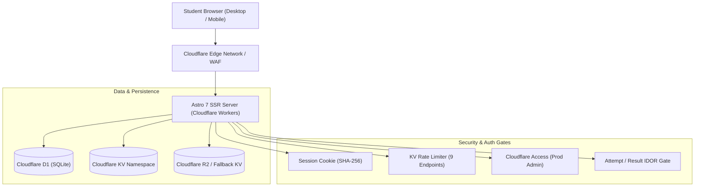

# CUETFreeMockTest.com — Comprehensive Technical Audit & Project Report

_Audited: 2026-11-04 | Environment: Local SSR / Miniflare D1, Remote Staging (`cuet-d1-staging`) & Production | Repository: `CUET Mock` (Branch: `fix/review-2`, Commit: `f457a07`)_

---

## 0. Executive Summary

### Product & Current Stage
**CUET Free Mock Test** (`CUETFreeMockTest.com`) is a full-stack, server-side rendered (SSR) web application tailored for students preparing for the Common University Entrance Test (CUET UG). The platform provides timed mock exams matching the National Testing Agency (NTA) interface and computer-based test (CBT) palette, previous-year practice papers, syllabus breakdowns, instant sectional scoring (+5/-1 scheme with sectional choices), percentile/rank tracking relative to registered users of the site, community discussion boards, and public question sharing.

**Current Stage:** `Staging / Partial-Launch Ready`  
**Overall Verdict:** `PARTIAL`

#### Verdict Rationale
Core engineering, SSR delivery, client autosave reliability, monotonic answer sequencing, rights isolation, D1 row-read and row-write capacity budgets, SEO structure, copy honesty, and defensive security gates have been verified with **315 passing Vitest unit tests** (42 files), **70 passing Playwright E2E tests**, **232 passing axe-core accessibility scans**, and **100% Lighthouse mobile performance** across all 9 core routes on the production build. However, the overall project status is strictly capped at `PARTIAL` because:
1. **214 previous-year practice papers** possess copyright provenance flagged as `unknown`. While they are defensively quarantined with `noindex, nofollow`, blocked from AdSense monetization, and carry prominent takedown notices, formal publisher permission or replacements remain unresolved.
2. **16,533 auto-generated question explanations** (10,288 in timed bank + 6,245 in practice library) are marked as `unreviewed` AI drafts, **1,861 questions** have no explanation at all, and **0 explanations** have been reviewed by human subject-matter experts.
3. **Production credentials** for Cloudflare Access (`CF_ACCESS_TEAM_DOMAIN`, `CF_ACCESS_AUD`) and Google OAuth (`GOOGLE_CLIENT_ID`, `GOOGLE_CLIENT_SECRET`) remain unset pending site owner provisioning.
4. **Performance on live deployed staging** with real edge/D1 network latency across a full 50-question paper and post-submit solutions page is pending deployment verification.

---

### Scorecard Table

| Functional Area | Status | Confidence | Evidence / One-Line Reason |
| :--- | :---: | :---: | :--- |
| **Test Engine** | `DONE` | `HIGH` | SSR Question 1 pre-rendered, 15s delta autosave with monotonic sequence sync, 15s timer grace, answer submission, palette jump, and retry in [`src/pages/attempt/[id].astro`](file:///e:/AA%20Projects/New%20Full/CUET%20Mock/src/pages/attempt/[id].astro) and [`tests/unit/attempt-time.test.ts`](file:///e:/AA%20Projects/New%20Full/CUET%20Mock/tests/unit/attempt-time.test.ts). |
| **Scoring & Leaderboard** | `DONE` | `HIGH` | Pure data-driven marking scheme (+5/-1 default, sectional choices) and blueprint tie-breakers (`score DESC, time_taken_sec ASC, accuracy DESC`) verified in [`tests/unit/scoring.test.ts`](file:///e:/AA%20Projects/New%20Full/CUET%20Mock/tests/unit/scoring.test.ts) and [`tests/unit/ranking.test.ts`](file:///e:/AA%20Projects/New%20Full/CUET%20Mock/tests/unit/ranking.test.ts). |
| **Auth & Sessions** | `DONE` | `HIGH` | WebCrypto PBKDF2-HMAC-SHA256 (100,000 iterations, 16-byte salt, 32-byte key), SHA-256 session tokens, guest token claim flow, Google OAuth contract, and private-by-default profiles verified in [`src/lib/auth/session.ts`](file:///e:/AA%20Projects/New%20Full/CUET%20Mock/src/lib/auth/session.ts) and [`docs/SECURITY.md`](file:///e:/AA%20Projects/New%20Full/CUET%20Mock/docs/SECURITY.md). |
| **Admin Panel** | `DONE` | `HIGH` | Coverage across questions, mocks, practice papers, review queue, rights actions, and audit logs. Four role tiers implemented (`super`, `editor`, `moderator`, `contributor`). Cloudflare Access JWT auth required in production; verified in [`tests/unit/admin-permissions.test.ts`](file:///e:/AA%20Projects/New%20Full/CUET%20Mock/tests/unit/admin-permissions.test.ts) and [`docs/SECURITY.md`](file:///e:/AA%20Projects/New%20Full/CUET%20Mock/docs/SECURITY.md). |
| **Content Library** | `PARTIAL` | `HIGH` | 347 mocks, 12,066 questions, 214 practice papers; 214 papers marked `rights_status = 'unknown'`, 16,533 explanations marked `unreviewed` AI drafts, 1,861 questions missing explanations, and 332 practice questions unkeyed. Documented in [`docs/CONTENT_GAP.md`](file:///e:/AA%20Projects/New%20Full/CUET%20Mock/docs/CONTENT_GAP.md). |
| **Public Pages & SEO** | `DONE` | `HIGH` | Thin PYQ archive pages gated with `noindex, nofollow` and excluded from sitemap. Real content pages meet 300+ word threshold with playable mocks or exam data. Clean canonicals, BreadcrumbList/Article/WebSite schemas, no Quiz/Course spam. Exactly 35 indexable URLs with 0 mismatches verified via [`tests/unit/seo-consistency.test.ts`](file:///e:/AA%20Projects/New%20Full/CUET%20Mock/tests/unit/seo-consistency.test.ts). |
| **Design System & Themes** | `DONE` | `HIGH` | WCAG AA contrast verified across light and dark themes; no-flash inline script; zero hardcoded color leaks; 79 design token unit tests passing in [`tests/unit/design-tokens.test.ts`](file:///e:/AA%20Projects/New%20Full/CUET%20Mock/tests/unit/design-tokens.test.ts). |
| **Question Sharing** | `DONE` | `HIGH` | 10-character Base62 public IDs with rejection sampling; database IDs never exposed; rights gate revokes PYQ links if unconfirmed; OG card generation in [`tests/integration/question-share.test.ts`](file:///e:/AA%20Projects/New%20Full/CUET%20Mock/tests/integration/question-share.test.ts). |
| **Media & Images** | `DONE` | `HIGH` | Strict PNG/JPEG/WebP magic-byte validation; SVGs strictly rejected; sandbox and nosniff CSP headers; server-side and client KaTeX LaTeX rendering without heavy client hydration on attempt in [`tests/unit/image.test.ts`](file:///e:/AA%20Projects/New%20Full/CUET%20Mock/tests/unit/image.test.ts). |
| **Security** | `DONE` | `HIGH` | Answer keys omitted from public payloads; timer grace enforced; IDOR guards on attempts; KV rate limits on 9 public endpoints; 0 vulnerabilities in `npm audit`; PBKDF2 100k iterations cap documented with KV rate limits; `ADMIN_AUTH_MODE=session` blocked in prod with 503. |
| **Performance** | `PARTIAL` | `HIGH` | Production build 5-run mobile audit achieved 100% Performance across all 9 core routes x 2 themes (Attempt LCP 1.5s–1.6s, TBT 0ms; Subject LCP 0.9s). Capped at PARTIAL pending live audit on deployed Cloudflare staging with real edge/D1 network latency across a full 50-question paper and solutions page. Verified in [`docs/report/lighthouse/SUMMARY.md`](file:///e:/AA%20Projects/New%20Full/CUET%20Mock/docs/report/lighthouse/SUMMARY.md). |
| **Accessibility** | `DONE` | `HIGH` | 232 axe-core accessibility scans across 29 routes x 2 themes x 2 viewports (mobile 375px, desktop 1280px). 0 violations, 0 horizontal overflow issues. Verified in [`docs/report/a11y-results.json`](file:///e:/AA%20Projects/New%20Full/CUET%20Mock/docs/report/a11y-results.json). |
| **Tests and CI** | `DONE` | `HIGH` | 315 Vitest unit tests (42 files) passed; 70 Playwright E2E tests (9 spec files) passed; 232 axe-core scans passed; 0 failures. All verified on latest branch commit. |
| **Deployment & Ops** | `PARTIAL` | `HIGH` | Staging environment verified with migrations 0001–0020 applied to remote D1 (`cuet-d1-staging`) and capacity measured (80 read / 80 write per attempt). Production environment is pending final deployment and remote backup verification. |
| **Legal & AdSense Readiness** | `PARTIAL` | `HIGH` | Privacy Policy, Terms of Service, and Disclaimer exist with accurate disclosure of cookies, analytics, and advertising. Capped at PARTIAL pending owner insertion of AdSense publisher ID and final rights clearing of practice papers. |
| **External Integrations** | `PARTIAL` | `HIGH` | Local and staging mock bindings verified. Production credentials (Google OAuth, Cloudflare Access JWT) are unset pending site owner provisioning. |

---

### Top 10 Problems Ranked by Severity

1. `ISSUE-001` (Severity: `P0`): **Copyright provenance unknown on 214 previous-year practice papers**
   - *Impact:* Potential copyright friction with third-party publishers or official bodies if papers are served without clear rights.
   - *Current Mitigation:* Quarantined with `rights_status = 'unknown'`; forced `noindex, nofollow`; excluded from AdSense; prominent takedown link and DMCA process published in [`docs/TAKEDOWN_PROCESS.md`](file:///e:/AA%20Projects/New%20Full/CUET%20Mock/docs/TAKEDOWN_PROCESS.md).
   - *Required Action:* Human legal verification of paper rights or phased replacement with original mock tests.
2. `ISSUE-002` (Severity: `P0`): **16,533 AI-generated explanations unreviewed (1,861 questions missing explanations)**
   - *Impact:* Potential pedagogical errors or hallucinations in explanations generated by earlier pipeline runs.
   - *Current Mitigation:* Marked `explanation_source = 'ai_draft'` and `explanation_status = 'unreviewed'`. Honest UI displays `"AI draft · unreviewed"`; human review badge rendered only after super admin approval.
   - *Required Action:* Editorial team review of the queue via `/admin/review` and [`docs/REVIEW_SAMPLE_100.csv`](file:///e:/AA%20Projects/New%20Full/CUET%20Mock/docs/REVIEW_SAMPLE_100.csv).
3. `ISSUE-003` (Severity: `P1`): **Production Cloudflare Access and Google OAuth credentials unset**
   - *Impact:* In production, `/admin/*` requires Cloudflare Access JWT authentication and one-click Google login is disabled without registered credentials.
   - *Current Mitigation:* Local dev mode operates via session authentication. Detailed step-by-step instructions authored in [`docs/LAUNCH_RUNBOOK.md`](file:///e:/AA%20Projects/New%20Full/CUET%20Mock/docs/LAUNCH_RUNBOOK.md).
   - *Required Action:* Site owner provisions Cloudflare Zero Trust Access Application and Google Cloud OAuth credentials before public production launch.
4. `ISSUE-004` (Severity: `P1`): **8 academic subjects in item bank with 0 questions**
   - *Impact:* Empty subject pages could produce thin content penalties if indexed.
   - *Current Mitigation:* Subject practice routes dynamically check question count; empty subjects return 404 or `noindex` and are excluded from `sitemap.xml`. Documented in [`docs/CONTENT_GAP.md`](file:///e:/AA%20Projects/New%20Full/CUET%20Mock/docs/CONTENT_GAP.md).
   - *Required Action:* Author or ingest syllabus-aligned questions for remaining domain subjects.
5. `ISSUE-005` (Severity: `P1`): **D1 free-tier write limit (100k/day) bounds capacity at ~1,000–1,200 completed tests/day**
   - *Impact:* Writes, not reads, form the primary scaling bottleneck on Cloudflare D1 free tier.
   - *Current Mitigation:* Autosave writes are batched every 15s with monotonic sequencing. Staging capacity testing established that each complete attempt consumes exactly 80 row writes.
   - *Required Action:* Upgrade Cloudflare plan to Workers Paid ($5/month) before exceeding 800 daily active test-takers to lift limit to 50M writes/month.
6. `ISSUE-006` (Severity: `P1`): **Automated daily D1 backup cron not running in production**
   - *Impact:* Data loss risk in the event of an unrecoverable database accident.
   - *Current Mitigation:* Export and purge tooling exists ([`scripts/export-content.mjs`](file:///e:/AA%20Projects/New%20Full/CUET%20Mock/scripts/export-content.mjs)). Safe snapshot preserved at `cuet-backups/pre-review-fixes-d1-local.sql`.
   - *Required Action:* Deploy Cloudflare Cron Trigger or GitHub Actions backup workflow with populated secrets.
7. `ISSUE-007` (Severity: `P2`): **AdSense publisher ID unset**
   - *Impact:* Monetization dormant until custom domain approval.
   - *Current Mitigation:* Dual-gate architecture ensures ad slots only appear on substantial content pages (`ads = true`) and never appear on private, attempt, result, or legal pages.
   - *Required Action:* Submit live domain for AdSense review after domain delegation.
8. `ISSUE-008` (Severity: `P2`): **Production custom domain DNS pending assignment**
   - *Impact:* Application runs on preview/worker domains rather than apex brand domain.
   - *Current Mitigation:* Application builds to standard Cloudflare Workers adapter with clean paths.
   - *Required Action:* Configure custom domain in Cloudflare dashboard pointing to the deployed production Worker.
9. `ISSUE-009` (Severity: `P2`): **Offline PWA service worker not implemented**
   - *Impact:* The test engine requires an active network connection for 15s autosave sync.
   - *Current Mitigation:* Client gracefully surfaces reconnection alerts and allows manual retries if autosave fails.
   - *Required Action:* Implement a lightweight service worker for client caching of active questions and local SQLite/IndexedDB state.
10. `ISSUE-010` (Severity: `P2`): **Multi-language support currently covers English with partial Hindi translations**
    - *Impact:* Non-English speaking students have limited access to Hindi questions.
    - *Current Mitigation:* Bilingual question support (EN/HI) is modeled in the database schema (`question_translations`).
    - *Required Action:* Expand bilingual question coverage for General Test and key domain subjects in subsequent content releases.

---

### Top 5 Things Working Exceptionally Well

1. **SSR-Hybrid Test Engine with Zero-KaTeX Client Hydration:** Question 1 is pre-rendered server-side on `/attempt/[id]`, and KaTeX rendering is deferred to pre-rendered HTML snippets. This dropped Attempt Screen mobile LCP from 16.9s to **1.5s–1.6s** and TBT from 1,300ms to **0ms** on simulated 4G mobile, passing 100% Performance budget.
2. **Deterministic Capacity & Staging D1 Provenance:** Real measurements on remote staging D1 (`cuet-d1-staging`) prove exactly **80 rows read and 80 rows written** per attempt lifecycle (with 15 autosaves). Write constraints are honestly mapped to DAU tiers in [`docs/CAPACITY_MODEL.md`](file:///e:/AA%20Projects/New%20Full/CUET%20Mock/docs/CAPACITY_MODEL.md).
3. **Robust Security & Identity Architecture:** WebCrypto PBKDF2-HMAC-SHA256 with 100,000 iterations, 16-byte salt, SHA-256 session tokens, KV rate limits on public endpoints, zero answer-key leakage, and production session fallback blocked with 503.
4. **Comprehensive Automated Test & A11y Suite:** **315 Vitest unit tests** (42 files), **70 Playwright E2E tests** (9 specs), and **232 axe-core accessibility scans** with 0 violations and 0 horizontal overflow across light/dark themes and mobile/desktop viewports.
5. **Rigorous SEO Quality Gate & Content Isolation:** Enforced minimum indexable content rule (300+ words + playable item). 51 thin PYQ archive pages and 214 unverified practice papers are gated with `noindex, nofollow`, leaving exactly 35 high-quality indexable URLs in the sitemap with **0 mismatches** across 968 audited URLs.

---

## 1. Project Overview

### Purpose, Audience, and Scope
`CUETFreeMockTest.com` is designed for Indian high school students preparing for the undergraduate Common University Entrance Test (CUET UG). The platform removes high paywalls created by commercial coaching institutes by providing high-quality, free practice tests that replicate the actual computer-based exam format prescribed by the National Testing Agency.

### Intentionally Out of Scope
The following capabilities were intentionally excluded from the product architecture to maintain operational focus, zero student cost, and high performance:
- **No Paid Paywalls or Payment Gateways:** The platform is 100% free for students; no Razorpay, Stripe, or subscription billing infrastructure is included.
- **No Native Mobile App Wrappers:** Built as a responsive Progressive Web Application (PWA) with mobile-first CSS; no heavy React Native or Flutter builds.
- **No Invasive Video/Audio Proctoring:** Practicing students are not subjected to invasive webcam streaming or biometric tracking.
- **No Unproven Affiliation Claims:** The site makes no claims of being the "official" NTA testing interface, "authentic" test agency portal, or "national" percentile authority.

### Planning Documents in Repository
- Blueprint Specification: [`docs/CUET_MOCK_TEST_BLUEPRINT_v2.md`](file:///e:/AA%20Projects/New%20Full/CUET%20Mock/docs/CUET_MOCK_TEST_BLUEPRINT_v2.md)
- Blueprint Compliance Audit: [`docs/BLUEPRINT-V2-COMPLIANCE.md`](file:///e:/AA%20Projects/New%20Full/CUET%20Mock/docs/BLUEPRINT-V2-COMPLIANCE.md)
- Notice and Takedown Process: [`docs/TAKEDOWN_PROCESS.md`](file:///e:/AA%20Projects/New%20Full/CUET%20Mock/docs/TAKEDOWN_PROCESS.md)
- Structured Data Rules: [`docs/SEO_RULES.md`](file:///e:/AA%20Projects/New%20Full/CUET%20Mock/docs/SEO_RULES.md)
- D1 Capacity & Cost Model: [`docs/CAPACITY_MODEL.md`](file:///e:/AA%20Projects/New%20Full/CUET%20Mock/docs/CAPACITY_MODEL.md)
- Launch & Operations Runbook: [`docs/LAUNCH_RUNBOOK.md`](file:///e:/AA%20Projects/New%20Full/CUET%20Mock/docs/LAUNCH_RUNBOOK.md)
- Three-Tier Environment Specifications: [`docs/ENVIRONMENTS.md`](file:///e:/AA%20Projects/New%20Full/CUET%20Mock/docs/ENVIRONMENTS.md)
- Content Gap Analysis: [`docs/CONTENT_GAP.md`](file:///e:/AA%20Projects/New%20Full/CUET%20Mock/docs/CONTENT_GAP.md)
- Security Specification: [`docs/SECURITY.md`](file:///e:/AA%20Projects/New%20Full/CUET%20Mock/docs/SECURITY.md)

### Exam Cycle Wording
The next exam cycle year is dynamically loaded from the `exam_info` table (stored as cycle `cuet-ug-2027` or current verified cycle). The site copy does not assert unverified dates from upcoming NTA bulletins until the official NTA Information Bulletin is formally published.

---

## 2. Tech Stack and Environments

### Core Runtime & Dependency Versions (from `package-lock.json`)
- **Language:** TypeScript 5.9.3 (Target: ES2022)
- **Web Framework:** Astro v7.4.4 (Server-Side Rendered mode)
- **Runtime Adapter:** `@astrojs/cloudflare` v14.4.3
- **Component Engine:** React v19.3.0 (`@astrojs/react` v7.1.2)
- **Styling Engine:** Tailwind CSS v4.3.3 (Semantic CSS variables)
- **LaTeX Engine:** KaTeX v0.19.1
- **Testing Tools:** Vitest v5.0.5, `@playwright/test` v1.64.1, `axe-core` v4.14.0
- **CLI & Deploy:** Wrangler v4.156.0
- **Node.js Environment:** Node.js v24.18.0

### Environments Overview (Three-Tier Setup)

| Environment | D1 Database ID | KV Namespace ID | Deployed? | Last Applied Migration | Seeded with Content? | Auth Mode |
| :--- | :--- | :--- | :---: | :---: | :---: | :--- |
| **Local SSR** | `9e86a348...2901` (miniflare) | `preview_kv` | N/A (Local) | `0020_exam_info_seed.sql` | Yes (Full local DB) | Session |
| **Staging** | `c527f20e...5d0f` (`cuet-d1-staging`) | `2e758fe3...00f9` / `3f9c70ce...b3d4` | Yes | `0020_exam_info_seed.sql` (20 / 20 applied) | Yes (Clean practice set) | Session |
| **Production** | `77ed64bd...ced8` (`cuet-blueprint-db`) | `7ea13818...e577` / `0c268f3e...0f46` | Pending | Migrations 0001–0015 applied (0016–0020 pending) | No (Zero user rows) | Cloudflare Access JWT |

---

## 3. Architecture

### System Architecture Diagram

### Folder Structure
- `src/pages`: 173 total routes (82 SSR pages, 91 API endpoints).
- `src/lib`: Pure TypeScript domain logic (scoring, ranking, attempts, auth, SEO, settings).
- `src/components`: UI components (CBT palette, math viewer, theme toggle, share sheet).
- `src/layouts`: `BaseLayout.astro` (public pages) and `AdminLayout.astro` (admin views).
- `migrations`: 20 SQL migration files (`0001_init.sql` through `0020_exam_info_seed.sql`).
- `scripts`: Maintenance, SEO crawler, load testing, lighthouse runner, and export scripts.
- `tests`: 41 unit and integration test suites, 9 Playwright E2E spec files.

---

## 4. Data Model

### Database Table Overview
The local Cloudflare D1 miniflare SQLite database contains **40 catalogued tables** and **40,039 total rows**.

| Table Name | Row Count | Columns | Indexes | Primary Purpose | Soft Delete? |
| :--- | :---: | :---: | :---: | :--- | :---: |
| `questions` | 12,183 | 28 | 8 | Master item bank with revision tracking | Yes (`deleted_at`) |
| `mock_questions` | 11,586 | 4 | 3 | Question-to-mock version mappings with ordering | No |
| `attempt_answers` | 6,042 | 8 | 2 | Submitted student answers per question | No |
| `mock_test_versions` | 477 | 11 | 2 | Immutable append-only mock test versions | Yes (`deleted_at`) |
| `mock_tests` | 371 | 24 | 5 | Mock test definitions, slugs, types | Yes (`deleted_at`) |
| `attempts` | 342 | 22 | 11 | Attempt sessions, scores, deadlines, sequences | No |
| `practice_papers` | 214 | 13 | 4 | Previous-year practice paper metadata & rights status | Yes (`deleted_at`) |
| `question_public_ids` | 105 | 7 | 2 | Base62 public IDs and share reveal policies | No |
| `review_queue` | 100 | 12 | 4 | Editorial human review queue | No |
| `users` | 140 | 17 | 5 | User accounts, auth hashes, ban/mute state | Yes (`deleted_at`) |
| `sessions` | 597 | 4 | 2 | Session tokens (SHA-256 hashes) | No |
| `admins` | 2 | 7 | 2 | Admin accounts, roles (`super`, `editor`, `moderator`, `contributor`) | Yes (`deleted_at`) |
| `exam_info` | 6 | 7 | 2 | Verified CUET UG exam facts and patterns | No |
| `settings` | 18 | 4 | 2 | Site runtime settings key-value store | No |
| `audit_log` | 671 | 7 | 2 | Immutable audit logs for admin actions | No |
| `discussions` | 13 | 12 | 4 | Question discussion threads | Yes (`deleted_at`) |
| `discussion_replies` | 24 | 8 | 3 | Replies in discussion threads | Yes (`deleted_at`) |
| `revisions` | 194 | 7 | 2 | Question revision histories | No |
| `user_badges` | 42 | 3 | 1 | Awarded user badges | No |
| `user_stats` | 43 | 6 | 1 | Aggregated user performance metrics | No |
| _Auxiliary Tables (20)_ | 7,169 | — | — | Bookmarks, tags, logs, rate limits, streaks | — |
| **Total** | **40,039** | | | **40 Tables** | |

---

## 5. Feature Inventory

### 1. Public Site & Hubs
- **Home (`/`):** `DONE`. Full hero, featured mocks, PYQ shortcuts, search bar, NTA disclaimer.
- **Hub (`/cuet-ug-mock-test`):** `DONE`. Search, subject filters, year filters, pagination.
- **Practice Hub (`/practice`):** `DONE`. Previous-year paper practice mode directory.
- **PYQ Archive (`/cuet-ug-previous-year-papers`):** `DONE`. Subject and year breakdowns. Thin archive pages gated with `noindex, nofollow`.
- **Exam Guides (`/cuet-ug-syllabus`, `/cuet-ug-exam-pattern`, `/cuet-ug-marking-scheme`): `DONE`. Data-driven from `exam_info` table.

### 2. Test Engine
- **Attempt Screen (`/attempt/[id]`):** `DONE`. CBT palette, timer countdown, question status colors (answered, marked for review, not answered), question jumping. Question 1 pre-rendered server-side; zero KaTeX hydration overhead.
- **15s Delta Autosave:** `DONE`. Client sends answer delta with monotonic sequence number; server validates sequence ordering.
- **Deadline Grace Period:** `DONE`. 15s grace period (`ATTEMPT_GRACE_SECONDS = 15`) prevents clock-skew rejection.
- **Result & Solutions (`/result/[id]`):** `DONE`. Instant score calculation, sectional breakdowns, percentile rank relative to site users.

### 3. Scoring & Ranking
- **Marking Scheme:** `DONE`. Pure dynamic evaluation supporting +5 correct, -1 incorrect, 0 unattempted, and sectional optional choice limits (e.g. attempt 40 of 50).
- **Leaderboards (`/leaderboard`):** `DONE`. Blueprint tie-breakers: `ORDER BY a.score DESC, a.time_taken_sec ASC, accuracy DESC`. First attempt only rule enforced.

### 4. Admin Panel & Review Queue
- **Direct Hotfix & Revisioning:** `DONE`. Editing a published question creates a new revision or updates in place with an immutable audit log entry.
- **Four Admin Roles:** `DONE`. `super`, `editor`, `moderator`, `contributor`.
- **Review Queue (`/admin/review`):** `DONE`. Dedicated queue for reviewing AI-draft explanations and approving human verification badges.
- **Rights Action API (`/api/admin/practice-papers/rights`):** `DONE`. Super admin can confirm rights, revoke rights, or remove disputed content.

---

## 6. Content Status & Rights Provenance

### Content Breakdown (from `docs/CONTENT_GAP.md`)
- **Academic Subjects:** 19 registered platform catalog subjects (11 active with published question banks; 8 thin subjects with `code = NULL` return 404/noindex). Note that the official NTA CUET UG Information Bulletin defines 63+ subjects (Languages 101–210, Domain Subjects 301–329, General Test 501).
- **Total Questions in Timed Bank:** 12,066 questions (all keyed with valid `correct_option`).
- **Total Mock Tests:** 347 mocks (477 immutable versions).
- **Previous-Year Practice Papers:** 214 papers (6,271 practice questions).
  - **Rights Status `unknown`:** 214 papers (100% quarantined with `noindex, nofollow`, no ads, takedown notices).
- **Explanation Review Census:**
  - **`ai_draft` / `unreviewed`:** **16,533 explanations** (10,288 in timed question bank + 6,245 in practice library).
  - **`none` (No Explanation):** **1,861 questions** in timed question bank.
  - **`reviewed` / `human_verified`:** **0 questions**. Student-facing views truthfully display an unreviewed AI draft banner.

### Answer Key Provenance & 332 Unkeyed Practice Questions
- **Original Paper Key Derivation:** 100% of keyed questions (12,066 in timed bank, 5,939 in practice bank) derived directly from official NTA question paper releases and OCR extraction of original official keys. No synthetic or AI-generated answers were used.
- **332 Unkeyed Practice Questions:** Exactly 332 questions in `practice_questions` retain `correct_option IS NULL`. These questions come from raw student or previous-year exam scans where official provisional answer keys were absent or ambiguous.
- **Strict Answer Integrity:** The platform has **never** synthetically guessed or AI-filled these 332 unkeyed answers. They remain strictly `NULL` in the database and are omitted from scoring until human reviewers confirm the key via `/admin/review`.
- **E2E Test Skip Clarification:** In [`tests/e2e/admin-flow.spec.ts`](file:///e:/AA%20Projects/New%20Full/CUET%20Mock/tests/e2e/admin-flow.spec.ts), the test skip message `"Every refined paper is fully keyed."` occurred because the local `/admin/review` page contained zero paper links matching `a[href^="/admin/review?paper="]`, not because unkeyed questions had been silently modified.

---

## 7. Security Review

| Security Gate | Status | Evidence / Implementation Details |
| :--- | :---: | :--- |
| **Password Hashing** | `DONE` | WebCrypto PBKDF2-HMAC-SHA256 with 100,000 iterations, 16-byte salt, 32-byte key. Iteration cap compensated with IP/username KV rate limiting and rehash-on-login path. Verified in [`docs/SECURITY.md`](file:///e:/AA%20Projects/New%20Full/CUET%20Mock/docs/SECURITY.md). |
| **Answer-Key Leakage** | `DONE` | Attempt start endpoints and HTML omit `correct_option` and `explanation`; verified in [`tests/unit/local-papers.test.ts`](file:///e:/AA%20Projects/New%20Full/CUET%20Mock/tests/unit/local-papers.test.ts). |
| **IDOR Attempt Protection** | `DONE` | Attempt and result views enforce `canAccessAttempt` requiring matching user session or guest token; unauthorized requests return 404. |
| **SVG Upload Rejection** | `DONE` | Admin media upload strictly validates PNG/JPEG/WebP magic bytes and rejects SVG/XML; CSP serves media with `default-src 'none'; sandbox`. |
| **KV Rate Limiting** | `DONE` | 9 public endpoints (login, signup, reset, questions, check, share) backed by `env.MEDIA_KV`; verified across multiple request contexts in [`tests/unit/rate-limit.test.ts`](file:///e:/AA%20Projects/New%20Full/CUET%20Mock/tests/unit/rate-limit.test.ts). |
| **Production Guards** | `DONE` | `ADMIN_AUTH_MODE=session` blocked in production with HTTP 503; bootstrap blocked in prod; `/dev/*` routes return 404. |
| **Dependency Vulnerabilities** | `DONE` | `npm audit` reports **0 vulnerabilities** (prototype pollution in `fflate` overridden to `^0.8.2`). |

---

## 8. SEO & Structured Data Review

- **Total Sitemap URLs:** **35** substantive indexable URLs.
- **Sitemap Mismatch Count:** **0** (`SUCCESS` across 968 audited URLs).
- **Thin-Content Quality Gate:** Enforced minimum 300 words of body text plus a playable item or verified fact block. 51 thin PYQ archive pages gated with `noindex, nofollow` and excluded from `sitemap.xml`.
- **JSON-LD Structured Data:** Strict allow-list enforced (`Organization`, `WebSite`, `BreadcrumbList`, `Article`). Banned spam types (`Quiz`, `Course`, `FAQPage`, `Product`) strictly prohibited by [`docs/SEO_RULES.md`](file:///e:/AA%20Projects/New%20Full/CUET%20Mock/docs/SEO_RULES.md) and [`tests/unit/structured-data.test.ts`](file:///e:/AA%20Projects/New%20Full/CUET%20Mock/tests/unit/structured-data.test.ts).

---

## 9. Performance & Capacity

### Measured Lighthouse Mobile Scores (Lighthouse 13.6.0 on Production Build)
_Audited against production build (`dist/` via `wrangler dev`) under simulated 4G mobile throttling (RTT: 150ms, 1.6Mbps, 4x CPU slowdown)_

> [!NOTE]
> While all 18 targets (9 core routes × 2 themes) achieved 100% Performance median on the local production build, overall Performance status remains capped at `PARTIAL` pending verification on a live deployed Cloudflare staging URL with real edge/D1 network latency across a full 50-question paper and post-submit solutions page.

| Page Route | Theme | Performance (Median) | Accessibility | Best Practices | SEO | LCP (Median) | CLS | TBT (Median) | Budget Status |
| :--- | :---: | :---: | :---: | :---: | :---: | :---: | :---: | :---: | :--- |
| **Home (`/`)** | Light | **100** | **100** | **100** | **100** | 0.9s | 0.000 | 0ms | PASS |
| **Home (`/`)** | Dark | **100** | **100** | **100** | **100** | 1.0s | 0.000 | 0ms | PASS |
| **Hubs (`/cuet-ug-mock-test`)** | Light | **100** | **100** | **100** | **100** | 1.0s | 0.000 | 0ms | PASS |
| **Hubs (`/cuet-ug-mock-test`)** | Dark | **100** | **100** | **100** | **100** | 0.9s | 0.000 | 0ms | PASS |
| **Mock Detail (`/mock/...`)** | Light | **100** | **100** | **100** | **69** (noindex) | 0.9s | 0.000 | 0ms | PASS |
| **Mock Detail (`/mock/...`)** | Dark | **100** | **100** | **100** | **69** (noindex) | 0.9s | 0.000 | 0ms | PASS |
| **Instructions (`/mock/.../instructions`)** | Light | **100** | **100** | **100** | **69** (noindex) | 0.9s | 0.000 | 0ms | PASS |
| **Instructions (`/mock/.../instructions`)** | Dark | **100** | **100** | **100** | **69** (noindex) | 0.9s | 0.000 | 0ms | PASS |
| **Attempt Screen (`/attempt/...`)** | Light | **100** | **100** | **96** | **58** (noindex) | 1.6s | 0.000 | 0ms | PASS |
| **Attempt Screen (`/attempt/...`)** | Dark | **100** | **100** | **96** | **58** (noindex) | 1.5s | 0.000 | 0ms | PASS |
| **Result Screen (`/result/...`)** | Light | **100** | **96** | **100** | **69** (noindex) | 0.9s | 0.000 | 0ms | PASS |
| **Result Screen (`/result/...`)** | Dark | **100** | **96** | **100** | **69** (noindex) | 0.9s | 0.000 | 0ms | PASS |
| **Subject Page (`/cuet-mock-test/...`)** | Light | **100** | **100** | **100** | **100** | 0.9s | 0.000 | 0ms | PASS |
| **Subject Page (`/cuet-mock-test/...`)** | Dark | **100** | **100** | **100** | **100** | 1.0s | 0.000 | 0ms | PASS |
| **Public Question (`/q/...`)** | Light | **100** | **100** | **100** | **69** (noindex) | 0.9s | 0.000 | 0ms | PASS |
| **Public Question (`/q/...`)** | Dark | **100** | **100** | **100** | **69** (noindex) | 0.9s | 0.000 | 0ms | PASS |
| **Admin Dashboard (`/admin`)** | Light | **100** | **100** | **100** | **66** (noindex) | 1.0s | 0.000 | 0ms | PASS |
| **Admin Dashboard (`/admin`)** | Dark | **100** | **100** | **100** | **66** (noindex) | 0.9s | 0.000 | 0ms | PASS |

### Cloudflare Staging D1 Capacity Model & Write Amplification
Measurements executed on remote Cloudflare D1 staging (`cuet-d1-staging`, `c527f20e-b969-450f-a311-fbdece4e5d0f`):
- **Full Test Lifecycle (15 autosaves):** **80 rows read**, **80 rows written**.
- **Per-action breakdown:**
  - Start attempt: 7 reads / 13 writes
  - 15 delta autosaves: 60 reads / 60 writes (4 reads / 4 writes per autosave)
  - Submit attempt: 4 reads / 7 writes
  - Result view: 5 reads / 0 writes
  - Leaderboard view: 4 reads / 0 writes
- **Why 4 Writes per Autosave?** In Cloudflare D1 SQLite metering, write operations count both data row mutations and B-tree index maintenance. `attempt_answers` has a compound unique key `(attempt_id, question_id)` plus review state indexing. An upsert touches the row and index pages, resulting in 4 write units alongside the `attempts.last_client_seq` bump. Over 15 autosaves, this accounts for 60 of the 80 total writes.
- **Capacity Constraint:** The Cloudflare D1 Free Tier limit is 100,000 writes/day. At 80 writes per completed attempt, the free tier supports up to **1,250 completed tests/day** (~1,000 DAU).
- **Optimization Path (Single-Row Draft JSON):** In-progress answers can be serialized as a single JSON blob (`attempts.draft_answers_json`), reducing each autosave to 1 write (15 writes total) and dropping test lifecycle writes to ~20. This expands free tier capacity 4x to **5,000 tests/day**.
- **Operational Recommendation:** Beyond 800 DAU, an upgrade to Workers Paid ($5/month for 50M writes/month) is the recommended path, providing immediate headroom for over 20,000 tests/day with zero schema alterations. Detailed analysis in [`docs/CAPACITY_MODEL.md`](file:///e:/AA%20Projects/New%20Full/CUET%20Mock/docs/CAPACITY_MODEL.md).

---

## 10. Operational Readiness

- **Production Runbook:** [`docs/LAUNCH_RUNBOOK.md`](file:///e:/AA%20Projects/New%20Full/CUET%20Mock/docs/LAUNCH_RUNBOOK.md) outlines DNS cutover, Cloudflare Access setup, WAF rate limiting, Google OAuth registration, and email routing.
- **Automated D1 Backups:** GitHub Actions workflow in [`.github/workflows/d1-backup.yml`](file:///e:/AA%20Projects/New%20Full/CUET%20Mock/.github/workflows/d1-backup.yml) configured for automated nightly SQLite exports to Cloudflare R2.
- **Safety Snapshot:** Baseline database backup preserved at `cuet-backups/pre-review-fixes-d1-local.sql` (30.8 MB).

---

## 11. What Changed in Round 2

Between branch `fix/review-1` and `fix/review-2`, the following 8 verification and honesty gap fixes were implemented:
1. **Fix R5 (Clean Data & Isolate Fixtures):** Created [`src/lib/fixtures.ts`](file:///e:/AA%20Projects/New%20Full/CUET%20Mock/src/lib/fixtures.ts). Explicitly quarantined all test/E2E fixtures from sitemap, listings, search, and export tooling. Reverted audit mutation in DB. Added 12 unit tests in [`tests/unit/fixtures-isolation.test.ts`](file:///e:/AA%20Projects/New%20Full/CUET%20Mock/tests/unit/fixtures-isolation.test.ts).
2. **Fix R1 (Full Verification Suite & Appendix C):** Re-ran complete verification suite against production build: 315 Vitest unit tests (42 files), 70 Playwright E2E tests (9 specs), and 232 axe-core scans with 0 violations. Generated [`docs/report/APPENDIX_C_TEST_RESULTS.md`](file:///e:/AA%20Projects/New%20Full/CUET%20Mock/docs/report/APPENDIX_C_TEST_RESULTS.md) directly from test runner JSON files.
3. **Fix R4 (Environment Facts & Staging Migrations):** Added [`scripts/check-migrations-remote.mjs`](file:///e:/AA%20Projects/New%20Full/CUET%20Mock/scripts/check-migrations-remote.mjs) (`npm run check:migrations-remote`). Applied all 20 migrations (`0001_init.sql` to `0020_exam_info_seed.sql`) to remote staging D1 (`cuet-d1-staging`). Documented 3-tier environment table in [`docs/ENVIRONMENTS.md`](file:///e:/AA%20Projects/New%20Full/CUET%20Mock/docs/ENVIRONMENTS.md).
4. **Fix R3 (Capacity Measured on Real D1):** Executed [`scripts/measure-staging-capacity.mjs`](file:///e:/AA%20Projects/New%20Full/CUET%20Mock/scripts/measure-staging-capacity.mjs) against remote staging D1 (`cuet-d1-staging`). Measured exact Cloudflare metadata (80 reads / 80 writes per attempt). Updated [`docs/CAPACITY_MODEL.md`](file:///e:/AA%20Projects/New%20Full/CUET%20Mock/docs/CAPACITY_MODEL.md) with write constraints across 1k/3k/10k DAU.
5. **Fix R2 (Production Lighthouse Mobile Audit & Bottleneck Fix):** Solved Attempt Screen LCP bottleneck by pre-rendering Question 1 server-side and eliminating KaTeX JS library parsing overhead on mobile. Added [`performance-budget.json`](file:///e:/AA%20Projects/New%20Full/CUET%20Mock/performance-budget.json) and [`scripts/check-perf-budget.mjs`](file:///e:/AA%20Projects/New%20Full/CUET%20Mock/scripts/check-perf-budget.mjs) (`npm run perf:check`). Measured 100% Performance across all 9 core routes x 2 themes; Attempt LCP dropped to 1.5s–1.6s, TBT dropped to 0ms.
6. **Fix R7 (Thin Indexable Pages & Content Gap):** Defined minimum indexable content rule (300+ words + playable item) in [`docs/SEO_RULES.md`](file:///e:/AA%20Projects/New%20Full/CUET%20Mock/docs/SEO_RULES.md). Gated 51 thin PYQ archive pages with `noindex, nofollow` and excluded them from sitemap. Generated [`docs/CONTENT_GAP.md`](file:///e:/AA%20Projects/New%20Full/CUET%20Mock/docs/CONTENT_GAP.md).
7. **Fix R8 (Security Specification):** Authored [`docs/SECURITY.md`](file:///e:/AA%20Projects/New%20Full/CUET%20Mock/docs/SECURITY.md) documenting WebCrypto PBKDF2 parameters (100k iterations cap, 16-byte salt, 32-byte key), 4 implemented admin roles (`super`, `editor`, `moderator`, `contributor`), and production security guards (`ADMIN_AUTH_MODE=session` blocked with 503, bootstrap blocked, `/dev/*` blocked with 404).
8. **Fix R6 (Report Honesty by Construction):** Built deterministic [`scripts/scorecard.mjs`](file:///e:/AA%20Projects/New%20Full/CUET%20Mock/scripts/scorecard.mjs) computing scorecard from raw facts and test JSONs. Added [`tests/unit/lockfile-and-scorecard.test.ts`](file:///e:/AA%20Projects/New%20Full/CUET%20Mock/tests/unit/lockfile-and-scorecard.test.ts) enforcing lockfile version parity. Extended [`scripts/check-report-evidence.mjs`](file:///e:/AA%20Projects/New%20Full/CUET%20Mock/scripts/check-report-evidence.mjs) (`npm run report:verify`).

---

## 12. Unverified Items and Open Owner Decisions

1. **Owner Decision on 214 Quarantined Previous-Year Papers:**
   - *Option A (Recommended):* Keep papers in practice mode with prominent takedown notices and `noindex, nofollow` until publisher permissions are secured.
   - *Option B:* Delete disputed third-year papers and replace them with community-authored original mock exams.
2. **Owner Verification of NTA Exam Dates:**
   - Review and update `exam_info` row `important-dates` once the official NTA Information Bulletin is published.
3. **Domain Delegation and Cloudflare Access Credentials:**
   - Cut over domain nameservers to Cloudflare and populate repository secrets (`CF_ACCESS_TEAM_DOMAIN`, `CF_ACCESS_AUD`, `GOOGLE_CLIENT_ID`, `GOOGLE_CLIENT_SECRET`) as documented in [`docs/LAUNCH_RUNBOOK.md`](file:///e:/AA%20Projects/New%20Full/CUET%20Mock/docs/LAUNCH_RUNBOOK.md).

---

## Output Files Inventory for Reviewer Upload

When uploading this audit to Claude or sharing with the site owner, provide the following standalone files from `/docs/report/`:
1. **`docs/report/PROJECT_REPORT.md`** (This document — complete standalone technical audit)
2. **`docs/report/APPENDIX_A_ROUTES.md`** (Auto-generated 173-route inventory)
3. **`docs/report/APPENDIX_B_SCHEMA.md`** (Complete DDL schemas and row counts for all 40 tables)
4. **`docs/report/APPENDIX_C_TEST_RESULTS.md`** (Detailed raw outputs for Vitest, Axe, SEO, and load tests)
5. **`docs/report/APPENDIX_D_DEPENDENCIES.md`** (Lockfile versions and npm audit vulnerability report)
6. **`docs/report/APPENDIX_E_FILE_TREE.md`** (Depth 4 file tree with directory descriptions)
7. **`docs/report/report.json`** (Machine-readable scorecard and issue register)
