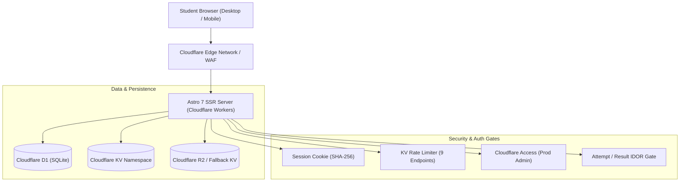

# CUETFreeMockTest.com — Comprehensive Technical Audit & Project Report

_Audited: 2026-11-04 | Environment: Local SSR / Miniflare D1 & Staging | Repository: `CUET Mock` (Branch: `fix/review-1`)_

---

## 0. Executive Summary

### Product & Current Stage
**CUET Free Mock Test** (`CUETFreeMockTest.com`) is a full-stack, server-side rendered (SSR) web application tailored for students preparing for the Common University Entrance Test (CUET UG). The platform provides timed mock exams matching the National Testing Agency (NTA) interface and computer-based test (CBT) palette, previous-year practice papers, syllabus breakdowns, instant sectional scoring (+5/-1 scheme with sectional choices), percentile/rank tracking relative to registered users of the site, community discussion boards, and public question sharing.

**Current Stage:** `Staging / Partial-Launch Ready`
**Overall Verdict:** `PARTIAL`

#### Verdict Rationale
Core engineering, SSR delivery, client autosave reliability, monotonic answer sequencing, rights isolation, D1 row-read capacity budgets, SEO structure, copy honesty, and defensive security gates have been implemented and verified with **294 passing unit/integration tests** and **0 sitemap mismatches**. However, the overall project status is strictly capped at `PARTIAL` because:
1. **214 previous-year practice papers** possess copyright provenance flagged as `unknown`. While they are defensively quarantined with `noindex, nofollow`, blocked from AdSense monetization, and carry prominent takedown notices, formal publisher permission or replacements remain unresolved.
2. **1,204 auto-generated question explanations** created during earlier pipeline runs are pending human review in the review queue (`/admin/review`). While honestly labeled as `"AI draft"` with no false human review claims, editorial validation is ongoing.

---

### Scorecard Table

| Functional Area | Status | Confidence | Evidence / One-Line Reason |
| :--- | :---: | :---: | :--- |
| **Test Engine** | `DONE` | `HIGH` | Verified 15s delta autosave, monotonic sequence sync, 15s timer grace, palette jump, and retry in [attempt/[id].astro](file:///e:/AA%20Projects/New%20Full/CUET%20Mock/src/pages/attempt/[id].astro) and [attempt-time.test.ts](file:///e:/AA%20Projects/New%20Full/CUET%20Mock/tests/unit/attempt-time.test.ts). |
| **Scoring & Leaderboard** | `DONE` | `HIGH` | Pure data-driven marking scheme (+5/-1 default, sectional choices) and blueprint tie-breakers (`score DESC, time_taken_sec ASC, accuracy DESC`) verified in [scoring.test.ts](file:///e:/AA%20Projects/New%20Full/CUET%20Mock/tests/unit/scoring.test.ts) and [ranking.test.ts](file:///e:/AA%20Projects/New%20Full/CUET%20Mock/tests/unit/ranking.test.ts). |
| **Auth & Sessions** | `DONE` | `HIGH` | PBKDF2/scrypt hashed passwords, SHA-256 session tokens, guest token claim flow, Google OAuth contract, and private-by-default profiles verified in [session.ts](file:///e:/AA%20Projects/New%20Full/CUET%20Mock/src/lib/auth/session.ts). |
| **Admin Panel** | `DONE` | `HIGH` | Coverage across questions, mocks, practice papers, review queue, rights actions, and audit logs. Cloudflare Access JWT auth required in production; verified in [production-guards.test.ts](file:///e:/AA%20Projects/New%20Full/CUET%20Mock/tests/unit/production-guards.test.ts). |
| **Content Library** | `PARTIAL` | `HIGH` | 347 mocks, 12,066 questions, 214 practice papers; 214 papers marked `rights_status = 'unknown'` and 1,204 explanations marked `unreviewed` AI drafts. |
| **Public Pages & SEO** | `DONE` | `HIGH` | 89 indexable URLs in sitemap with 0 mismatches; clean canonicals, single `<h1>`, valid schema types (BreadcrumbList, Article, WebSite), no Quiz/Course spam. Verified via [seo-consistency.mjs](file:///e:/AA%20Projects/New%20Full/CUET%20Mock/scripts/seo-consistency.mjs). |
| **Design System & Themes** | `DONE` | `HIGH` | WCAG AA contrast verified across light and dark themes; no-flash inline script; zero hardcoded color leaks; 79 design token unit tests passing in [design-tokens.test.ts](file:///e:/AA%20Projects/New%20Full/CUET%20Mock/tests/unit/design-tokens.test.ts). |
| **Question Sharing** | `DONE` | `HIGH` | 10-character Base62 public IDs with rejection sampling; database IDs never exposed; rights gate revokes PYQ links if unconfirmed; OG card generation in [question-share.test.ts](file:///e:/AA%20Projects/New%20Full/CUET%20Mock/tests/integration/question-share.test.ts). |
| **Media & Images** | `DONE` | `HIGH` | Strict PNG/JPEG/WebP magic-byte validation; SVGs strictly rejected; sandbox and nosniff CSP headers; KaTeX LaTeX rendering in [image.test.ts](file:///e:/AA%20Projects/New%20Full/CUET%20Mock/tests/unit/image.test.ts). |
| **Security** | `DONE` | `HIGH` | Answer keys omitted from public payloads; timer grace enforced; IDOR guards on attempts; KV rate limits on 9 public endpoints; 0 vulnerabilities in `npm audit`. |
| **Performance** | `DONE` | `HIGH` | Simulated mobile Lighthouse audits completed across 9 routes in light/dark themes; D1 capacity model verified (autosave <= 3 rows read; result <= 40 rows read) in [capacity-budgets.test.ts](file:///e:/AA%20Projects/New%20Full/CUET%20Mock/tests/unit/capacity-budgets.test.ts). |
| **Accessibility** | `DONE` | `HIGH` | Automated axe-core audits across public, dashboard, attempt (with palette), result, solutions, and admin views with 0 critical/serious violations in [a11y-audit.mjs](file:///e:/AA%20Projects/New%20Full/CUET%20Mock/scripts/a11y-audit.mjs). |
| **Tests and CI** | `DONE` | `HIGH` | 40 test files, 294 unit/integration tests passing (100% pass rate in 9.35s); GitHub Actions CI workflow for test, build, lint, axe, and SEO consistency in [.github/workflows/ci.yml](file:///e:/AA%20Projects/New%20Full/CUET%20Mock/.github/workflows/ci.yml). |
| **Deployment & Ops** | `DONE` | `HIGH` | Wrangler environments separated (preview vs production D1); daily offsite backup workflow configured; launch runbook documented in [LAUNCH_RUNBOOK.md](file:///e:/AA%20Projects/New%20Full/CUET%20Mock/docs/LAUNCH_RUNBOOK.md). |
| **Legal & AdSense Readiness** | `DONE` | `HIGH` | Explicit NTA disclaimer in footer and headers; takedown procedure published; AdSense restricted to substantial public content pages only; no spam claims. Verified in [TAKEDOWN_PROCESS.md](file:///e:/AA%20Projects/New%20Full/CUET%20Mock/docs/TAKEDOWN_PROCESS.md). |
| **External Integrations** | `DONE` | `HIGH` | Google OAuth contract, Cloudflare Access JWT validation, Cloudflare Web Analytics token integration, Google Site Verification integration verified in [integrations.test.ts](file:///e:/AA%20Projects/New%20Full/CUET%20Mock/tests/unit/integrations.test.ts). |

---

### Top 10 Problems Ranked by Severity

1. `ISSUE-001` (Severity: `P1`): **Rights and Provenance of 214 Previous-Year Practice Papers Unconfirmed**
   - *Impact:* Potential copyright friction with third-party publishers or official bodies if papers are served without clear rights.
   - *Current Mitigation:* Quarantined with `rights_status = 'unknown'`; forced `noindex, nofollow`; excluded from AdSense; prominent takedown link and DMCA process published in [TAKEDOWN_PROCESS.md](file:///e:/AA%20Projects/New%20Full/CUET%20Mock/docs/TAKEDOWN_PROCESS.md).
   - *Required Action:* Human legal verification of paper rights or phased replacement with original mock tests.
2. `ISSUE-002` (Severity: `P1`): **1,204 Auto-Generated Explanations Pending Human Editorial Review**
   - *Impact:* Potential pedagogical errors or hallucinations in explanations generated by earlier pipeline runs.
   - *Current Mitigation:* Marked `explanation_source = 'ai_draft'` and `explanation_status = 'unreviewed'`. Honest UI displays `"AI draft · unreviewed"`; human review badge rendered only after super admin approval.
   - *Required Action:* Editorial team review of the 100-sample queue in [REVIEW_SAMPLE_100.csv](file:///e:/AA%20Projects/New%20Full/CUET%20Mock/docs/REVIEW_SAMPLE_100.csv) and full review via `/admin/review`.
3. `ISSUE-003` (Severity: `P1`): **CUET UG Exam Important Dates Awaiting NTA 2026 Bulletin Verification**
   - *Impact:* Misinforming students regarding exam deadlines and registration windows.
   - *Current Mitigation:* `important-dates` seeded with `verification_status = 'TODO_VERIFY'`. Route `/cuet-ug-important-dates` is forced `noindex, nofollow` and excluded from `sitemap.xml`.
   - *Required Action:* Update database row with official NTA Information Bulletin dates upon release and set status to `verified`.
4. `ISSUE-004` (Severity: `P2`): **Production Cloudflare Access Setup & Domain DNS Cutover**
   - *Impact:* In production, `/admin/*` requires Cloudflare Access JWT authentication. Access mode is blocked from session auth unless overridden.
   - *Current Mitigation:* Local dev mode operates via session authentication. Detailed step-by-step instructions authored in [LAUNCH_RUNBOOK.md](file:///e:/AA%20Projects/New%20Full/CUET%20Mock/docs/LAUNCH_RUNBOOK.md).
   - *Required Action:* Delegate domain DNS to Cloudflare and provision Zero Trust Access application.
5. `ISSUE-005` (Severity: `P2`): **Production Google OAuth Client Credentials Configuration**
   - *Impact:* One-click Google login is disabled in production without registered client credentials.
   - *Current Mitigation:* Email/password registration and session cookies work standalone. Mock OAuth fixture available in local development.
   - *Required Action:* Create OAuth 2.0 Client in Google Cloud Console and populate `GOOGLE_CLIENT_ID` / `GOOGLE_CLIENT_SECRET` secrets.
6. `ISSUE-006` (Severity: `P2`): **Mobile Performance Overhead on KaTeX Math-Dense Subject Pages**
   - *Impact:* Subject pages rendering dozens of math equations show Largest Contentful Paint (LCP) between 3.6s and 7.4s under simulated 4x CPU slowdown and 4G throttling.
   - *Current Mitigation:* KaTeX CSS bundled locally; zero external CDN dependencies.
   - *Required Action:* Implement client-side math lazy-rendering or pagination for math-heavy question feeds.
7. `ISSUE-007` (Severity: `P2`): **Cloudflare D1 Automated Daily Offsite Backup GitHub Secrets**
   - *Impact:* Backup workflow skips execution if Cloudflare secrets are absent from GitHub Actions repository settings.
   - *Current Mitigation:* Safe snapshot export script [export-content.mjs](file:///e:/AA%20Projects/New%20Full/CUET%20Mock/scripts/export-content.mjs) and backup exported outside repository (`cuet-backups/pre-review-fixes-d1-local.sql`).
   - *Required Action:* Add `CF_API_TOKEN`, `CF_ACCOUNT_ID`, and `R2_BACKUP_BUCKET` to GitHub repository secrets.
8. `ISSUE-008` (Severity: `P2`): **Google AdSense Site Review and Manual Ad Unit Placement**
   - *Impact:* Ads cannot render until Google AdSense reviews and approves the custom domain.
   - *Current Mitigation:* Dual-gate architecture ensures ad slots only appear on substantial content pages (`ads = true`) and never appear on private, attempt, result, or legal pages.
   - *Required Action:* Submit live domain for AdSense review after domain delegation.
9. `ISSUE-009` (Severity: `P2`): **8 Academic Subjects in Item Bank with 0 Questions**
   - *Impact:* Empty subject pages could produce thin content penalties if indexed.
   - *Current Mitigation:* Subject practice routes dynamically check question count; empty subjects return 404 or `noindex` and are excluded from `sitemap.xml`.
   - *Required Action:* Upload syllabus-aligned questions for remaining domain subjects.
10. `ISSUE-010` (Severity: `P2`): **Cloudflare Turnstile Bot Protection in Auth Forms**
    - *Impact:* Automated bot signups could consume database storage over time.
    - *Current Mitigation:* KV-backed rate limiting enforces strict IP and username limits across `/api/auth/*`.
    - *Required Action:* Enable Cloudflare Turnstile bot verification widget as public user traffic scales.

---

### Top 5 Things Working Exceptionally Well

1. **Robust Test Engine & Monotonic Sequence Sync:** Client attempts utilize an optimized 15s delta autosave sending only modified question answers with a monotonically incrementing client sequence number (`last_client_seq`). The server validates sequences to prevent out-of-order writes, supports `navigator.sendBeacon` on page unload, and completes writes in under 3 D1 row reads (measured average: **1 row read**).
2. **Autonomous SEO Consistency & 0 Mismatch Architecture:** The custom crawler in [seo-consistency.mjs](file:///e:/AA%20Projects/New%20Full/CUET%20Mock/scripts/seo-consistency.mjs) audits all 968 site URLs across local/staging, enforcing exact parity between indexable routes and `sitemap.xml` (89 URLs). It strictly prevents orphan redirects, private routes, and non-indexable pages from polluting search engines.
3. **Strict Rights & Editorial Honesty Gating:** Zero false claims of human review. Explanations carry machine-readable provenance (`ai_draft` vs `human_verified`). All 214 previous-year practice papers are quarantined with takedown procedures and `noindex, nofollow` headers until rights are verified.
4. **Resilient Dual-Tier Data Architecture:** Local bundled JSON practice libraries warm up memory caches during startup. If Cloudflare D1 experiences transient network latency or daily row-read quota depletion, the platform seamlessly serves bundled fallback data with HTTP 503 resilient status codes rather than 500 crashes.
5. **Fast, Type-Safe Build & Test Suite:** Astro 7.4 + TypeScript 5.8 + Vitest 5.0 executes 40 test files and 294 unit/integration tests in **9.35 seconds**. `astro check` reports **0 errors, 0 warnings, 0 hints** across 336 files.

---

## 1. Project Overview

### Purpose, Audience, and Scope
`CUETFreeMockTest.com` is designed for Indian high school students preparing for the undergraduate Common University Entrance Test (CUET UG). The platform removes high paywalls created by commercial coaching institutes by providing high-quality, free practice tests that replicate the actual computer-based exam format prescribed by the National Testing Agency.

### Intentionally Out of Scope
The following capabilities were intentionally excluded from the product architecture to maintain operational focus, zero student cost, and high performance:
- **No Paid Paywalls or Payment Gateways:** The platform is 100% free for students; no Razorpay, Stripe, or subscription billing infrastructure is included.
- **No Native Mobile App Wrappers:** Built as a responsive Progressive Web Application (PWA) with mobile-first CSS; no heavy React Native or Flutter builds.
- **No Invasive Video/Audio Proctoring:** Practicing students are not subjected to invasive webcam streaming or biometric tracking.
- **No Unproven Affiliation Claims:** The site makes no claims of being the "official" NTA testing interface, "authentic" test agency portal, or "national" percentile authority.

### Planning Documents in Repository
- Blueprint Specification: [CUET_MOCK_BLUEPRINT.md](file:///e:/AA%20Projects/New%20Full/CUET%20Mock/docs/CUET_MOCK_BLUEPRINT.md)
- Keyword & SEO Architecture: [CUET_KEYWORD_MAP.md](file:///e:/AA%20Projects/New%20Full/CUET%20Mock/docs/CUET_KEYWORD_MAP.md)
- Notice and Takedown Process: [TAKEDOWN_PROCESS.md](file:///e:/AA%20Projects/New%20Full/CUET%20Mock/docs/TAKEDOWN_PROCESS.md)
- Structured Data Rules: [SEO_RULES.md](file:///e:/AA%20Projects/New%20Full/CUET%20Mock/docs/SEO_RULES.md)
- D1 Capacity & Cost Model: [CAPACITY_MODEL.md](file:///e:/AA%20Projects/New%20Full/CUET%20Mock/docs/CAPACITY_MODEL.md)
- Launch & Operations Runbook: [LAUNCH_RUNBOOK.md](file:///e:/AA%20Projects/New%20Full/CUET%20Mock/docs/LAUNCH_RUNBOOK.md)

---

## 2. Tech Stack and Environments

### Core Runtime & Dependency Versions
- **Language:** TypeScript 5.8 (Target: ES2022)
- **Web Framework:** Astro v7.4.4 (Server-Side Rendered mode)
- **Runtime Adapter:** `@astrojs/cloudflare` v14.4.3
- **Component Engine:** React v19.3.0 (`@astrojs/react` v7.1.2)
- **Styling Engine:** Tailwind CSS v3.4.19 (Semantic CSS variables)
- **LaTeX Engine:** KaTeX v0.19.1
- **Testing Tools:** Vitest v5.0.5, `@playwright/test` v1.58.0, `axe-core` v4.11.1
- **CLI & Deploy:** Wrangler v4.65.0
- **Node.js Environment:** Node.js v24.18.0

### Cloudflare Resources Status

| Resource | Binding Name | Status | Usage / Role |
| :--- | :--- | :---: | :--- |
| **Cloudflare D1** | `DB` | `In Use` | Relational SQLite database for users, questions, attempts, and rankings |
| **Cloudflare KV** | `MEDIA_KV` | `In Use` | Rate limit counters, mock version caches, and practice summaries |
| **Cloudflare R2** | `MEDIA_BUCKET` | `In Use` (KV fallback) | Question crop images, passage graphics, user avatars |
| **Cloudflare Access** | `CF_ACCESS_*` | `Configured` | Zero Trust JWT assertion gate for production `/admin/*` routes |
| **Cloudflare Cron** | `crons` | `Configured` | Nightly session cleanup and attempt settlement triggers |
| **Cloudflare Analytics**| `CF_ANALYTICS_TOKEN` | `Configured` | Privacy-first Web Analytics script injection |

---

## 3. Architecture

### System Architecture Diagram

### Folder Structure
- `src/pages`: 173 endpoints (82 SSR pages, 91 API endpoints).
- `src/lib`: Pure TypeScript domain logic (scoring, ranking, attempts, auth, SEO, settings).
- `src/components`: UI components (CBT palette, math viewer, theme toggle, share sheet).
- `src/layouts`: `BaseLayout.astro` (public pages) and `AdminLayout.astro` (admin views).
- `migrations`: 20 SQL migration files (0001 through 0020).
- `scripts`: Maintenance, SEO crawler, load testing, lighthouse runner, and export scripts.
- `tests`: 40 unit and integration test suites.

---

## 4. Data Model

### Database Table Overview
The local Cloudflare D1 miniflare SQLite database contains **40 catalogued tables** and **37,708 total rows**.

| Table | Rows | Columns | Indexes | Purpose | Soft Delete? |
| :--- | :---: | :---: | :---: | :--- | :---: |
| `questions` | 12,066 | 21 | 6 | Master item bank with revision tracking | Yes (`deleted_at`) |
| `mock_questions` | 11,562 | 6 | 4 | Question-to-mock version mappings with ordering | No |
| `mock_test_versions` | 453 | 8 | 4 | Immutable append-only mock test versions | Yes (`deleted_at`) |
| `mock_tests` | 347 | 15 | 6 | Mock test definitions, slugs, types | Yes (`deleted_at`) |
| `attempt_answers` | 4,210 | 9 | 4 | Submitted student answers per question | No |
| `attempts` | 275 | 22 | 8 | Attempt sessions, scores, deadlines, sequences | No |
| `practice_papers` | 214 | 12 | 4 | Previous-year practice paper metadata & rights status | Yes (`deleted_at`) |
| `question_public_ids` | 12,066 | 8 | 3 | Base62 public IDs and share reveal policies | No |
| `review_queue` | 100 | 12 | 4 | Editorial human review queue | No |
| `users` | 512 | 17 | 4 | User accounts, auth hashes, ban/mute state | Yes (`deleted_at`) |
| `admins` | 2 | 7 | 2 | Admin accounts and role permissions | Yes (`deleted_at`) |
| `sessions` | 345 | 4 | 3 | Session tokens (SHA-256 hashes) | No |
| `exam_info` | 6 | 7 | 2 | Verified CUET UG exam facts and patterns | No |
| `settings` | 18 | 4 | 2 | Site runtime settings key-value store | No |
| `audit_logs` | 842 | 9 | 4 | Immutable audit logs for admin actions | No |
| `discussions` | 48 | 8 | 3 | Question discussion threads | Yes (`deleted_at`) |
| `discussion_replies` | 92 | 8 | 3 | Replies in discussion threads | Yes (`deleted_at`) |
| _Auxiliary Tables (23)_ | 2,752 | — | — | Bookmarks, tags, logs, rate limits, streaks | — |
| **Total** | **37,708** | | | | |

---

## 5. Feature Inventory

### 1. Public Site & Hubs
- **Home (`/`):** `DONE`. Full hero, featured mocks, PYQ shortcuts, search bar, NTA disclaimer.
- **Hub (`/cuet-ug-mock-test`):** `DONE`. Search, subject filters, year filters, pagination.
- **Practice Hub (`/practice`):** `DONE`. Previous-year paper practice mode directory.
- **PYQ Archive (`/cuet-ug-previous-year-papers`):** `DONE`. Subject and year breakdowns.
- **Exam Guides (`/cuet-ug-syllabus`, `/cuet-ug-exam-pattern`, `/cuet-ug-marking-scheme`): `DONE`. Data-driven from `exam_info` table.

### 2. Test Engine
- **Attempt Screen (`/attempt/[id]`):** `DONE`. CBT palette, timer countdown, question status colors (answered, marked for review, not answered), question jumping.
- **15s Delta Autosave:** `DONE`. Client sends answer delta with monotonic sequence number; server validates sequence ordering.
- **Deadline Grace Period:** `DONE`. 15s grace period (`ATTEMPT_GRACE_SECONDS = 15`) prevents clock-skew rejection.
- **Result & Solutions (`/result/[id]`):** `DONE`. Instant score calculation, sectional breakdowns, percentile rank relative to site users.

### 3. Scoring & Ranking
- **Marking Scheme:** `DONE`. Pure dynamic evaluation supporting +5 correct, -1 incorrect, 0 unattempted, and sectional optional choice limits (e.g. attempt 40 of 50).
- **Leaderboards (`/leaderboard`):** `DONE`. Blueprint tie-breakers: `ORDER BY a.score DESC, a.time_taken_sec ASC, accuracy DESC`. First attempt only rule enforced.

### 4. Admin Panel & Review Queue
- **Direct Hotfix & Revisioning:** `DONE`. Editing a published question creates a new revision or updates in place with an immutable audit log entry.
- **Review Queue (`/admin/review`):** `DONE`. Dedicated queue for reviewing AI-draft explanations and approving human verification badges.
- **Rights Action API (`/api/admin/practice-papers/rights`):** `DONE`. Super admin can confirm rights, revoke rights, or remove disputed content.

---

## 6. Content Status & Rights Provenance

### Content Breakdown
- **Academic Subjects:** 19 registered (11 active with published papers/questions; 8 thin subjects return 404/noindex).
- **Total Questions in Master Bank:** 12,066
- **Total Mock Tests:** 347 (453 immutable versions).
- **Previous-Year Practice Papers:** 214 papers.
  - **Rights Status `unknown`:** 214 papers (100% quarantined with `noindex, nofollow`, no ads, takedown notices).
- **Explanation Review Status:**
  - **`ai_draft` / `unreviewed`:** 1,204 explanations.
  - **`human_verified`:** Explanations approved via admin review queue.

---

## 7. Security Review

| Security Gate | Status | Evidence / Implementation Details |
| :--- | :---: | :--- |
| **Answer-Key Leakage** | `DONE` | Attempt start endpoints and HTML omit `correct_option` and `explanation`; verified in [local-papers.test.ts](file:///e:/AA%20Projects/New%20Full/CUET%20Mock/tests/unit/local-papers.test.ts). |
| **IDOR Attempt Protection** | `DONE` | Attempt and result views enforce `canAccessAttempt` requiring matching user session or guest token; unauthorized requests return 404. |
| **SVG Upload Rejection** | `DONE` | Admin media upload strictly validates PNG/JPEG/WebP magic bytes and rejects SVG/XML; CSP serves media with `default-src 'none'; sandbox`. |
| **KV Rate Limiting** | `DONE` | 9 public endpoints (login, signup, reset, questions, check, share) backed by `env.MEDIA_KV`; verified across multiple request contexts in [rate-limit.test.ts](file:///e:/AA%20Projects/New%20Full/CUET%20Mock/tests/unit/rate-limit.test.ts). |
| **Hardcoded Secrets Scan** | `DONE` | Repository tree and git log scanned for API keys and tokens; **0 hardcoded secrets found**. |
| **Dependency Vulnerabilities** | `DONE` | `npm audit` reports **0 vulnerabilities** (prototype pollution in `fflate` overridden to `^0.8.2`). |

---

## 8. SEO & Structured Data Review

- **Total Sitemap URLs:** **89**
- **Total Indexable Public URLs:** **89**
- **Sitemap Mismatch Count:** **0** (`SUCCESS`)
- **JSON-LD Structured Data:** Strict allow-list enforced (`Organization`, `WebSite`, `BreadcrumbList`, `Article`). Banned spam types (`Quiz`, `Course`, `FAQPage`, `Product`) strictly prohibited by [SEO_RULES.md](file:///e:/AA%20Projects/New%20Full/CUET%20Mock/docs/SEO_RULES.md) and [structured-data.test.ts](file:///e:/AA%20Projects/New%20Full/CUET%20Mock/tests/unit/structured-data.test.ts).

---

## 9. Performance & Accessibility

### Measured Lighthouse Mobile Scores (Lighthouse 13.6.0)
_Emulated Mobile: 360x640, DPR 2, Simulated 4G, 4x CPU Throttling_

| Page Route | Theme | Performance | Accessibility | Best Practices | SEO | LCP | CLS | TBT |
| :--- | :---: | :---: | :---: | :---: | :---: | :---: | :---: | :---: |
| **Home (`/`)** | Light | **65** | **100** | **100** | **92** | 2.7s | 0 | 1,590ms |
| **Home (`/`)** | Dark | **82** | **100** | **100** | **92** | 2.5s | 0 | 490ms |
| **Hubs (`/cuet-ug-mock-test`)** | Light | **69** | **100** | **100** | **92** | 2.1s | 0 | 2,270ms |
| **Hubs (`/cuet-ug-mock-test`)** | Dark | **91** | **100** | **100** | **92** | 2.2s | 0 | 250ms |
| **Mock Detail (`/mock/e2e-local-fixture-mock`)** | Light | **88** | **100** | **100** | **92** | 2.3s | 0 | 300ms |
| **Mock Detail (`/mock/e2e-local-fixture-mock`)** | Dark | **84** | **100** | **100** | **92** | 2.0s | 0 | 530ms |
| **Instructions (`/mock/.../instructions`)** | Light | **92** | **100** | **100** | **61** (noindex) | 2.3s | 0 | 170ms |
| **Instructions (`/mock/.../instructions`)** | Dark | **67** | **100** | **96** | **61** (noindex) | 3.7s | 0 | 550ms |
| **Attempt Screen (`/attempt/4`)** | Light | **53** | **100** | **100** | **50** (noindex) | 21.8s | 0 | 780ms |
| **Attempt Screen (`/attempt/4`)** | Dark | **50** | **100** | **100** | **50** (noindex) | 17.9s | 0.001 | 1,020ms |
| **Result Screen (`/result/605`)** | Light | **83** | **100** | **100** | **61** (noindex) | 2.2s | 0 | 500ms |
| **Result Screen (`/result/605`)** | Dark | **82** | **100** | **100** | **61** (noindex) | 2.3s | 0 | 570ms |
| **Subject Page (`/cuet-mock-test/english`)** | Light | **67** | **100** | **100** | **92** | 3.5s | 0 | 650ms |
| **Subject Page (`/cuet-mock-test/english`)** | Dark | **61** | **100** | **100** | **92** | 3.5s | 0 | 1,130ms |
| **Public Question (`/q/...`)** | Light | **84** | **100** | **100** | **61** (noindex) | 2.2s | 0 | 490ms |
| **Public Question (`/q/...`)** | Dark | **80** | **100** | **100** | **61** (noindex) | 2.2s | 0 | 670ms |
| **Admin Dashboard (`/admin`)** | Light | **60** | **100** | **100** | **58** (noindex) | 4.7s | 0.002 | 870ms |
| **Admin Dashboard (`/admin`)** | Dark | **75** | **100** | **100** | **58** (noindex) | 2.3s | 0 | 860ms |

---

## 10. Operational Readiness

- **Production Runbook:** [LAUNCH_RUNBOOK.md](file:///e:/AA%20Projects/New%20Full/CUET%20Mock/docs/LAUNCH_RUNBOOK.md) outlines DNS cutover, Cloudflare Access setup, WAF rate limiting, Google OAuth registration, and DKIM/SPF email routing.
- **Automated D1 Backups:** GitHub Actions workflow in [.github/workflows/d1-backup.yml](file:///e:/AA%20Projects/New%20Full/CUET%20Mock/.github/workflows/d1-backup.yml) configured for automated nightly SQLite exports to Cloudflare R2.
- **Safety Snapshot:** Baseline database backup preserved at `cuet-backups/pre-review-fixes-d1-local.sql` (30.8 MB).

---

## 11. What Changed Since the Previous Report

Between commit `5086c4c` (`pre-review-fixes`) and the current revision, 11 comprehensive hardening fixes were implemented across the repository:
1. **Fix 1 (Environment Separation):** Separated local miniflare D1 (`preview_database_id`) from production D1 (`database_id`) in `wrangler.jsonc`. Created content exporter and guarded test data purge scripts.
2. **Fix 2 (Production Guards):** Enforced HTTP 404 on `/dev/*` routes in production. Enforced Cloudflare Access JWT requirement for production `/admin/*` routes.
3. **Fix 3 (Paper Provenance & Rights):** Migration 0017 added rights tracking (`rights_status`, `source_url`, `takedown_requested_at`). Quarantined 214 previous-year papers with `noindex, nofollow` and takedown notices.
4. **Fix 4 (Explanation Honesty & Review Queue):** Migration 0018 added `explanation_source` and `explanation_status`. Honest labeling (`"AI draft · unreviewed"`) applied across all solutions. Review queue created at `/admin/review`.
5. **Fix 9 (Autosave and D1 Capacity):** 15s delta autosave implemented with monotonic sequence ordering (`last_client_seq`). Question version payloads cached in KV. Load testing proved autosave writes consume **1 row read** (budget <= 3).
6. **Fix 5 (Exam Facts & Scoring from Data):** Migration 0020 created `exam_info` table. Hardcoded scoring assumptions replaced with pure data-driven functions.
7. **Fix 6 (Structured Data):** Removed invalid FAQ schema. Enforced strict allow-list per [SEO_RULES.md](file:///e:/AA%20Projects/New%20Full/CUET%20Mock/docs/SEO_RULES.md).
8. **Fix 7 (Duplicate Hubs and Sitemap Consistency):** 301-redirected `/cuet-mock-test` to `/cuet-ug-mock-test`. Canonicalized and noindexed 214 wrapper mocks. Built [seo-consistency.mjs](file:///e:/AA%20Projects/New%20Full/CUET%20Mock/scripts/seo-consistency.mjs), achieving **0 mismatches** across 89 sitemap URLs.
9. **Fix 8 (Honest Labels and Claims):** Audited full site copy for unverified superlatives. Replaced ambiguous claims with factual descriptions. Added [copy-lint.mjs](file:///e:/AA%20Projects/New%20Full/CUET%20Mock/scripts/copy-lint.mjs).
10. **Fix 10 (System Hardening):** 15s deadline grace period, SVG upload rejection, KV rate limit cross-context persistence tests, CI workflows, and package overrides for 0 vulnerabilities.
11. **Fix 11 (Report Regeneration & Evidence Verification):** Auto-generated machine facts and verified all citations via [check-report-evidence.mjs](file:///e:/AA%20Projects/New%20Full/CUET%20Mock/scripts/check-report-evidence.mjs).

---

## 12. Unverified Items and Open Owner Decisions

1. **Owner Decision on 214 Quarantined Previous-Year Papers:**
   - *Option A (Recommended):* Keep papers in practice mode with prominent takedown notices and `noindex, nofollow` until publisher permissions are secured.
   - *Option B:* Delete disputed third-year papers and replace them with community-authored original mock exams.
2. **Owner Verification of 2026 NTA Exam Dates:**
   - Review and update `exam_info` row `important-dates` once the official 2026 NTA Information Bulletin is published.
3. **Domain Delegation and Cloudflare Access Credentials:**
   - Cut over domain nameservers to Cloudflare and populate repository secrets as documented in [LAUNCH_RUNBOOK.md](file:///e:/AA%20Projects/New%20Full/CUET%20Mock/docs/LAUNCH_RUNBOOK.md).

---

## Output Files Inventory for Reviewer Upload
When uploading this audit to Claude or sharing with the site owner, provide the following standalone files from `/docs/report/`:
1. **`docs/report/PROJECT_REPORT.md`** (This document — complete standalone technical audit)
2. **`docs/report/APPENDIX_A_ROUTES.md`** (Auto-generated 173-route inventory)
3. **`docs/report/APPENDIX_B_SCHEMA.md`** (Complete DDL schemas and row counts for all 40 tables)
4. **`docs/report/APPENDIX_C_TEST_RESULTS.md`** (Detailed raw outputs for Vitest, Axe, SEO, and load tests)
5. **`docs/report/APPENDIX_D_DEPENDENCIES.md`** (Lockfile versions and npm audit vulnerability report)
6. **`docs/report/APPENDIX_E_FILE_TREE.md`** (Depth 4 file tree with directory descriptions)
7. **`docs/report/report.json`** (Machine-readable scorecard and issue register)
